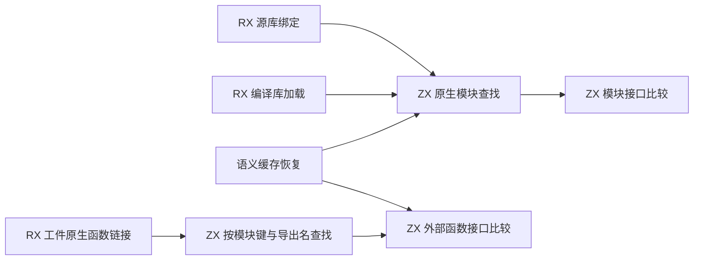
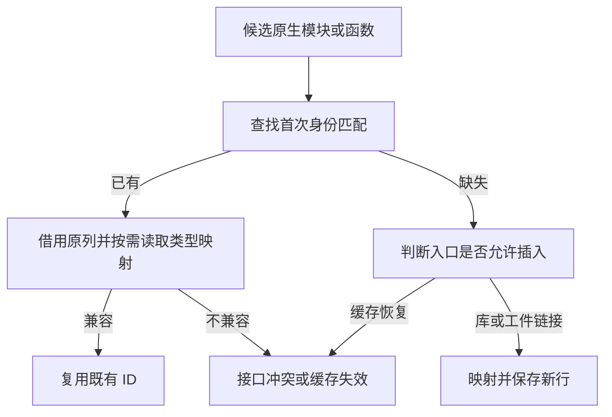

# 原生模块绑定与接口自举

## Intent · 意图

将源库链接、编译库加载、语义缓存恢复和模块工件链接中的原生模块身份与接口校验合并为一个迁移阶段。保持首次匹配顺序、稳定的模块和函数 ID、绑定隔离及现有诊断。

## Data · 证据

- 过去源库链接在查找既有模块前复制绑定名称、分配重映射后的类型列。编译库加载也会为重复模块先物化类型列。缓存恢复拥有单独的查找和比较实现。
- 三条路径共用 ZX 身份查找和接口比较。身份由有效键和导入名共同确定。接口按顺序比较命名空间、绑定名称和映射后的类型 ID。编译库先检查目标已有表，再检查本次新增表。
- 原生函数工件链接在 RX 中依次查找符号、核对签名、决定复用、报错或插入。语义缓存复用其中的接口兼容逻辑。两者借用名称、成员路径、原生参数名称和现有列，只有插入时将外部描述符复制到目标生命周期。
- 状态传递采用只读描述符。模块和函数绑定的查找顺序与旧实现一致。复用的原生函数 ID 保留原位；已有模块的类型 ID 映射在比较时按需读取。

## Edges · 边界

源库链接先检查所有源类型 ID 的范围。编译库使用已校验的 IR 与完整类型映射，身份重写仍会创建作用域字符串。语义缓存匹配失败保持既有回退行为。外部接口比较沿用此前校验的 ABI 标志、命名路径和参数名，保留已有错误集合及并发字段的校验边界。

Zig 适配器仍负责可变目标表、分配器生命周期和宿主 IR 的拥有式物化。初始 seed 保留旧算法。普通依赖校验与其余 IR 物化属于后续完整迁移块。

## Answer · 交付与验收

本阶段集中验收库链接、编译库导入、原生工件及运行、语义缓存复用。使用安装版发布并重发布现有原生资源样例，对比同一输入的全部产物和模块身份。完整冷构建沿用固定基线。

### 集中回归

以前一阶段的 Source stage 3 生成本阶段 RX/ZX，关闭常驻生成，使用 ReleaseSmall 构建并运行既有库编码、初始化器、链接、导入、原生链接、原生运行及语义缓存七组回归。通过 104/104 步和 205/205 项测试。

生成代码中，原生模块绑定以借用参数进入 `executeValue`，只有插入分支调用类型列重映射。原生函数匹配的两个入口及其可达函数按值返回决策或布尔值，借用字符串和接口列，无临时堆分配。宿主只在插入分支调用拥有式复制。

### 冷构建

固定 Zig 0.17.0、ReleaseSmall、12 核、四分区、遍历种子 `0x3b41c83f` 和同一份 Zig 归档。关闭常驻生成，local/global 缓存为空。Native seed 引导构建工具本体，安装版运行时使用 Source。完整构建通过 70/70 步。

| 指标                   | 固定基线      | 上阶段        | 本阶段        | 较上阶段    | 较固定基线  |
| ---------------------- | ------------- | ------------- | ------------- | ----------- | ----------- |
| 墙钟 / s               | 129.740       | 117.113       | 117.376       | +0.263      | −12.364     |
| CPU / s                | 216.03        | 207.71        | 208.09        | +0.38       | −7.94       |
| 进程树采样峰值 RSS / B | 2,247,294,976 | 2,238,300,160 | 2,269,741,056 | +31,440,896 | +22,446,080 |
| 单进程系统峰值 RSS / B | 2,075,033,600 | 2,127,380,480 | 2,105,163,776 | −22,216,704 | +30,130,176 |

进程树峰值出现在四个分区和 RX 编译检查并行期间。上阶段的峰值出现在三个分区编译后段。分区 1 和 2 的目标文件字节一致，分区 0 和 3 分别增加 1,896 和 5,512 字节。RSS 为进程级观测，峰值差额无法直接归因到绑定逻辑。

### 安装版发布

同路径交替运行两版安装工具，关闭应用缓存，排除首轮。源库发布的 20 个文件与编译库重发布的 21 个文件分别逐字节一致，两种路径均保留两个独立的原生模块。三轮中位墙钟均为 0.01 秒，CPU 差异低于计时分辨率。源库峰值 RSS 中位数为 12,894,208 → 12,877,824 字节，重发布为 12,812,288 → 12,943,360 字节。

安装版原生发布集成通过，覆盖资源保留、迁移后执行、失败回滚和 Zig 直接消费。

日志、命令、采样和分区哈希保存在 `.zig-cache/cold-build-analysis/ownership-research/library-native-binding/` 及同级 `partition-reference/cold-library-native-binding/`。
