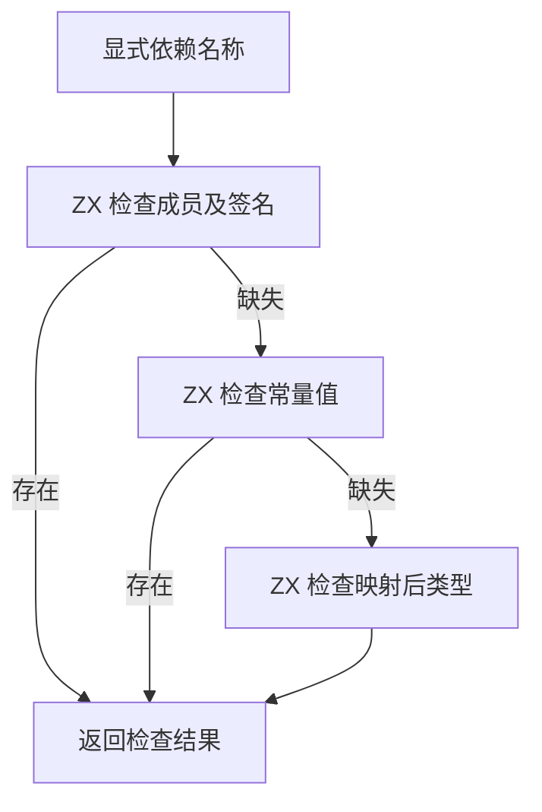

# 命名依赖接口与链接登记自举

## Intent · 意图

迁移独立工件链接中的绑定合法性、命名依赖接口比较及函数登记决策，保持诊断顺序、重导出语义、递归入口身份和可独立使用的输出。

## Data · 证据

- RX 先检查导入和重导出的绑定形状，再检查导入端口与已链接函数。名称依赖校验按默认函数、通配成员、显式名称依次执行。显式名称按成员、常量、类型别名匹配。
- 常量复用既有 ZX 字面量比较。类型别名核对源名称、本地名称、类型类别和两个工件的映射后类型。外部及内置依赖走同一组生成的校验入口。
- 参数与返回类型映射、函数签名列、字符串和原生模块名称保持借用。宿主为按行存储的绑定投影小型列描述，消费者按模块投影一次，提供者按边投影。常见形状使用栈缓冲，比较不复制字符串字节。
- RX 函数登记区分无正文、普通函数、入口及递归入口。ZX 只检查调用表达式实际引用的函数行。Zig 宿主执行目标表写入。

## Edges · 边界

保留初始 seed 的旧接口检查。正式路径仍由 Zig 驱动源工件排序后的模块迭代、查找源依赖目标、解析签名来源并持有可变结果表。命名接口检查和函数登记决策由生成的 RX/ZX 执行。

## Answer · 交付与验收

集中回归工件链接边界、原生链接、重链接运行、源码和编译库导入。以前一阶段已经生成的测试编译器为对照，交替验证六种导入顺序和两种消费路径的输出哈希与耗时。冷构建继续沿用固定基线。

### 集中回归

使用上一阶段的 Source 自举工具生成 ReleaseSmall 测试编译器，关闭常驻生成。工件链接边界、工件导入运行、重链接运行、原生链接和工件槽位五组共通过 77/77 步与 71/71 项。命名常量直接复用原比较实现，既有工件端到端夹具未单独覆盖通配重导出与命名常量组合。

### 产物和链接开销

用两个阶段的 Source 测试编译器交替运行同一组工件夹具，每轮覆盖六种导入顺序及源码与编译库两条路径。十二份生成 Zig 按 SHA-256 逐字节一致。排除首轮后比较六轮中位数，每十二次的墙钟为 0.1355 → 0.1366 秒，CPU 为 0.1295 → 0.1306 秒。该测量包含分析、工件提取、链接和源码生成。

### 冷构建

固定 Zig 0.17.0、ReleaseSmall、12 核、四分区、遍历种子 `0x3b41c83f`、空 local/global 缓存和同一份 Zig 归档。关闭常驻生成，Native seed 引导工具构建，安装版运行时使用 Source。

首次候选通过 70/70 步，墙钟 117.258 秒，CPU 208.11 秒。较上一阶段分别增加 1.943 秒与 1.49 秒。采样显示分区约晚 1.13 秒启动，分区 0、1、2 的目标文件字节一致，分区 3 增加 8,176 字节。Native seed 生成清单的分析、输出和写盘合计约增加 0.047 秒。保留首轮证据，用同配置复测。

| 主工作区指标           | 固定基线      | 上阶段        | 候选复测      | 较固定基线  |
| ---------------------- | ------------- | ------------- | ------------- | ----------- |
| 墙钟 / s               | 129.740       | 115.315       | 117.394       | −12.346     |
| CPU / s                | 216.03        | 206.62        | 206.33        | −9.70       |
| 进程树采样峰值 RSS / B | 2,247,294,976 | 2,272,968,704 | 2,270,494,720 | +23,199,744 |
| 单进程系统峰值 RSS / B | 2,075,033,600 | 2,108,162,048 | 2,116,435,968 | +41,402,368 |

主工作区复测仍比上阶段慢 2.079 秒，CPU 降低 0.29 秒。分区晚约 1.96 秒启动，四个分区各自的采样 CPU 均未增加。随后在同一临时目录先后重建 `06395007` 与候选，两个构建均通过 70/70 步。配对结果为墙钟 129.175 → 118.557 秒，CPU 208.93 → 209.49 秒，进程树峰值 2,323,808,256 → 2,330,296,320 字节。配对基线在构建配置器启动前多等约 11.49 秒，因此整体差额只用于确认启动波动。配置器启动到构建结束约为 87.03 → 87.90 秒，差约 0.87 秒。

命令、输出哈希、冷构建采样和日志保存在 `.zig-cache/cold-build-analysis/ownership-research/artifact-named-interfaces/` 及同级 `partition-reference/cold-artifact-named-interfaces/`。
