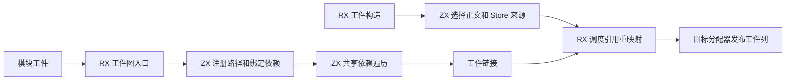
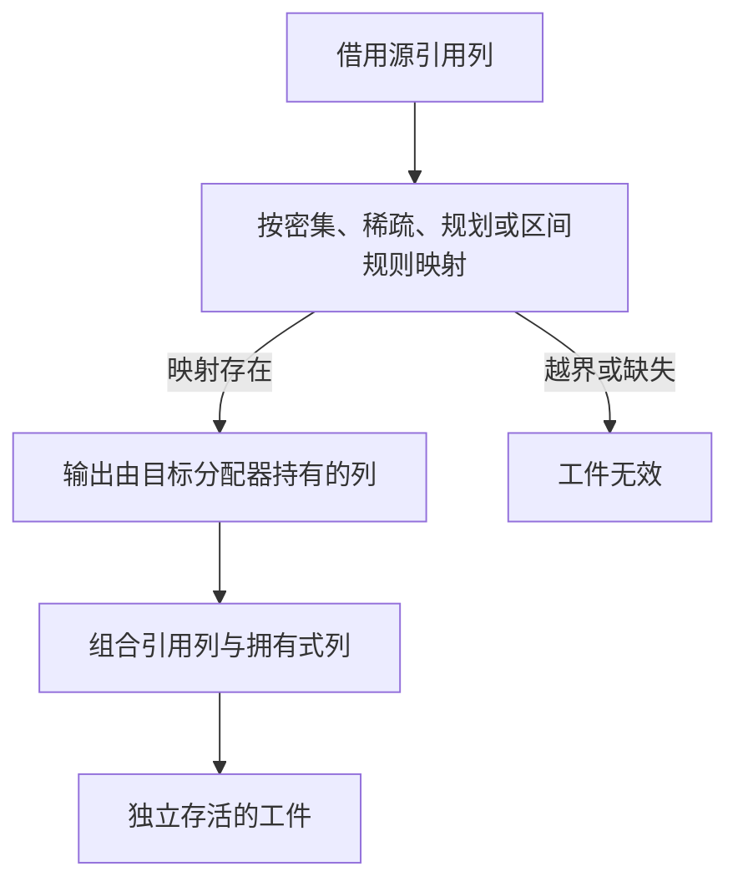

# 工件依赖与产物构造自举

## Intent · 意图

将独立模块工件的依赖顺序、引用列重映射及函数体选择合并迁移到 RX/ZX。保持从入口出发的后序遍历、错误行为、引用身份和工件销毁后的产物有效性。

## Data · 证据

- 普通工件和 RX 的依赖图都需要稳定的深度优先遍历。普通工件仅遍历入口可达模块，RX 继续从所有模块启动。两条路径复用同一个 ZX 遍历，保持边出现顺序。
- 工件依赖图使用 ZX 路径表登记、查找入口及绑定边。索引借用原路径列，桶只存模块行号。无效目标用图节点数表示，普通工件无需额外的边诊断列。共享遍历使用枚举保存访问状态，链接时按顺序借用工件描述符。
- 符号、表达式、Store 和契约内部的引用列统一由 RX 调度 ZX 重映射。密集、稀疏、预规划和区间映射各保留原有编号语义。新增列由最终分配器持有，发布时直接接管。
- 源模块共享函数前缀与原生模块身份映射使用区间描述，取消两张逐 ID 的临时表。类型、函数和原生模块仍保留原有范围校验。
- 工件构造由 RX 选择正文来源和 Store 来源。同一正文使用已经构造好的 Store 列，契约按最终大小构造，控制流通过现有列复制获得独立存储。

## Edges · 边界

初始 seed 保留旧依赖图和列映射逻辑。工件调用方可以销毁原来的解析结果，产物仍须拥有字符串和未变化的列。宿主 Zig 负责布局适配和目标内存发布。命名依赖的成员、常量和类型接口比对，以及整个链接的状态调度仍待迁移。

## Answer · 交付与验收

集中运行现有工件提取、链接、库导入、语义缓存、原生链接和 RX 图回归。使用同配置安装版对照缓存首次生成、命中、正文编辑和恢复，比较全部缓存有效载荷与生成 Zig。记录固定基线和上一阶段的冷构建差异。

### 集中回归

用上一阶段的 Source 工具生成本阶段 ReleaseSmall 测试编译器，关闭常驻生成。工件提取、链接边界、原生链接、重链接运行、工件别名导入、库导入、语义缓存和 RX 图共八组回归通过 108/108 步与 10,524/10,524 项。首轮编译发现宿主 Store 分支需要显式类型，修复后通过。

冷构建发现旧 seed 调用按值接收工件的类型联结接口。保留该接口，正式工件链接直接借用工件字段进入同一类型联结实现。

路径索引压缩后，集中复验受影响的工件链接边界、工件别名运行和 RX 图，共通过 64/64 步与 10,500/10,500 项。

### 依赖图开销

在同一 ReleaseSmall 驱动中交替运行上一阶段使用的 Zig 遍历与本阶段生成的 Source 遍历。输入是每节点最多两条边的图，比较完整顺序哈希。样本保留三轮中位数。

| 模块数 | Zig 耗时 / ms | Source 耗时 / ms | Zig 峰值 RSS / B | Source 峰值 RSS / B |
| ------ | ------------- | ---------------- | ---------------- | ------------------- |
| 4,096  | 0.350         | 0.378            | 2,899,968        | 3,178,496           |
| 16,384 | 1.482         | 1.468            | 5,734,400        | 6,766,592           |

两个规模的顺序哈希分别一致。16,384 节点的 Source 图峰值较首版迁移从 7,602,176 字节降至 6,766,592 字节。独立图仍需投影路径和边，以上计时只覆盖图本身。完整链接还取消排序后的工件结构体副本，实测每个顺序项从 2,616 字节改为 8 字节指针。

### 缓存与产物

在同一路径交替运行两个 Native seed 构建且运行时使用 Source 的安装版。对 64 个 ZX 模块进行首次写入、全量命中、编辑叶模块正文和还原。每种状态的 64 份缓存有效载荷与输出 Zig 在两个版本间逐字节一致；编辑后的命中结果也与禁用缓存的输出一致。

排除进程首次运行后比较三轮中位数。首次写入墙钟均为 0.17 秒，CPU 从 0.17 降至 0.16 秒。命中、编辑和还原均为 0.09 秒墙钟及 CPU。命中峰值 RSS 中位数一致，编辑和还原分别下降约 0.39 MB 和 0.16 MB。安装版的五项持久缓存集成通过。

### 冷构建

固定 Zig 0.17.0、ReleaseSmall、12 核、四分区、遍历种子 `0x3b41c83f`、空 local/global 缓存和同一份 Zig 归档。关闭常驻生成，Native seed 引导工具构建，安装版运行时使用 Source。最终通过 70/70 步。

| 指标                   | 固定基线      | 上阶段        | 本阶段        | 较上阶段   | 较固定基线  |
| ---------------------- | ------------- | ------------- | ------------- | ---------- | ----------- |
| 墙钟 / s               | 129.740       | 117.376       | 115.315       | −2.061     | −14.425     |
| CPU / s                | 216.03        | 208.09        | 206.62        | −1.47      | −9.41       |
| 进程树采样峰值 RSS / B | 2,247,294,976 | 2,269,741,056 | 2,272,968,704 | +3,227,648 | +25,673,728 |
| 单进程系统峰值 RSS / B | 2,075,033,600 | 2,105,163,776 | 2,108,162,048 | +2,998,272 | +33,128,448 |

进程树峰值出现在三个 LLVM 分区编译后段。分区 0 和 1 的目标文件逐字节一致，分区 2 和 3 分别增加 3,376 和 3,832 字节。图微测的 RSS 与冷构建 RSS 分属不同场景。

命令、生成代码、产物哈希、日志和冷构建采样保存在 `.zig-cache/cold-build-analysis/ownership-research/artifact-dependencies-and-materialization/` 及同级 `partition-reference/cold-artifact-dependencies-and-materialization/`。
