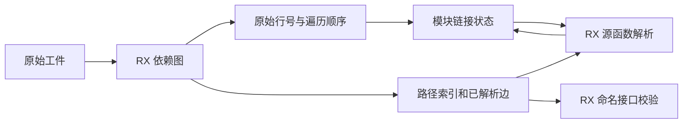
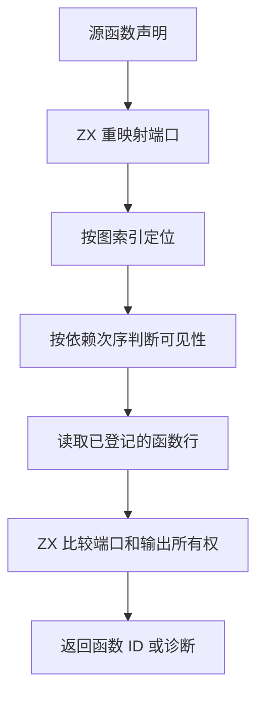

# 工件源函数解析与链接索引自举

## Intent · 意图

迁移普通工件链接的源函数可见性与签名解析，保留直接导入、重导出的可达范围和已登记函数的编号语义。共用已经完成依赖解析的图，消除链接期间重复的全模块路径扫描。

## Data · 证据

- RX 按原次序重映射声明端口、查找函数来源、检查可见性、查询已登记函数并比较端口及输出所有权。旧 seed 继续使用原实现。
- 依赖图把路径索引和已解析的源依赖行号交给后续阶段，复用同一份索引、路径和边数组。命名依赖校验用已解析行号，源函数签名使用图的散列表查找。宿主链接状态统一用原始模块行号，取消排序后的第二份模块指针表。
- ZX 按依赖声明次序检查直接函数和重导出成员。遇到有效的越界重导出时保留既有短路，禁止后续依赖掩盖错误。局部可见性仍按依赖和成员顺序扫描。
- 函数签名借用目标列。源依赖投影只在模块首次遇到源签名时构造，每个模块复用一次并在签名绑定后释放。

## Edges · 边界

类型映射和已登记函数数组按输入模块数分配，只有入口可达工件进行类型合并和正文构造。返回的已链接程序拥有其结果。宿主仍驱动模块迭代、类型存储、函数和原生模块写入、产物组装与最终 IR 校验。源可见性及端口匹配的正式入口执行生成的 RX/ZX。

## Answer · 交付与验收

集中运行现有链接边界、工件槽位、重链接运行、原生链接、工件别名导入和所有权回归。对六种导入顺序及两条消费路径进行前后产物比较。冷构建按上一阶段及固定基线分别报告墙钟、CPU 和峰值内存。

### 集中回归

使用上一阶段的 Source 自举工具生成 ReleaseSmall 测试编译器，关闭常驻生成。六组定向回归通过 104/104 步与 168/168 项，包含伪造输出所有权、原输入释放、缓存后重链接和分配失败路径。

### 产物与链接开销

两个阶段的 Source 测试编译器交替处理六种导入顺序和源码、编译库两条消费路径，十二份生成 Zig 的 SHA-256 逐一相同。排除首轮后比较六轮中位数，每十二次的墙钟为 0.1339 → 0.1332 秒，CPU 为 0.1275 → 0.1271 秒。该场景包含分析、工件提取、链接和生成，未单独计量大规模工件图。

生成的依赖图值入口将路径桶和已解析边的现有 `.items` 直接交给宿主。正式命名依赖校验和源函数解析均已移除原来的全模块查找。

### 冷构建

固定 Zig 0.17.0、ReleaseSmall、12 核、四分区、遍历种子 `0x3b41c83f`、空 local/global 缓存及同一份 Zig 归档。关闭常驻生成，Native seed 引导工具构建，安装版运行时使用 Source。通过 70/70 步。

| 指标                   | 固定基线      | 上阶段复测    | 本阶段        | 较上阶段    | 较固定基线  |
| ---------------------- | ------------- | ------------- | ------------- | ----------- | ----------- |
| 墙钟 / s               | 129.740       | 117.394       | 117.291       | −0.103      | −12.449     |
| CPU / s                | 216.03        | 206.33        | 208.14        | +1.81       | −7.89       |
| 进程树采样峰值 RSS / B | 2,247,294,976 | 2,270,494,720 | 2,313,191,424 | +42,696,704 | +65,896,448 |
| 单进程系统峰值 RSS / B | 2,075,033,600 | 2,116,435,968 | 2,102,427,648 | −14,008,320 | +27,394,048 |

CPU 较上阶段工作区复测上升 0.88%，墙钟缩短 0.103 秒，符合墙钟持平或下降时允许 CPU 小幅增长的约定。上阶段首次测得 208.11 秒 CPU。分区 0、1、2 的目标文件字节一致，分区 3 增加 1,568 字节。上阶段峰值出现在四个分区与 RX 编译检查并行时，本次峰值出现在三个 LLVM 分区编译后段。两次峰值取自不同的并发组合。

命令、输出哈希、采样和日志保存在 `.zig-cache/cold-build-analysis/ownership-research/artifact-source-signatures/` 及同级 `partition-reference/cold-artifact-source-signatures/`。
