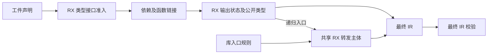
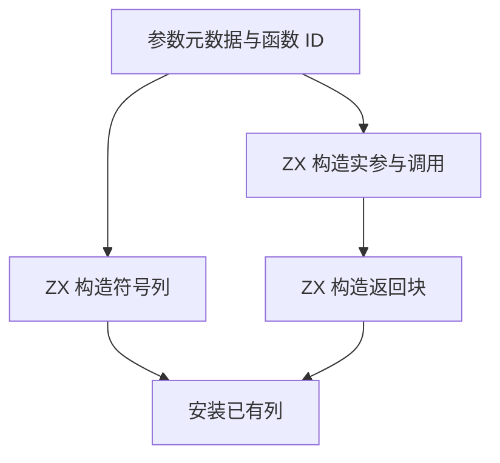

# 工件结果发布与入口转发自举

## Intent · 意图

迁移普通工件链接的类型接口准入、输出状态与递归入口 IR 构造。统一递归入口和库入口的转发主体，保持原有参数、源位置、调用目标、Store 边界与最终 IR 校验。

## Data · 证据

- RX 依次检查导出和类型导入。ZX 核对名称非空、类型映射范围和重名，保留常量验证及函数解析前的准入顺序。
- 结果发布 RX 根据选定的入口确定类型专用状态、端口、输出所有权、Store 模式和递归目标，并统一重映射公开类型。Zig 将生成的状态和已拥有的列装入现有 IR。
- 库入口和递归入口调用同一 RX 转发模块。ZX 生成符号列、引用或 unit 实参、调用表达式及返回控制块。递归入口保留原参数、所有权和源位置，库入口保留合成参数、void 分支及 Store 条件。
- 两个 Zig 调用方通过同一列适配写入生成的符号、表达式、控制和契约。字符串内容继续借用各自已经持有的输入，公共导出名称仍复制到结果所有者。

## Edges · 边界

初始 seed 保留旧的准入、结果状态及递归入口构造。正式路径的 Zig 宿主仍持有类型表、函数表、Store 和其他已构造 IR 列，负责 allocator 生命周期、将生成列适配为公共 IR 布局和调用现有终验。该阶段不改变工件格式、链接顺序或 Store ABI。

## Answer · 交付与验收

集中回归工件链接、所有权和库运行。比较同一工件输入的生成 Zig，以及有无 Store 的发布文件。沿用固定冷构建基线，分别记录墙钟、CPU 与内存。

### 集中回归

使用上一阶段的 Source 自举工具生成 ReleaseSmall 测试编译器，关闭常驻生成。六组定向回归通过 171/171 步与 162/162 项，涵盖工件链接边界、别名导入、重链接运行、工件槽位、不可变输入和库运行。首轮发现 Zig 会将同一相对路径适配文件归入两个编译模块，随后通过现有 frontend 模块导出共享安装接口。

### 产物与链接开销

两个阶段的 Source 测试编译器交替处理六种导入顺序和源码、编译库两条消费路径。十二份生成 Zig 的 SHA-256 逐一相同。排除首轮后比较六轮中位数，每十二次墙钟均为 0.1334 秒，CPU 为 0.1274 → 0.1276 秒。

安装版在同一源码与输出位置、关闭应用缓存时，对照单文件库和 Store 库。分别比较 6 与 14 个发布文件，所有文件逐字节一致。安装版入口与 Store 集成回归分别通过 5 项与 2 项。

### 冷构建

固定 Zig 0.17.0、ReleaseSmall、12 核、四分区、遍历种子 `0x3b41c83f`、空 local/global 缓存和同一 Zig 归档。关闭常驻生成，Native seed 引导构建，安装版运行时使用 Source。通过 70/70 步。

| 指标                   | 固定基线      | 上阶段        | 本阶段        | 较上阶段    | 较固定基线  |
| ---------------------- | ------------- | ------------- | ------------- | ----------- | ----------- |
| 墙钟 / s               | 129.740       | 117.291       | 117.706       | +0.415      | −12.034     |
| CPU / s                | 216.03        | 208.14        | 208.72        | +0.58       | −7.31       |
| 进程树采样峰值 RSS / B | 2,247,294,976 | 2,313,191,424 | 2,304,753,664 | −8,437,760  | +57,458,688 |
| 单进程系统峰值 RSS / B | 2,075,033,600 | 2,102,427,648 | 2,114,486,272 | +12,058,624 | +39,452,672 |

分区 0、1、2 的目标文件字节一致，分区 3 增加 3,328 字节。与两阶段前的 206.33 秒工作区复测相比，CPU 增加 2.39 秒。该阶段首轮测得 208.11 秒，后续仍沿用固定基线跟踪趋势。两个阶段的进程树峰值均出现在三个 LLVM 分区编译后段。

命令、输出哈希、采样及日志保存在 `.zig-cache/cold-build-analysis/ownership-research/artifact-result-publication/` 和同级 `partition-reference/cold-artifact-result-publication/`。
