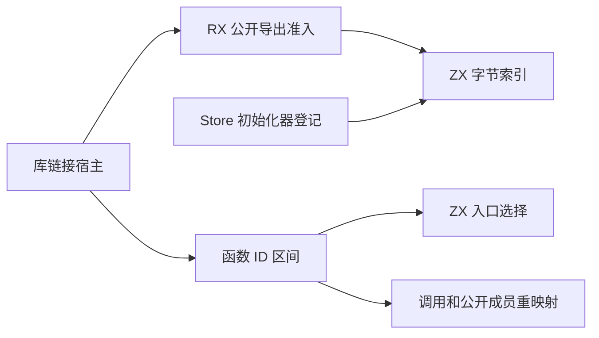
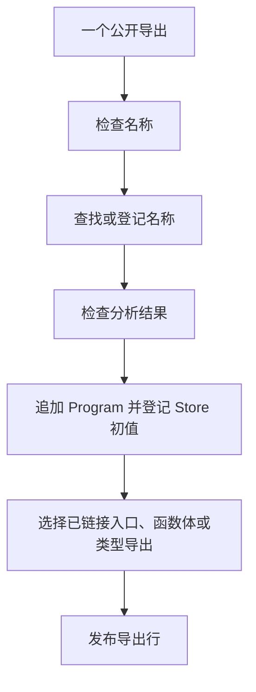

# 库链接导出准入与入口自举

## Intent · 意图

将公开导出的准入流程和入口函数选择迁入 RX/ZX，保持库链接的错误顺序、函数 ID 和产物格式。用连续区间表示顺序追加的函数 ID，省掉逐函数映射表。

## Data · 证据

- RX 对每个导出依次检查名称、重复项和分析结果。现有 ZX 文本校验负责拒绝空串、NUL 和不合法 UTF-8。名称验证后才进入字节索引，仍在前一个导出完成链接后处理下一个导出。
- 公开名称和 Store 初始化器共享 core 的字节索引。每次登记只运行一次哈希探测，扩容后才重新定位。键在链接期间借用输入字节。名称索引的初始分配使用栈缓冲。
- 已分析的入口 ID、仅类型导出和待追加的函数体由 ZX 判定。宿主只根据结果借用已链接函数 ID 或追加最终拥有的函数体。
- 完整 Program 顺序追加全部函数，源 ID 到目标 ID 的关系为连续偏移。区间保存起点和长度，供函数调用、公开成员和初始化器复用。稀疏、重排和共享前缀路径沿用其现有表示。

## Edges · 边界

名称合法性仍先于重复诊断，重复诊断先于当前导出的分析结果检查。入口选择仍在当前导出的 Store 初始化器登记后执行。保持显式入口优先于仅类型标志的既有行为，超出函数表可用行数返回分配错误。空输入、IR 数据所有权、类型合并和原生模块绑定仍由宿主管理。初始 seed 保留原生准入和入口选择。

## Answer · 交付与验收

验证三个 Source 自编译阶段、库链接和运行回归。用安装版对照同一 Store、多导出及编译库消费路径，核对发布内容、函数映射和开销。保持完整冷构建的固定基线，记录墙钟、CPU 和内存。

### Source 自编译

以前一阶段 Source stage 3 引导，连续构建三个 ReleaseSmall、16 分区的 Source 工具，关闭常驻生成。三个阶段均通过 22/22 步。排除内部输入清单后，五组共 9,862 个生成文件按路径和 SHA-256 逐字节一致。

以本阶段 Source stage 3 运行 `test-library-codec`、`test-library-link`、`test-library-initializers` 与 `test-library-import`。通过 71/71 步和 114/114 项 Zig 构建内测试，另通过六组独立编译库导入执行验证。首轮回归发现生成的状态参数在不同配置下可能按值或借用传递，适配按生成签名调用后复测通过。

### 冷构建

固定 Zig 0.17.0、ReleaseSmall、12 核、四分区、遍历种子 `0x3b41c83f` 和同一份 Zig 归档。关闭常驻生成，local/global 缓存为空。Native seed 引导构建工具本体，安装版运行时使用 Source。完整构建通过 70/70 步。

| 指标                   | 固定基线      | 上阶段复测    | 本阶段        | 较上阶段    | 较固定基线  |
| ---------------------- | ------------- | ------------- | ------------- | ----------- | ----------- |
| 墙钟 / s               | 129.740       | 117.649       | 117.113       | −0.536      | −12.627     |
| CPU / s                | 216.03        | 207.32        | 207.71        | +0.39       | −8.32       |
| 进程树采样峰值 RSS / B | 2,247,294,976 | 2,330,427,392 | 2,238,300,160 | −92,127,232 | −8,994,816  |
| 单进程系统峰值 RSS / B | 2,075,033,600 | 2,119,352,320 | 2,127,380,480 | +8,028,160  | +52,346,880 |

分区 1 和 2 的目标文件字节一致，分区 0 增加 3,136 字节，分区 3 减少 24 字节。进程树和单进程峰值分别统计，采样差异不能直接等同于移除函数映射表释放的内存。

### 安装版发布

在相同路径上交替运行两版安装工具，关闭应用缓存，去掉首轮后比较三轮中位数。现有 Store 样例的 14 个发布文件逐字节一致，墙钟和 CPU 均为 0.03 秒，峰值 RSS 为 19,038,208 → 19,021,824 字节。

用同一 Store 样例布置 16 组不同路径的公开模块。48 个导出保留 32 个初始化器，133 个文件逐字节一致，IR 均为 418,570 字节。墙钟均为 1.24 秒，CPU 均为 1.35 秒，峰值 RSS 为 154,845,184 → 154,648,576 字节。

安装版重发布、契约、运行和 Store 集成共 11 项通过。

命令、日志、采样和分区哈希保存在 `.zig-cache/cold-build-analysis/ownership-research/library-entry-admission/` 及同级 `partition-reference/cold-library-entry-admission/`。
