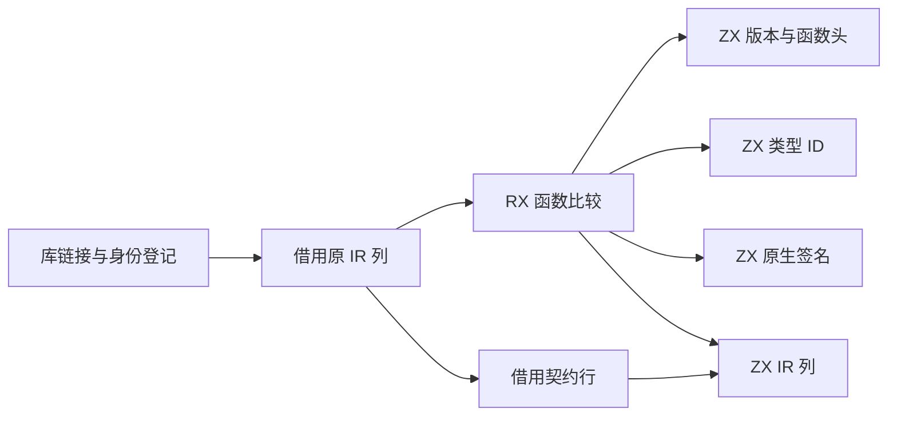
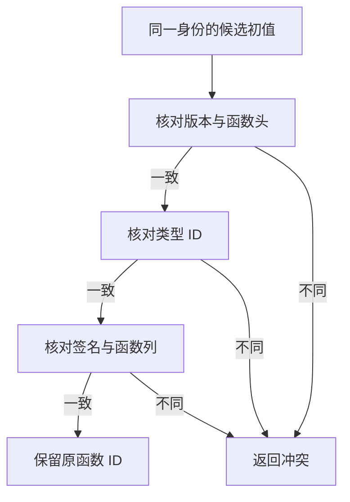

# 库链接状态初始化器比较自举

## Intent · 意图

将同一 Store 身份的初始化器版本及函数等价判定迁入 RX/ZX。保留原有冲突诊断、函数 ID、列顺序和发布格式。

## Data · 证据

- RX 按顺序比较版本与函数头、目标类型 ID、原生签名和 IR 列。ZX 直接比较同一进程内的数值字节视图，保持有限浮点的符号零。布尔和枚举比较其有效位，可空值和文本比较语义值。
- 源码候选的函数输入输出、符号及表达式类型 ID 在读取时映射。已链接候选的类型 ID 直接比较原列，两条路径都借用原 IR。
- Zig 适配层按现有列结构在栈上构造切片描述符，列载荷原位借用。比较入口使用零容量分配器。嵌套契约的原生行指针由宿主逐个投影，内容仍通过同一 ZX 列比较。

## Edges · 边界

相同身份、版本及函数数据共享首次登记的函数 ID。任何差异都按现有路径返回 `ConflictingInitializer`。初始 seed 继续使用原生比较。正式编译器中的 Zig 代码仍提供 IR 列及嵌套行的布局适配，迁移这些适配依赖剩余 IR 状态模型的自举。

## Answer · 交付与验收

验证三个 Source 自编译阶段、现有库链接及初始化器测试。安装版按相同路径发布 Store 样例和多身份样例，对照所有文件、初始化器行数及进程成本。固定工具链和输入对比完整冷构建墙钟、CPU 和内存。

### Source 自编译

以前一阶段 Source stage 3 引导，连续构建三个 ReleaseSmall、16 分区的 Source 工具，关闭常驻生成。三个阶段均通过 22/22 步。排除内部输入清单后，五组共 9,850 个生成文件按路径与 SHA-256 逐字节一致。小范围生成产物中的比较入口及调用不含分配或列载荷复制。

首轮库回归定位到原生借用适配的列分组需要在编译期求值。将分组和偏移固定到编译期后，使用本阶段 Source stage 3 执行 `test-library-codec`、`test-library-link` 和 `test-library-initializers`，通过 50/50 步及 114/114 项测试。回归覆盖版本差异、初值差异、重复源码和编译库重发布。

### 冷构建

固定 Zig 0.17.0、ReleaseSmall、12 核、四分区、遍历种子 `0x3b41c83f` 和同一份 Zig 归档。关闭常驻生成，local/global 缓存为空。Native seed 引导构建工具本体，安装版运行时使用 Source。首轮和复测均通过 70/70 步，四个分区目标文件逐字节一致。

| 指标                         | 固定基线      | 上阶段        | 首轮          | 复测          |
| ---------------------------- | ------------- | ------------- | ------------- | ------------- |
| 墙钟 / s                     | 129.740       | 117.154       | 118.859       | 117.649       |
| CPU / s                      | 216.03        | 207.57        | 207.35        | 207.32        |
| 进程树采样峰值 RSS / B       | 2,247,294,976 | 2,333,212,672 | 2,321,793,024 | 2,330,427,392 |
| 单进程系统峰值 RSS / B       | 2,075,033,600 | 2,127,888,384 | 2,122,219,520 | 2,119,352,320 |
| 首次采样到配置器后的墙钟 / s |               | 88.057        | 87.880        | 87.433        |

首轮完整墙钟增加 1.705 秒，其中增加 1.882 秒出现在首次采样到 Zig 构建配置器之前，触发同配置复测。复测完整墙钟较上阶段增加 0.495 秒，CPU 下降 0.25 秒，进程树和单进程峰值分别下降 2,785,280 与 8,536,064 字节。复测墙钟与 CPU 相对固定基线累计下降 12.091 与 8.71 秒，进程树峰值仍高 83,132,416 字节。相比上阶段，仅分区 3 的目标文件变化，增加 3,640 字节。

### 安装版发布

在相同路径上交替运行两版安装工具，关闭应用缓存，去掉首轮后比较三轮中位数。现有 Store 样例的 14 个发布文件逐字节一致，墙钟和 CPU 均为 0.03 秒，峰值 RSS 为 18,825,216 → 18,989,056 字节。

用同一 Store 样例布置 16 组不同路径的公开模块。48 个导出保留 32 个初始化器，133 个文件逐字节一致，IR 均为 418,570 字节。墙钟均为 1.24 秒，CPU 均为 1.35 秒，峰值 RSS 为 154,402,816 → 154,615,808 字节。

安装版重发布、契约、运行和 Store 集成共 11 项通过。

命令、日志、采样和分区哈希保存在 `.zig-cache/cold-build-analysis/ownership-research/library-initializer-comparison/` 及同级 `partition-reference/cold-library-initializer-comparison*/`。
