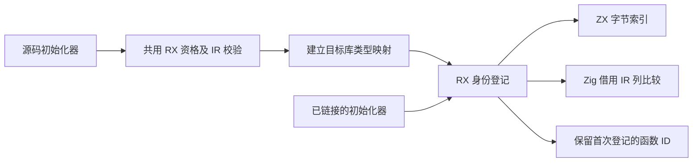
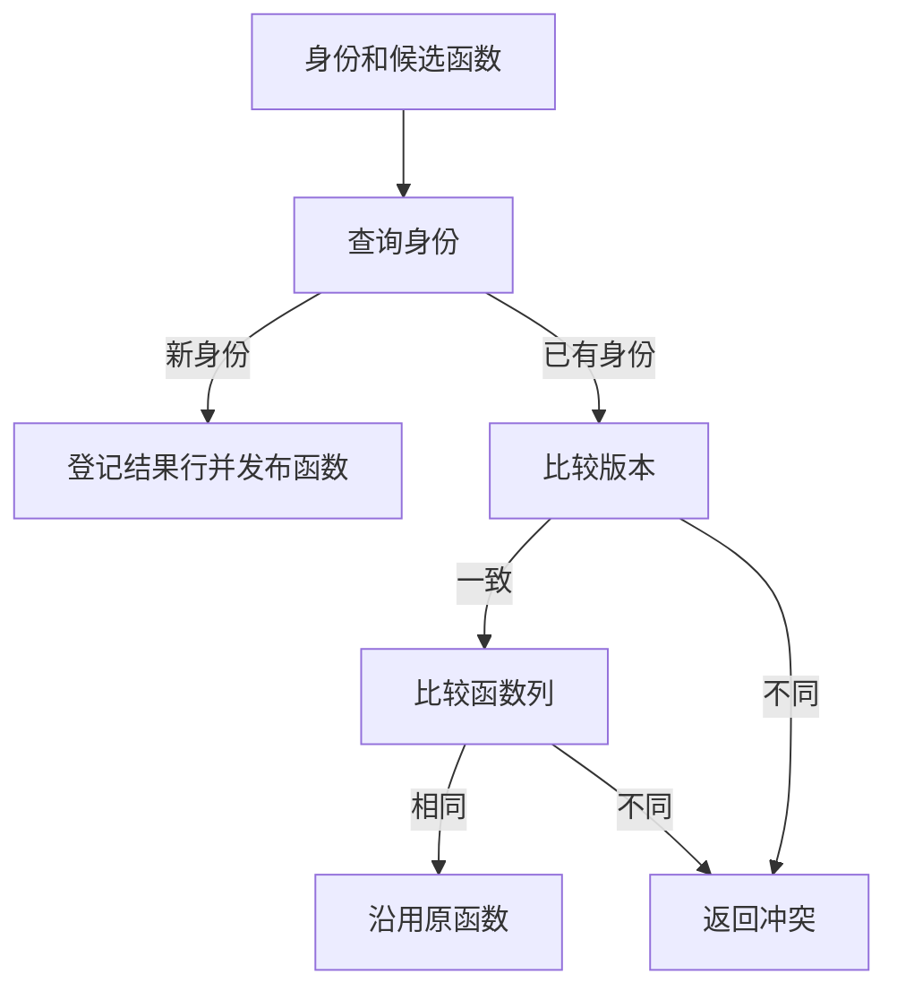

# 库链接状态初始化器登记自举

## Intent · 意图

将库链接中的 Store 初始化器身份登记和源码资格检查迁入 RX/ZX。保持初值函数 ID、导出顺序、冲突诊断及发布格式。

## Data · 证据

- 旧链接器按已登记的初始化器线性查找身份。两条记录命中同一身份时，分别把完整 IR 函数序列化成 JSON 再比较。源码重复项也会先复制进最终库的 arena，随后弹出函数行。
- RX 先查询 core 的字节索引，再为首次出现的身份登记结果行号。键在链接期借用输入文本。结果保留首次出现的初始化器与函数 ID。
- 源码资格检查与后端共用现有 RX 校验。校验先检查允许的 Program 组成，再运行 canonical IR 校验并检查输入输出类型。库链接拒绝原生模块，后端保留既有规则。
- 函数列比较直接读取原数据。源码重复项只在比较时将输入、输出、符号和表达式的类型 ID 映射到目标库，未命中的初始化器才把函数体复制进最终库。

## Edges · 边界

版本不同和函数数据不同仍返回 `ConflictingInitializer`。比较保留所有 IR 列、行顺序、可空值、文本字节和有限浮点的零符号。已链接函数和源码候选分别使用完整结构比较和按需类型映射。初始 seed 保留原生资格检查和索引。正式路径的版本比较及结构化 IR 列比较仍在 Zig。迁移这部分需要让 ZX 表达现有 IR 的无分配类型化比较，覆盖可空列、枚举列和函数契约引用。

## Answer · 交付与验收

核对三个 Source 自编译阶段、库链接和初始化器回归，以及安装版发布和独立消费。用现有 Store 样例测量重复初始化器的发布路径，核对生成物和初始化器行数。冷构建同时记录完整墙钟、CPU、进程树及单进程峰值，沿用已有固定基线。

### Source 自编译

以前一阶段 Source stage 3 引导，连续构建三个 ReleaseSmall、16 分区的 Source 工具，关闭常驻生成。三个阶段均通过 22/22 步。排除内部输入清单，五组共 9,832 个生成文件按路径与 SHA-256 逐字节一致。以本阶段 Source stage 3 执行 `test-library-codec`、`test-library-link` 和 `test-library-initializers`，通过 50/50 步及 114/114 项测试。

### 冷构建

固定 Zig 0.17.0、ReleaseSmall、12 核、四分区、遍历种子 `0x3b41c83f` 和同一份 Zig 归档。关闭常驻生成，local/global 缓存为空。Native seed 引导构建工具本体，安装版运行时使用 Source。完整构建通过 70/70 步。

| 指标                   | 固定基线      | 上阶段        | 本阶段        | 较上阶段    | 较固定基线  |
| ---------------------- | ------------- | ------------- | ------------- | ----------- | ----------- |
| 墙钟 / s               | 129.740       | 119.163       | 117.154       | −2.009      | −12.586     |
| CPU / s                | 216.03        | 207.08        | 207.57        | +0.49       | −8.46       |
| 进程树采样峰值 RSS / B | 2,247,294,976 | 2,280,275,968 | 2,333,212,672 | +52,936,704 | +85,917,696 |
| 单进程系统峰值 RSS / B | 2,075,033,600 | 2,108,506,112 | 2,127,888,384 | +19,382,272 | +52,854,784 |

分区 0、1、2 的目标文件字节一致，这三个编译进程各自的采样峰值仍增加约 40、31、31 MB。唯一改变的分区 3 目标文件增加 1,096 字节，进程采样峰值下降约 14 MB。末尾静态库编译与链接的采样耗时为 32.51 → 32.39 秒。进程树峰值增加保留在累计记录中，单轮采样无法分离未变化分区的 RSS 波动和最终静态库阶段的内存差异。

### 安装版发布

在相同路径上交替运行两版安装工具，关闭应用缓存，去掉首轮后比较三轮中位数。原有 Store 样例的 14 个发布文件逐字节一致，墙钟和 CPU 均为 0.03 秒，峰值 RSS 为 19,054,592 → 18,857,984 字节。

用同一 Store 样例布置 16 组不同路径的公开模块，每组三个导出，其中两个模块共享同一初值。48 个导出保留 32 个初始化器，覆盖索引扩容。133 个发布文件逐字节一致，IR 均为 418,570 字节。墙钟均为 1.24 秒，CPU 均为 1.35 秒，峰值 RSS 为 155,287,552 → 154,173,440 字节。

安装版重发布、契约、运行和 Store 集成共 11 项通过，覆盖编译库重定位、初值执行和二次发布。

命令、日志、采样和分区哈希保存在 `.zig-cache/cold-build-analysis/ownership-research/library-initializer-registration/` 及同级 `partition-reference/cold-library-initializer-registration/`。
