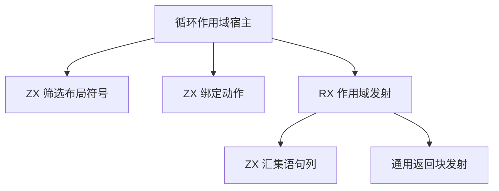

# 循环作用域绑定自举

## Intent

将循环作用域的布局符号筛选、绑定动作和语句发射迁入 RX 和 ZX，保留已有作用域可见性、求值顺序和 AST 节点身份。

## Data

- 作用域进入时先登记使用循环布局的新符号，再求值结果表达式。退出时仅移除本次实际加入的符号，外层已有符号继续可见。
- 初始化式在编译时从后往前降低，使后续绑定的引用能标记先前符号。未使用的纯引用可以跳过，其他初始化式必须保留。求值后重新读取使用标记，选择常量、丢弃值或表达式语句。
- 最终按原绑定顺序发布语句，并复用现有块收尾逻辑。递归发射期间产生的节点、块标签与错误退出沿用旧实现。

## Edges

- ZX 读取现有类型列并筛选符号，按求值前后两次的活跃性确定绑定动作。RX 组织作用域语句的汇集与返回块收尾。
- 临时绑定列在作用域结束时释放，生成语句列直接写入 AST。递归求值只保留小栈缓冲，语句发射结束前单独使用页大小缓冲。只持久保存需要的节点与块名。
- 宿主仍负责把符号逐项加入可变上下文、异常退出时回收、递归求值和布局类型查询。逐项发布保持分配失败后的作用域状态一致。迁移这些上下文操作后才能移除宿主适配器。旧流程保留给 Zig seed。

### 架构

### 数据流

## Answer

验收覆盖三阶段自编译、同输入生成产物对照、已有作用域和循环行为回归、生成器开销与完整冷构建。正式编译器的传递依赖仍需继续迁移。

### 自编译与生成器

上一阶段 Source stage 3 生成当前 stage 1，再连续生成 stage 2 和 stage 3，三轮均为 22/22 步。主组 8,888 个文件、顺序组 23 个、集合组 70 个、增长组 416 个、宿主组 108 个，三阶段逐字节一致。前后工具使用同一份 385 入口清单，生成的主组和增长组也完全一致。

前后工具均由 Source 自编译至 stage 3，运行时均使用 Source 分析与生成。空函数缓存每轮重新生成 4,110 个函数，取三轮交替测量的中位数。

| 三轮中位数          | 墙钟秒      | CPU 秒      | 单体峰值 RSS 字节         |
| ------------------- | ----------- | ----------- | ------------------------- |
| 缓存命中，前 → 后   | 1.53 → 1.52 | 5.28 → 5.26 | 839,041,024 → 838,729,728 |
| 空函数缓存，前 → 后 | 2.02 → 2.02 | 8.84 → 8.84 | 904,118,272 → 904,675,328 |

空函数缓存的单体峰值 RSS 中位数增加 0.6 MB。符号候选和语句列的生成 Zig 均复用列表增长存储。计时和逐文件校验在 `.zig-cache/cold-build-analysis/ownership-research/iteration-scope/`。

### 完整冷构建

Zig 0.17.0、ReleaseSmall、12 核、四分区、固定遍历种子 `0x3b41c83f`、本地 Zig 归档。关闭常驻生成器，使用独立空缓存，每 200 毫秒采样进程树。构建中工具本体、分析及生成来自 Zig seed，安装版 CLI 使用 Source。

| 对照                 | 墙钟秒  | CPU 秒 | 进程树峰值字节 | 单体最大 RSS 字节 |
| -------------------- | ------- | ------ | -------------- | ----------------- |
| 固定基线             | 129.740 | 216.03 | 2,247,294,976  | 2,075,033,600     |
| 上一阶段同工作区样本 | 116.610 | 206.46 | 2,203,664,384  | 2,105,147,392     |
| 本阶段样本           | 116.609 | 206.08 | 2,267,037,696  | 2,116,993,024     |

冷构建 70/70 步通过。相对上一阶段，墙钟持平，CPU 减少 0.38 秒，进程树峰值增加 63.4 MB，单体最大 RSS 增加 11.8 MB。相对固定基线，墙钟少 13.13 秒，CPU 少 9.95 秒，进程树峰值高 19.7 MB，单体最大 RSS 高 42.0 MB。

前后两次进程树峰值均出现在约 81 秒，由 LLVM 分区 0、1、2 同时编译形成。这三个分区的目标对象逐字节一致。分区 3 增加 4,736 字节，在峰值前已退出。上述核对给出了峰值所在阶段，尚未确定采样差异的具体原因。日志与对象校验在 `partition-reference/cold-iteration-scope/`。

### 回归与自我复核

前后安装版 CLI 禁用缓存生成 28 个已有用例，Zig 文件逐字节一致，覆盖作用域、借用参数、快照、分支、缓冲列表和投影。RX、ZX 通过格式化与 lint，Zig 通过 `zig fmt --check`。

使用本阶段 Source stage 3 运行 `test-modular-loop`、`test-iterate`、`test-iterate-cli`、`test-iterate-buffer`、`test-iterate-calls`、`test-loop-columns` 与 `test-nested-buffer`，348/348 步、508/508 项通过。

已复核结果先降低、初始化式逆序降低、语句按源码顺序写入的边界。作用域退出只撤销本层实际登记的符号，出错时执行同一清理。最终版本将页大小缓冲放入独立发射函数，递归求值帧保留 1 KiB 缓冲。写入 AST 的字段名借用持久名称，块标签只保存一份。
