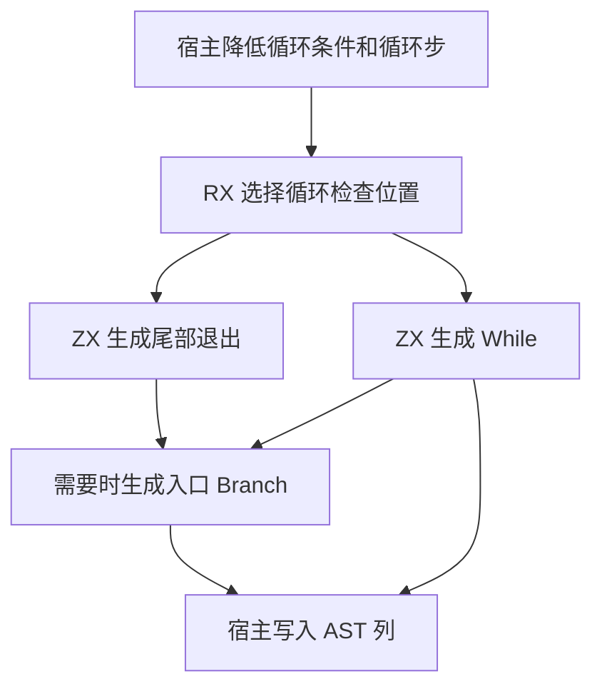
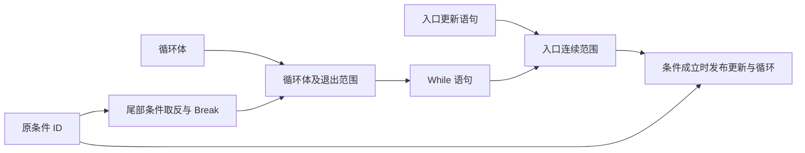

# 循环入口保护自举

## Intent

把循环入口检查和语句发布迁入 RX/ZX。需要在首次迭代前更新状态存储时，先确认循环会执行，再写入更新语句。循环体完成后仍按原规则检查是否退出。

## Data

- 普通循环在入口有更新语句且条件应在首步前检查时，使用条件分支包住更新与循环。分支内的循环在每步写回状态后检查退出。
- 普通循环没有入口更新时直接发布。首次检查已由结果保护处理的循环仍保留尾部检查。
- 投影循环先保护整段投影过程，随后发布带尾部检查的循环。投影路径的第一次条件求值仍发生在种子状态上。

## Edges

- RX 按条件检查位置和入口语句数量选择尾部退出及入口分支。ZX 负责生成结构化语句列和计算其作用域范围。
- 先写尾部退出的 Break，再写循环体及其退出分支。需保护入口时，按顺序写更新与 While，由 RX 选出的入口 Branch 引用这段连续范围。
- Source 在受保护路径直接把 While 写入 AST 列，入口语句列表不追加再复制一份 While。投影路径沿用已有语句目标。初始 seed 保留原有生成行为。
- 独立应用构建暴露了函数文件内的调用适配器自导入。目标调用变体已经在同一文件内定义时，生成局部函数引用。仍需为调用补发普通 ABI 变体时，保留扫描所需的导入引用。
- 递归降低条件、循环步、更新语句及状态布局仍由宿主处理。

## Answer

### 自编译

ReleaseSmall、12 核、16 分区。上一阶段 Source stage 3 构建本阶段 stage 1，后两阶段各由前一阶段构建。每阶段 22/22 步通过。

以同一份清单和同一份源码核对 stage 2 和 stage 3 的实际构建产物。主组 8,784、增长组 416、顺序组 23、集合组 70、宿主组 108 个文件逐字节一致。仅排除记录工具身份的 `.zxc-inputs`。

上一阶段工具生成的 stage 1 原始产物中，主组 82、增长组 15、顺序组 3、集合组 2 个函数文件仍导入同一文件中的调用变体。核对这些函数仅将自身导入替换为局部引用。主组的根模块、ABI 类型和签名保持字节一致，分区产物随函数引用变化重新分配。

### 生成器性能

前后工具均由 Source 自编译至 stage 3，运行时均使用 Source 分析与生成。使用同一份 373 入口主组清单交替执行，空函数缓存每轮重新生成 4,064 个函数。

| 三轮中位数          | 墙钟秒      | CPU 秒      | 单体峰值 RSS 字节         |
| ------------------- | ----------- | ----------- | ------------------------- |
| 缓存命中，前 → 后   | 1.50 → 1.50 | 5.17 → 5.17 | 839,991,296 → 839,909,376 |
| 空函数缓存，前 → 后 | 2.12 → 2.14 | 8.88 → 8.85 | 891,682,816 → 906,510,336 |

空缓存单体 RSS 中位数增加 14.8 MB。前后样本范围分别为 891.2～900.8 MB 和 888.6～910.8 MB。入口分支在原有固定栈缓冲区生成，仅写入标量和空捕获列，持久 AST 行与迁移前一致。峰值差异继续跟踪。计时和逐文件校验记录在 `.zig-cache/cold-build-analysis/ownership-research/loop-entry/`。

### 完整冷构建

Zig 0.17.0、ReleaseSmall、12 核、四分区、固定遍历种子 `0x3b41c83f`、本地 Zig 归档。关闭常驻生成器，独立空缓存，每 200 毫秒采样进程树。构建中由 Zig seed 生成工具并使用 seed 分析与生成。安装版 CLI 使用 Source。

| 对照                 | 墙钟秒  | CPU 秒 | 进程树峰值字节 | 单体最大 RSS 字节 |
| -------------------- | ------- | ------ | -------------- | ----------------- |
| 固定基线             | 129.740 | 216.03 | 2,247,294,976  | 2,075,033,600     |
| 上一阶段同工作区样本 | 116.893 | 206.90 | 2,311,667,712  | 2,113,257,472     |
| 本阶段最终样本       | 117.331 | 207.50 | 2,309,488,640  | 2,112,749,568     |

完整冷构建 70/70 步通过。相对上一阶段，墙钟增加 0.438 秒，CPU 增加 0.60 秒，均在 1 秒容差内。树峰值减少 2.2 MB，单体峰值减少约 0.5 MB。相对固定基线，墙钟少 12.409 秒，CPU 少 8.53 秒，树峰值高 62.2 MB，单体峰值高 37.7 MB。最终树峰出现在约 81.24 秒，三个 LLVM 分区并行编译。日志、采样和分区对象校验在 `partition-reference/cold-loop-entry-final/`。

### 回归与自我复核

用最终安装版 CLI 将实际循环帧 RX 构建为独立应用，分别调用带入口更新、直接发布、尾部检查、已有首步保护四种路径。核对入口分支只在需要时生成，条件 ID、尾部退出和连续语句范围符合原顺序。

前后安装版 CLI 禁用缓存，七个已有循环用例的生成 Zig 源码逐字节相同。修改的 RX 和 ZX 通过格式化和 lint 检查，Zig 通过 `zig fmt --check`。

最终 Source stage 3 运行 `test-loop-columns`、`test-aggregate-loop` 和 `test-function-analysis-runtime`，172/172 步、264/264 项通过。最终安装版 CLI 的 RX 工程回归 9/9 项通过。修复局部调用前的循环迁移版本已另行通过 `test-reduce-runtime` 及两组循环回归，合计 338/338 项。
