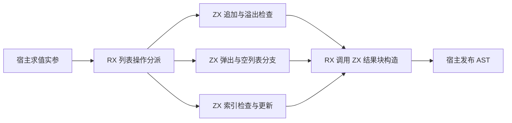
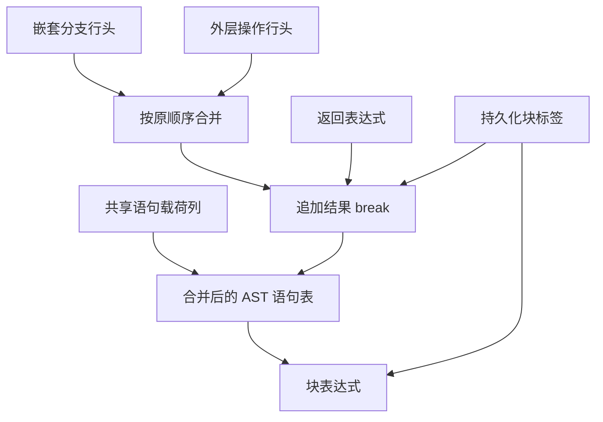

# 循环列表修改自举

## Intent · 目标

将缓冲循环中列表追加、弹出和索引更新的结果块交由 RX/ZX 生成。Zig 宿主读取 IR 实参并写入已经封装的 AST 列。

## Data · 现状与假设

RX 已编排溢出检查、索引检查、缓冲区准备和结果构造。内部子分支和外层操作使用同一组语句载荷列，分别保存行头。宿主原先先发布内部分支，再把外层操作解码为临时 Zig 语句数组，最后调用另一生成入口封装结果块。现有 ZX 的块构造器可按相同顺序合并行头并追加 `break`，供宿主一次发布整张语句表，避免临时语句数组及第二次调用。

## Edges · 边界

- 保留嵌套分支的绝对语句索引、外层行头的顺序和结果标签的编号。索引检查先于更新值的运行时求值，空列表弹出保留惰性分支。
- 块标签在 AST 所属分配器中只保留一份，供块和末尾的 `break` 共享。索引失败可能使用外部捕获标签，该标签仍借用外层已有存储。
- Zig 宿主仍负责递归 IR 求值、读写 AST 和文本所有权交接。Native seed 保留初始引导逻辑，整体自举依赖闭包仍待完成。

## Answer · 交付与验收

对比同输入生成 Zig，核对 Source 三阶段产物并运行现有循环更新、追加、弹出、失败顺序和分配回归。记录成对的生成器成本及相对固定基线的完整冷构建成本。

### 阶段一致性与生成成本

以上阶段 Source stage3 构建本阶段 stage1，再逐级自编译。三轮各通过 22/22 步，五组共 9,532 个文件逐字节一致。使用前后两个 Source stage3 处理本阶段的同一份输入，主组 8,903 个文件和增长组 419 个文件也逐字节一致。

| 同输入三轮交替对照 | 前后墙钟中位数 | 前后 CPU 中位数 |     前后进程峰值 RSS 中位数 |
| ------------------ | -------------: | --------------: | --------------------------: |
| 各自预热函数缓存   |  1.52 → 1.52 s |   5.25 → 5.28 s | 851,378,176 → 851,591,168 B |
| 每轮使用新函数缓存 |  2.03 → 2.03 s |   8.88 → 8.89 s | 909,000,704 → 885,850,112 B |

两端工具本体均由 Source stage2 生成，运行时均启用 Source 分析和生成。完整日志及各轮测量保存在本地 `.zig-cache/cold-build-analysis/ownership-research/iteration-mutation-block/`。

### 完整冷构建

固定 Zig 0.17.0、ReleaseSmall、12 核、四分区、全新 local/global 缓存和同一份本地 Zig 归档。以 Native seed 引导生成工具本体，安装产物启用 Source 分析与生成。构建通过 70/70 步。

| 指标                   |      固定基线 |        上阶段 |        本阶段 |    较上阶段 | 累计较固定基线 |
| ---------------------- | ------------: | ------------: | ------------: | ----------: | -------------: |
| 墙钟 / s               |       129.740 |       116.639 |       117.057 |      +0.418 |        −12.683 |
| CPU / s                |        216.03 |        206.48 |        206.54 |       +0.06 |          −9.49 |
| 进程树采样峰值 RSS / B | 2,247,294,976 | 2,283,159,552 | 2,300,182,528 | +17,022,976 |    +52,887,552 |
| 单进程系统峰值 RSS / B | 2,075,033,600 | 2,117,697,536 | 2,108,801,024 |  −8,896,512 |    +33,767,424 |

四个目标文件中仅分区 2 改变，增加 176 B。树峰快照中该分区 RSS 下降 6,635,520 B，分区 1 的目标文件哈希相同而 RSS 增加 25,444,352 B。单轮冷构建只确认这次的峰值差异与各进程的贡献，未分离采样波动和编译器分析内存。采样及对象哈希保存在本地 `.zig-cache/cold-build-analysis/ownership-research/partition-reference/cold-iteration-mutation-block/`。

### 产物与代码复核

- 用前后两个安装版 CLI 生成 40 个应用样例，Zig 输出逐字节一致。另有 8 个仓库回归输入在单文件 CLI 路径上得到相同的样式或模块诊断，它们属于仓库回归驱动的覆盖范围。
- 迭代、缓冲、聚合、嵌套与模块循环回归通过 486/486 项 Zig 测试及 5/5 项循环 CLI 检查，覆盖索引失败早于右值副作用、归档调用、空列表和分配失败。首次库重发布检查在工具链缓存写入时失败。释放已验收的临时构建缓存后，单独重跑该目标通过 53/53 步及 1/1 项 CLI 测试。
- 语句列中的嵌套分支保持在外层操作之前，旧行头和共享载荷索引可以直接验证。结果块的 `break` 在所有外层行之后，块标签仅分配一次，捕获分支保留原来的标签。
- 列表更新使用相同的检查、赋值与缓冲区准备代码。迁移删除临时 Zig 语句数组和独立块生成调用，未单独量化每次操作省下的临时分配。
