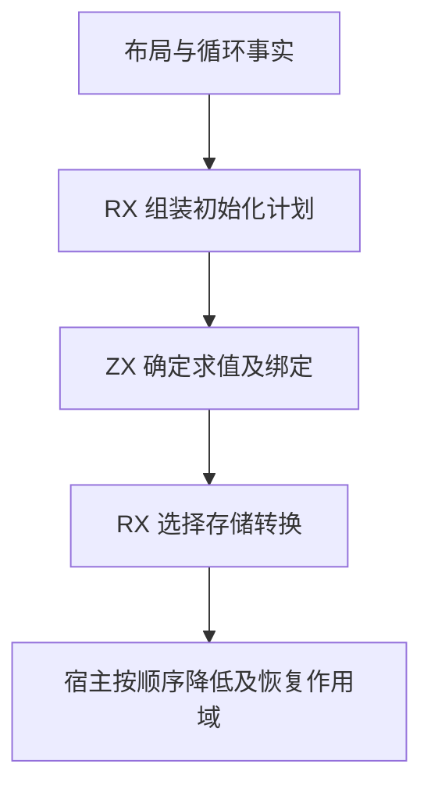

# 循环初始值自举

## Intent

由 RX/ZX 决定循环初始值的求值、绑定、首步保护和存储转换。保留递归求值顺序、状态作用域和原有借用。

## Data

- 初始表达式只求值一次。直接深布局优先，其次是值布局，最后是普通表达式。局部布局需要绑定一次结果供后续使用。
- 先绑定初始值，再建立缓冲循环的首步保护，然后进入状态作用域和准备投影字段。初始表达式及保护条件内的递归降低都会恢复进入前的状态作用域。
- 初始值转换在循环参数和深布局上下文就绪后执行。首次进入状态布局时转换为状态值，已经位于状态作用域时收窄所有权。其余路径按原规则保留、解引用或转换至深布局。

## Edges

- RX 连接绑定规则与存储选择，并按缓冲、后置条件事实决定首步保护。ZX 计算表达式求值模式及所需绑定。解引用复用已有结构化发射器。
- Zig 宿主在原顺序执行计划和恢复递归上下文。投影种子继续保留原有名称编号，初始化方案仅传递标量事实。
- 初始 seed 保留原生规则。对同输入生成结果逐字节核对，并测量 Source 生成器及完整冷构建。

## Answer

### 自编译与产物

ReleaseSmall、12 核、16 分区。上一阶段 Source stage 3 构建本阶段 stage 1，后两阶段各由前一阶段构建。每阶段 22/22 步通过。

三阶段在同一份源码和清单上生成的主组 8,818、增长组 416、顺序组 23、集合组 70、宿主组 108 个文件逐字节一致。仅排除记录生成器身份的 `.zxc-inputs`。

检查生成的 `executeValue` 入口及其三个依赖。绑定规则和存储分支使用标量参数与栈上对象，Source 实际调用路径没有分配。公开指针 ABI 的包装入口需要返回对象存储，自举调用使用值入口。

### 生成器性能

前后工具均由 Source 自编译至 stage 3，运行时均使用 Source 分析与生成。使用同一份 377 入口清单交替执行，空函数缓存每轮重新生成 4,079 个函数。重复生成的主组与增长组均与同输入基线逐字节一致。

| 三轮中位数          | 墙钟秒      | CPU 秒      | 单体峰值 RSS 字节         |
| ------------------- | ----------- | ----------- | ------------------------- |
| 缓存命中，前 → 后   | 1.52 → 1.51 | 5.20 → 5.21 | 833,404,928 → 833,191,936 |
| 空函数缓存，前 → 后 | 2.02 → 2.02 | 8.83 → 8.80 | 893,845,504 → 883,965,952 |

空函数缓存的单体峰值 RSS 中位数减少 9.9 MB。计时和逐文件校验记录在 `.zig-cache/cold-build-analysis/ownership-research/loop-initial/`。

### 完整冷构建

Zig 0.17.0、ReleaseSmall、12 核、四分区、固定遍历种子 `0x3b41c83f`、本地 Zig 归档。关闭常驻生成器，独立空缓存，每 200 毫秒采样进程树。构建中由 Zig seed 生成工具并使用 seed 分析与生成。安装版 CLI 使用 Source。

| 对照                 | 墙钟秒  | CPU 秒 | 进程树峰值字节 | 单体最大 RSS 字节 |
| -------------------- | ------- | ------ | -------------- | ----------------- |
| 固定基线             | 129.740 | 216.03 | 2,247,294,976  | 2,075,033,600     |
| 上一阶段同工作区样本 | 117.044 | 206.78 | 2,281,127,936  | 2,105,475,072     |
| 本阶段样本           | 116.795 | 206.80 | 2,288,615,424  | 2,119,860,224     |

完整冷构建 70/70 步通过。相对上一阶段，墙钟减少 0.25 秒，CPU 增加 0.02 秒，树峰值增加 7.5 MB，单体最大 RSS 增加 14.4 MB。相对固定基线，墙钟少 12.94 秒，CPU 少 9.23 秒，树峰值高 41.3 MB，单体最大 RSS 高 44.8 MB。

前后树峰均出现在约 81 秒，重叠的 LLVM 分区 0、1、2 对象逐字节相同。分区 3 的对象增加 456 字节。日志和对象校验在 `partition-reference/cold-loop-initial/`。

### 回归与自我复核

前后安装版 CLI 禁用缓存生成七个已有用例，覆盖列式与聚合循环、双路状态、元组结果、借用对象和条件归约。对应 Zig 源码逐字节相同。

使用本阶段 Source stage 3 运行 `test-nested-buffer`、`test-loop-columns`、`test-aggregate-loop` 和 `test-value-return`，274/274 步、392/392 项通过。RX、ZX 通过格式化和 lint 检查，Zig 通过 `zig fmt --check`。

已核对递归降低恢复 `state_active` 的路径、初始值单次求值、种子与变化标记的生成顺序，以及转换使用的上下文。宿主仍负责循环参数绑定、表达式递归降低和作用域恢复。
