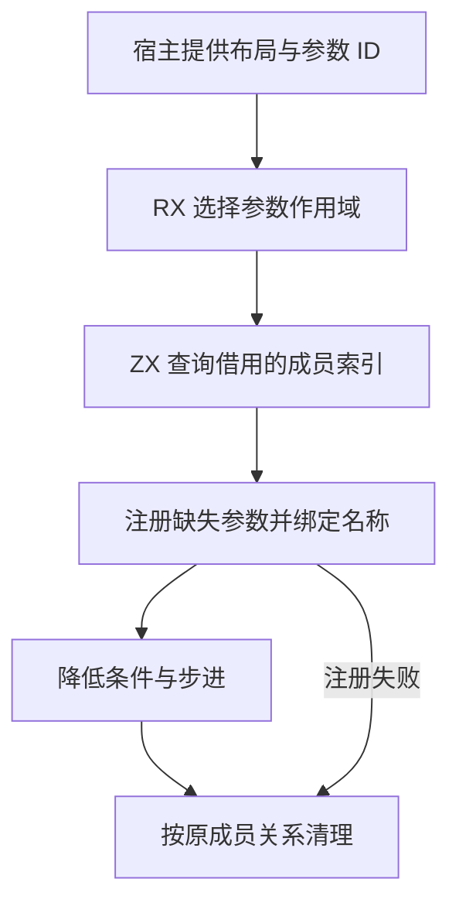
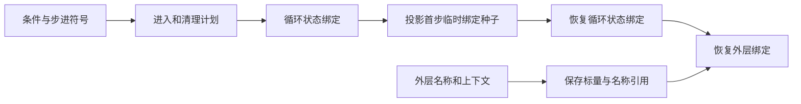

# 循环参数作用域自举

## Intent

把循环条件和步进参数的注册与清理规则迁入 RX/ZX，保留外层符号、初始种子和循环状态的名称切换。

## Data

- 状态布局在状态集合注册参数，栈布局在栈集合注册参数，深布局使用本次循环的专用集合。普通布局仅绑定名称。
- 状态布局退出时还需清理进入前不在栈集合中的参数。进入前已有的成员应继续可见。
- 旧流程在两个成员均注册成功后才安装清理动作。第二次注册失败时，第一次成功的写入可能留在宿主集合中。

## Edges

- RX 按布局选择需要读取的集合。ZX 借用已有索引，查询进入前的成员关系。两处参数共用符号时，只产生一次集合操作。
- 宿主应用注册和清理计划，复用现有成员表的生成代码。绑定完成前安装错误清理，恢复进入前的名称与深布局上下文。
- 投影循环在检查首次条件时使用种子名称，降低循环体前恢复循环状态名称。常规路径仍在发布状态前恢复外层深布局上下文。

## Answer

### 自编译与产物

ReleaseSmall、12 核、16 分区。上一阶段 Source stage 3 构建本阶段 stage 1，后两阶段各由前一阶段构建。每阶段 22/22 步通过。

三阶段在同一份源码和清单上生成的主组 8,827、增长组 416、顺序组 23、集合组 70、宿主组 108 个文件逐字节一致。仅排除记录生成器身份的 `.zxc-inputs`。

Source 使用生成的 `executeValue` 入口。已核对该入口、成员查询及分支所用的生成 Zig。计划通过栈传递标量，复用已有索引的底层列。成员表仍按原有规则增长。

### 生成器性能

前后工具均由 Source 自编译至 stage 3，运行时均使用 Source 分析与生成。使用同一份 378 入口清单交替执行，空函数缓存每轮重新生成 4,083 个函数。重复生成的主组与增长组均与同输入基线逐字节一致。

| 三轮中位数          | 墙钟秒      | CPU 秒      | 单体峰值 RSS 字节         |
| ------------------- | ----------- | ----------- | ------------------------- |
| 缓存命中，前 → 后   | 1.52 → 1.52 | 5.22 → 5.23 | 845,250,560 → 845,365,248 |
| 空函数缓存，前 → 后 | 2.06 → 2.14 | 8.83 → 8.82 | 907,542,528 → 909,901,824 |

空函数缓存的墙钟中位数增加 0.08 秒，单体峰值 RSS 中位数增加 2.4 MB。计时和逐文件校验记录在 `.zig-cache/cold-build-analysis/ownership-research/loop-parameters/`。

### 完整冷构建

首次测量因磁盘耗尽中止。保留 `partition-reference/cold-loop-parameters/` 中的日志，清理失败缓存与已完成基准的可重建缓存后，在独立空缓存中复测。

Zig 0.17.0、ReleaseSmall、12 核、四分区、固定遍历种子 `0x3b41c83f`、本地 Zig 归档。关闭常驻生成器，每 200 毫秒采样进程树。构建中由 Zig seed 生成工具并使用 seed 分析与生成。安装版 CLI 使用 Source。

| 对照                 | 墙钟秒  | CPU 秒 | 进程树峰值字节 | 单体最大 RSS 字节 |
| -------------------- | ------- | ------ | -------------- | ----------------- |
| 固定基线             | 129.740 | 216.03 | 2,247,294,976  | 2,075,033,600     |
| 上一阶段同工作区样本 | 116.795 | 206.80 | 2,288,615,424  | 2,119,860,224     |
| 本阶段复测           | 116.326 | 206.54 | 2,263,400,448  | 2,115,125,248     |

复测 70/70 步通过。相对上一阶段，墙钟减少 0.47 秒，CPU 减少 0.26 秒，树峰值减少 25.2 MB，单体最大 RSS 减少 4.7 MB。相对固定基线，墙钟少 13.41 秒，CPU 少 9.49 秒，树峰值高 16.1 MB，单体最大 RSS 高 40.1 MB。

树峰出现在约 80.44 秒的 LLVM 分区并行编译期。前后分区 0、1、2 对象逐字节相同，分区 3 的对象增加 1,800 字节。日志和对象校验在 `partition-reference/cold-loop-parameters-final/`。

### 回归与自我复核

前后安装版 CLI 禁用缓存生成八个已有用例，覆盖嵌套循环、聚合状态、借用对象和元组缓冲。对应 Zig 源码逐字节相同。

使用本阶段 Source stage 3 运行 `test-modular-loop`、`test-loop-columns`、`test-nested-buffer` 和 `test-value-return`，283/283 步、413/413 项通过。模块循环回归包含编译期分配失败与缓存恢复检查。RX、ZX 通过格式化和 lint 检查，Zig 通过 `zig fmt --check`。

已核对两次注册间的错误清理、同符号去重、外层成员保留及投影种子名称切换。宿主仍持有名称表和递归上下文，并按生成的计划应用和恢复绑定。
