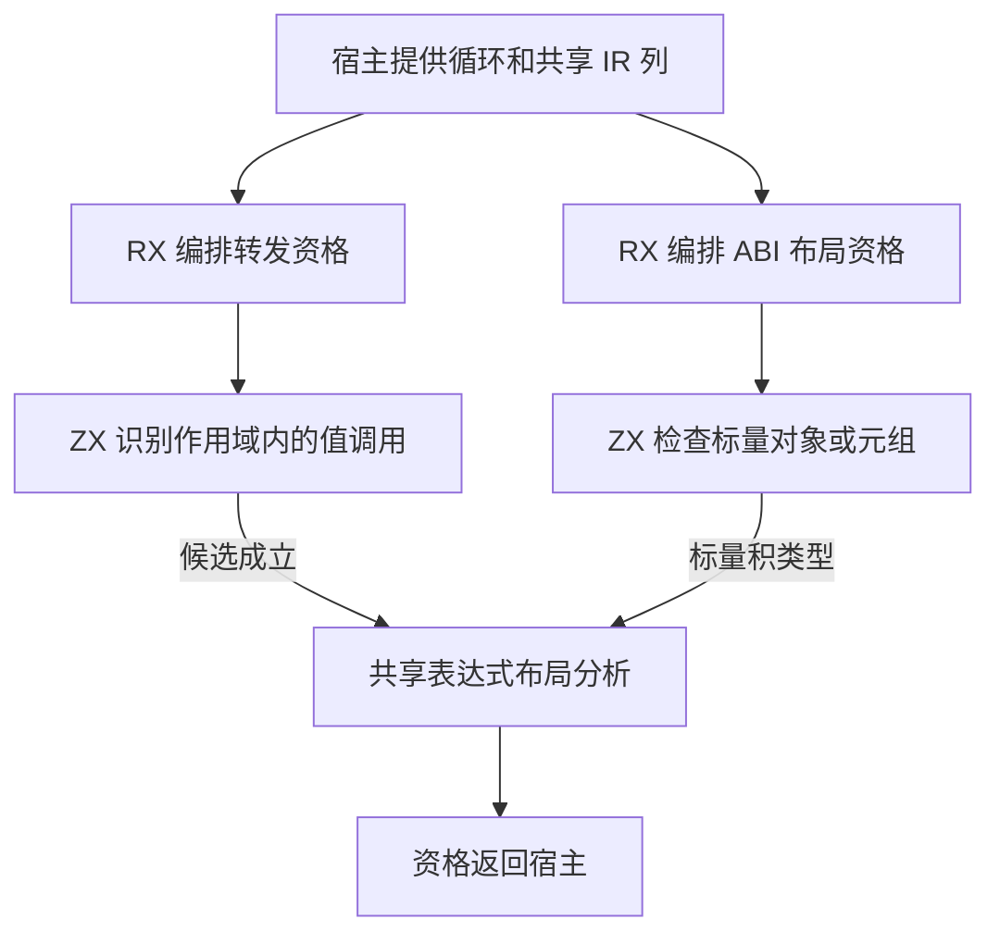
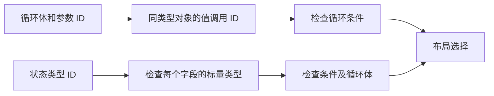

# 循环布局资格自举

## Intent

把循环转发值调用与标量积类型 ABI 布局的资格判断迁入 RX/ZX，保持布局选择和后续生成结果一致。

## Data

- 循环体直接返回调用结果，或经空作用域和单绑定透传调用结果时，才可能直接用循环状态调用值版本。被调函数须有值版本，输入和输出为同一个对象类型，实参须直接引用循环参数。
- 转发候选成立后，独立检查循环条件是否可在值布局求值。
- 标量结果消费允许标量积类型留在 ABI 布局。对象和元组的每个字段须满足已有标量规则，再检查循环条件及循环体的深布局安全性。

## Edges

- RX 依次执行便宜的形状判断和表达式分析。形状失败时直接返回，避免扫描表达式表。
- ZX 通过已有 IR 列读取作用域、函数签名和类型表，复用已有标量查询与表达式布局分析。
- 宿主借用类型和表达式列。每个资格查询只可能执行一次图扫描，临时存储在调用返回后释放。seed 保留原有原生路径。
- 缓冲、投影及最终布局选择仍由现有宿主流程组装。阶段验收核对同输入产物、循环行为和热缓存、空缓存及完整冷构建性能。

## Answer

### 自编译与产物

ReleaseSmall、12 核、16 分区。上一阶段 Source stage 3 构建本阶段 stage 1，后两阶段各由前一阶段构建。每阶段 22/22 步通过。

三阶段在同一份源码和清单上生成的主组 8,800、增长组 416、顺序组 23、集合组 70、宿主组 108 个文件逐字节一致。仅排除记录生成器身份的 `.zxc-inputs`。独立重复生成也核对了主组与增长组。

### 生成器性能

前后工具均由 Source 自编译至 stage 3，运行时均使用 Source 分析与生成。使用同一份 375 入口主组清单交替执行，空函数缓存每轮重新生成 4,071 个函数。

| 三轮中位数          | 墙钟秒      | CPU 秒      | 单体峰值 RSS 字节         |
| ------------------- | ----------- | ----------- | ------------------------- |
| 缓存命中，前 → 后   | 1.52 → 1.51 | 5.19 → 5.20 | 841,121,792 → 829,620,224 |
| 空函数缓存，前 → 后 | 2.02 → 2.02 | 8.79 → 8.81 | 890,716,160 → 881,180,672 |

缓存命中和空函数缓存的单体峰值 RSS 中位数分别减少 11.5 MB 和 9.5 MB。两条筛选路径的生成 Zig 借用已有列。范围和下标检查由编译器生成，筛选过程未复制列或为字段循环增加堆分配。记录在 `.zig-cache/cold-build-analysis/ownership-research/loop-layout-eligibility/`。

### 完整冷构建

Zig 0.17.0、ReleaseSmall、12 核、四分区、固定遍历种子 `0x3b41c83f`、本地 Zig 归档。关闭常驻生成器，独立空缓存，每 200 毫秒采样进程树。构建中由 Zig seed 生成工具并使用 seed 分析与生成。安装版 CLI 使用 Source。

| 对照                 | 墙钟秒  | CPU 秒 | 进程树峰值字节 | 单体最大 RSS 字节 |
| -------------------- | ------- | ------ | -------------- | ----------------- |
| 固定基线             | 129.740 | 216.03 | 2,247,294,976  | 2,075,033,600     |
| 上一阶段同工作区样本 | 117.331 | 207.50 | 2,309,488,640  | 2,112,749,568     |
| 本阶段样本           | 116.502 | 206.30 | 2,325,315,584  | 2,110,963,712     |

完整冷构建 70/70 步通过。相对上一阶段，墙钟减少 0.829 秒，CPU 减少 1.20 秒，单体峰值减少 1.8 MB，树峰值增加 15.8 MB。相对固定基线，墙钟少 13.238 秒，CPU 少 9.73 秒，树峰值高 78.0 MB，单体峰值高 35.9 MB。

前后树峰均出现在约 81 秒，重叠的 LLVM 分区 0、1、2 的对象逐字节相同。唯一发生变化的分区 3 对象增加 1,696 字节，当时已结束。两次采样中分区 0 与 2 的各自峰值变化方向相反。树峰仍按后续样本跟踪。日志和分区校验在 `partition-reference/cold-loop-layout-eligibility/`。

### 回归与自我复核

前后安装版 CLI 禁用缓存生成六个已有用例，包含对象和元组别名、转发调用、元组结果及借用对象。对应 Zig 源码逐字节相同。

最终 Source stage 3 运行 `test-iterate-calls`、`test-modular-loop` 和 `test-value-return`，358/358 项 Zig 回归通过。另有一项 CLI 库重定位回归首次写入内置工具链缓存失败。对原测试和同一 CLI 设置 `ZXC_ZIG` 使用本机同版本 Zig，仅复跑该项并通过。修改的 RX、ZX 通过格式化和 lint，Zig 通过 `zig fmt --check`。

已复核空作用域、单绑定透传、多绑定拒绝、可空标量字段与元组的选择顺序。宿主仍负责在不同布局候选之间选择，并降低初始值、条件和循环步。
