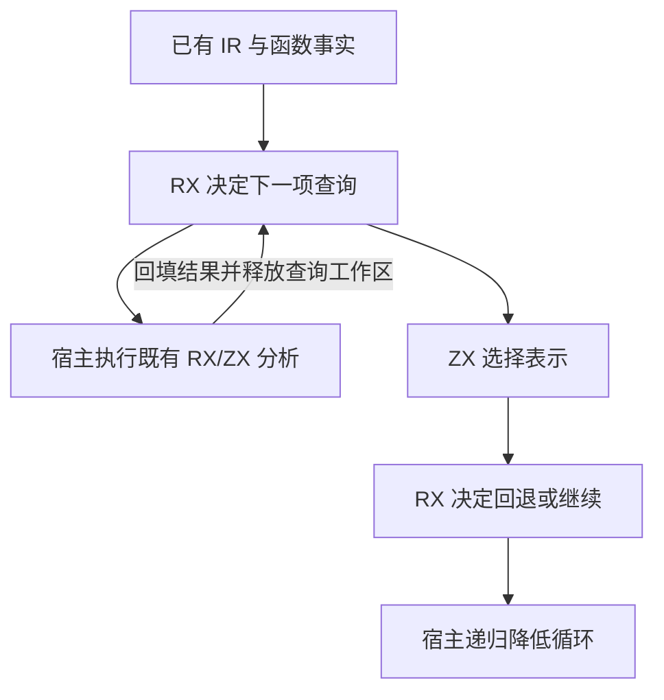

# 循环布局选择自举

## Intent

把循环布局的检查顺序、表示选择和回退迁入 RX/ZX。保留原有循环求值、所有权和生成代码。

## Data

- 原 Zig 路径依次检查纯调用、本地调用、转发和缓冲，再选择深布局、状态布局、栈布局或普通表示。
- 缓冲成立时跳过深布局扫描。状态布局或转发成立时跳过浅布局扫描。值请求未选择状态布局或栈布局时回退到引用表示，无法直接消费的投影交回调用者。
- 现有图分析已经由 RX/ZX 实现。其工作区由单次查询持有，返回后释放。

## Edges

- RX 根据已有事实请求下一项分析，处理回退和投影，并在得到最终表示后结束。ZX 原子函数计算深布局资格及表示候选。
- Zig 适配器只执行 RX 请求的查询并回填结果。选择状态保存在栈上，跨调用仅保留布尔结果和转发 ID。各查询沿用独立的短生命周期工作区。
- 输出生成仍使用已有 IR 和递归降低。初始 seed 保留原布局规则。

## Answer

### 自编译与产物

ReleaseSmall、12 核、16 分区。上一阶段 Source stage 3 构建本阶段 stage 1，后两阶段各由前一阶段构建。每阶段 22/22 步通过。

三阶段在同一份源码和清单上生成的主组 8,809、增长组 416、顺序组 23、集合组 70、宿主组 108 个文件逐字节一致。仅排除记录生成器身份的 `.zxc-inputs`。

已检查生成的 RX 入口及其两个 ZX 依赖。它们接收栈上输入并返回枚举，生成代码无分配调用。对于实际发生的图分析，宿主沿用每次查询原有的工作区边界。

### 生成器性能

前后工具均由 Source 自编译至 stage 3，运行时均使用 Source 分析与生成。使用同一份 376 入口主组清单交替执行，空函数缓存每轮重新生成 4,075 个函数。重复生成的主组和增长组均与同输入基线逐字节一致。

| 三轮中位数          | 墙钟秒      | CPU 秒      | 单体峰值 RSS 字节         |
| ------------------- | ----------- | ----------- | ------------------------- |
| 缓存命中，前 → 后   | 1.50 → 1.49 | 5.18 → 5.17 | 832,929,792 → 832,716,800 |
| 空函数缓存，前 → 后 | 2.03 → 2.00 | 8.86 → 8.78 | 877,166,592 → 877,969,408 |

空函数缓存的单体峰值 RSS 中位数增加 0.8 MB。计时和逐文件校验记录在 `.zig-cache/cold-build-analysis/ownership-research/loop-layout-selection/`。

### 完整冷构建

Zig 0.17.0、ReleaseSmall、12 核、四分区、固定遍历种子 `0x3b41c83f`、本地 Zig 归档。关闭常驻生成器，独立空缓存，每 200 毫秒采样进程树。构建中由 Zig seed 生成工具并使用 seed 分析与生成。安装版 CLI 使用 Source。

| 对照                 | 墙钟秒  | CPU 秒 | 进程树峰值字节 | 单体最大 RSS 字节 |
| -------------------- | ------- | ------ | -------------- | ----------------- |
| 固定基线             | 129.740 | 216.03 | 2,247,294,976  | 2,075,033,600     |
| 上一阶段同工作区样本 | 116.502 | 206.30 | 2,325,315,584  | 2,110,963,712     |
| 本阶段样本           | 117.044 | 206.78 | 2,281,127,936  | 2,105,475,072     |

完整冷构建 70/70 步通过。相对上一阶段，墙钟增加 0.54 秒，CPU 增加 0.48 秒，均在 1 秒容差内。树峰值减少 44.2 MB，单体峰值减少 5.5 MB。相对固定基线，墙钟少 12.70 秒，CPU 少 9.25 秒，树峰值高 33.8 MB，单体峰值高 30.4 MB。

前后树峰均出现在约 81 秒，重叠的 LLVM 分区 0、1、2 的对象逐字节相同。唯一变化的分区 3 对象增加 776 字节。日志和对象校验在 `partition-reference/cold-loop-layout-selection/`。

### 回归与自我复核

前后安装版 CLI 禁用缓存生成六个已有用例，覆盖列式与聚合循环、元组结果、借用对象和条件归约。对应的 Zig 源码逐字节相同。

使用本阶段 Source stage 3 运行 `test-loop-columns`、`test-aggregate-loop`、`test-value-return` 和 `test-modular-loop`，304/304 步、465/465 项通过。RX、ZX 通过格式化和 lint 检查，Zig 通过 `zig fmt --check`。

已核对缓冲成功时不请求深扫描，浅扫描在旧规则允许的条件下执行，投影拒绝与初始值检查发生在原有回退顺序。宿主仍负责查询工作区和循环表达式的递归降低。
