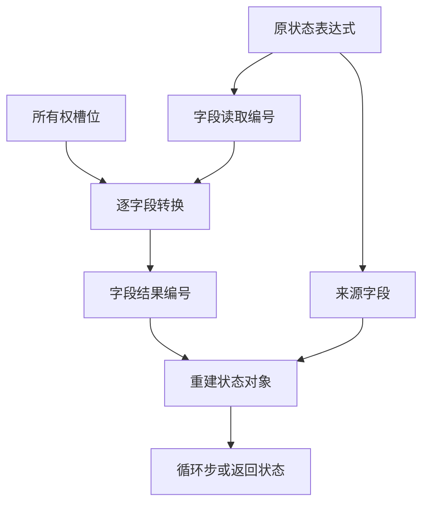

# 循环投影字段重建自举

## Intent · 目标

由 RX/ZX 规划投影字段的所有权处理，成批生成字段读取，并重建进入或更新循环时的状态对象。循环步计划决定投影后的状态是否需要恢复。

## Data · 现状与假设

遮蔽借用字段和限定赋值共享一套槽位分析，但宿主逐字段调用生成器读取，再自行拼装状态对象和来源字段。将字段读取合并到槽位计划中，并复用投影结果的结构化对象生成，应减少生成入口切换。每个所有权转换仍在原字段顺序执行。

## Edges · 边界

- 对象字段先按原顺序处理所有权，再追加既有来源字段。批量读取只生成 AST 投影，运行时求值顺序由最终对象和转换语句保持。
- 来源字段可能使用分配生成的名称。发布前将这份名称移入 AST 所属分配器，普通字段名继续借用类型表。
- Native seed 保留引导实现。宿主仍负责逐字段的所有权转换调用、类型布局查找和 AST 发布。

## Answer · 交付与验收

核对 Source 三阶段和应用生成 Zig，运行投影字段、借用状态、边界与分配失败的现有回归，再测量生成器和完整冷构建成本。

### 阶段一致性与生成成本

以上阶段 Source stage3 构建本阶段 stage1，再逐级自编译。三轮各通过 22/22 步，五组共 9,563 个文件逐字节一致。前后两个 Source stage3 处理相同的本阶段输入，主组 8,931 个文件和增长组 422 个文件逐字节一致。

| 同输入三轮交替对照 | 前后墙钟中位数 | 前后 CPU 中位数 |     前后进程峰值 RSS 中位数 |
| ------------------ | -------------: | --------------: | --------------------------: |
| 各自预热函数缓存   |  1.53 → 1.53 s |   5.30 → 5.31 s | 843,857,920 → 843,939,840 B |
| 每轮使用新函数缓存 |  2.04 → 2.04 s |   8.90 → 8.92 s | 916,045,824 → 896,958,464 B |

两端工具本体均由 Source stage2 生成，运行时均启用 Source 分析和生成。本轮未单独测量单个投影对象的临时分配。日志及各轮测量保存在本地 `.zig-cache/cold-build-analysis/ownership-research/iteration-field-rebuild/`。

### 完整冷构建

固定 Zig 0.17.0、ReleaseSmall、12 核、四分区、全新 local/global 缓存和同一份本地 Zig 归档。以 Native seed 引导生成工具本体，安装产物启用 Source 分析与生成。构建通过 70/70 步。

| 指标                   |      固定基线 |        上阶段 |        本阶段 |   较上阶段 | 累计较固定基线 |
| ---------------------- | ------------: | ------------: | ------------: | ---------: | -------------: |
| 墙钟 / s               |       129.740 |       117.168 |       116.737 |     −0.431 |        −13.003 |
| CPU / s                |        216.03 |        206.84 |        206.77 |      −0.07 |          −9.26 |
| 进程树采样峰值 RSS / B | 2,247,294,976 | 2,298,593,280 | 2,304,688,128 | +6,094,848 |    +57,393,152 |
| 单进程系统峰值 RSS / B | 2,075,033,600 | 2,123,202,560 | 2,127,396,864 | +4,194,304 |    +52,363,264 |

峰值快照中的分区 0、1、2 目标文件逐字节一致。唯一变化的分区 3 目标文件增大 2,056 B。单轮树峰采样无法分离并发时序与实际内存成本。日志、采样及对象哈希保存在本地 `.zig-cache/cold-build-analysis/ownership-research/partition-reference/cold-iteration-field-rebuild/`。

### 产物与代码复核

- 两个安装版 CLI 对 60 个既有应用样例生成逐字节一致的 Zig。新增比对覆盖直接投影返回、普通缓冲列表及局部借用。
- 循环列、聚合与模块循环、RX 产品转移、字段事实与所有权回归通过 286/286 步及 458/458 项测试。覆盖零步借用、源码与归档路径、越界检查和分配失败。
- 批量读取在宿主开始逐字段转换前写入 AST。原始字段顺序、被遮蔽字段的槽位、来源字段及声明布局均沿用原规则。返回状态恢复由循环步计划决定，首轮检查仍由同一计划控制。
