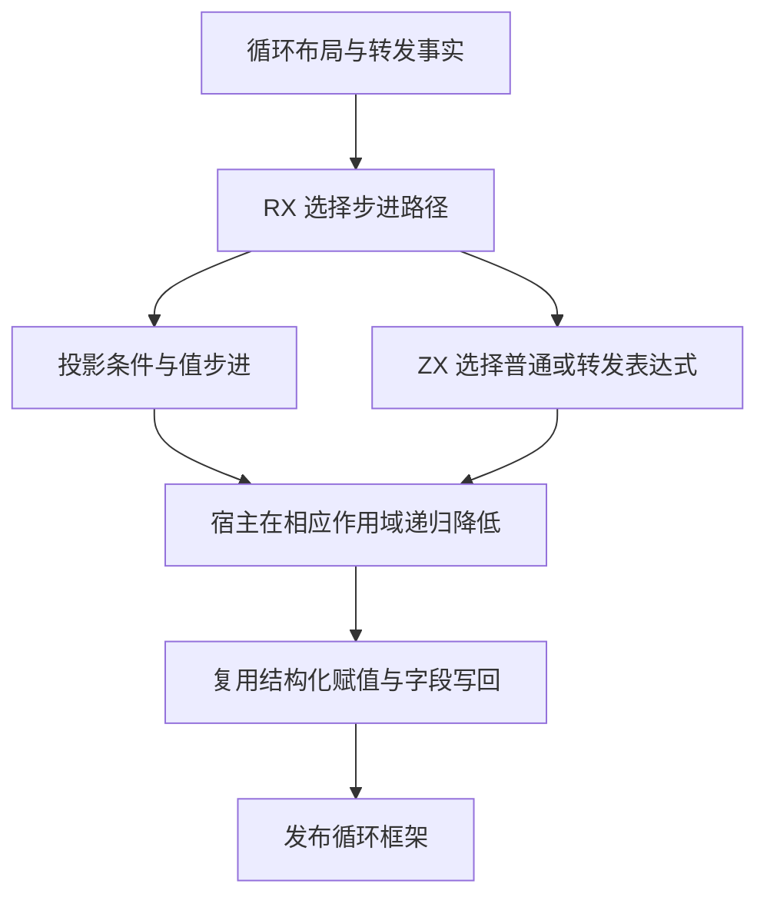

# 循环步进自举

## Intent

把循环条件、步进取值和写回方式的选择迁入 RX/ZX。保留首次检查的作用域、延迟续用和写回的所有权语义。

## Data

- 投影循环在种子上降低首次条件，再在字段投影下依次降低条件和步进。后置条件循环从步进开始。
- 普通循环在延迟续用上下文中依次降低条件和步进。已有转发调用优先使用值版本，其余步进按布局使用值或普通表达式。
- 写回使用直接赋值、逐字段状态写回或投影状态赋值。所有权判断仍使用原循环体 ID。

## Edges

- RX 区分投影与普通循环，输出首步检查、循环尾部检查和续用分类。ZX 计算普通步进的表达式及写回表示。
- Zig 适配器按计划递归降低表达式，并恢复原有名称、字段投影及延迟续用上下文。直接与投影赋值复用 ZX 生成的基本赋值，状态写回复用既有字段快照生成。
- 规划使用标量事实。初始 seed 保留原有分支和赋值语义。

## Answer

### 自编译与产物

ReleaseSmall、12 核、16 分区。上一阶段 Source stage 3 构建本阶段 stage 1，后两阶段各由前一阶段构建。每阶段 22/22 步通过。

三阶段在同一份源码和清单上生成的主组 8,834、增长组 416、顺序组 23、集合组 70、宿主组 108 个文件逐字节一致。仅排除记录生成器身份的 `.zxc-inputs`。

已核对步进计划的生成 `executeValue` 入口及依赖。值入口通过栈传递标量计划，直接赋值沿用基本发射器的短生命周期缓冲区。

### 生成器性能

前后工具均由 Source 自编译至 stage 3，运行时均使用 Source 分析与生成。使用同一份 379 入口清单交替执行，空函数缓存每轮重新生成 4,086 个函数。重复生成的主组与增长组均与同输入基线逐字节一致。

| 三轮中位数          | 墙钟秒      | CPU 秒      | 单体峰值 RSS 字节         |
| ------------------- | ----------- | ----------- | ------------------------- |
| 缓存命中，前 → 后   | 1.50 → 1.50 | 5.20 → 5.21 | 830,193,664 → 830,439,424 |
| 空函数缓存，前 → 后 | 2.02 → 2.02 | 8.85 → 8.83 | 887,422,976 → 879,853,568 |

空函数缓存的单体峰值 RSS 中位数减少 7.6 MB。计时和逐文件校验记录在 `.zig-cache/cold-build-analysis/ownership-research/loop-step/`。

### 完整冷构建

Zig 0.17.0、ReleaseSmall、12 核、四分区、固定遍历种子 `0x3b41c83f`、本地 Zig 归档。关闭常驻生成器，独立空缓存，每 200 毫秒采样进程树。构建中由 Zig seed 生成工具并使用 seed 分析与生成。安装版 CLI 使用 Source。

| 对照                 | 墙钟秒  | CPU 秒 | 进程树峰值字节 | 单体最大 RSS 字节 |
| -------------------- | ------- | ------ | -------------- | ----------------- |
| 固定基线             | 129.740 | 216.03 | 2,247,294,976  | 2,075,033,600     |
| 上一阶段同工作区样本 | 116.326 | 206.54 | 2,263,400,448  | 2,115,125,248     |
| 本阶段样本           | 117.233 | 206.47 | 2,291,990,528  | 2,116,632,576     |

完整冷构建 70/70 步通过。相对上一阶段，墙钟增加 0.91 秒，CPU 减少 0.07 秒，树峰值增加 28.6 MB，单体最大 RSS 增加 1.5 MB。相对固定基线，墙钟少 12.51 秒，CPU 少 9.56 秒，树峰值高 44.7 MB，单体最大 RSS 高 41.6 MB。

树峰出现在约 81.15 秒的 LLVM 分区并行编译期。前后分区 0、1、2 对象逐字节相同，分区 3 的对象增加 360 字节。日志和对象校验在 `partition-reference/cold-loop-step/`。

### 回归与自我复核

前后安装版 CLI 禁用缓存生成九个已有用例，覆盖投影、嵌套缓冲、聚合状态、转发值调用和条件归约。对应 Zig 源码逐字节相同。

使用本阶段 Source stage 3 运行 `test-modular-loop`、`test-loop-columns`、`test-nested-buffer` 和 `test-value-return`，283/283 步、413/413 项通过。RX、ZX 通过格式化和 lint 检查，Zig 通过 `zig fmt --check`。

已核对投影循环两次条件降低的各自作用域，以及普通循环在恢复延迟续用上下文后写回状态的顺序。被转发的表达式 ID 用于求值，原循环体 ID 仍用于所有权。宿主持有递归表达式和字段投影上下文，并执行生成的计划。
