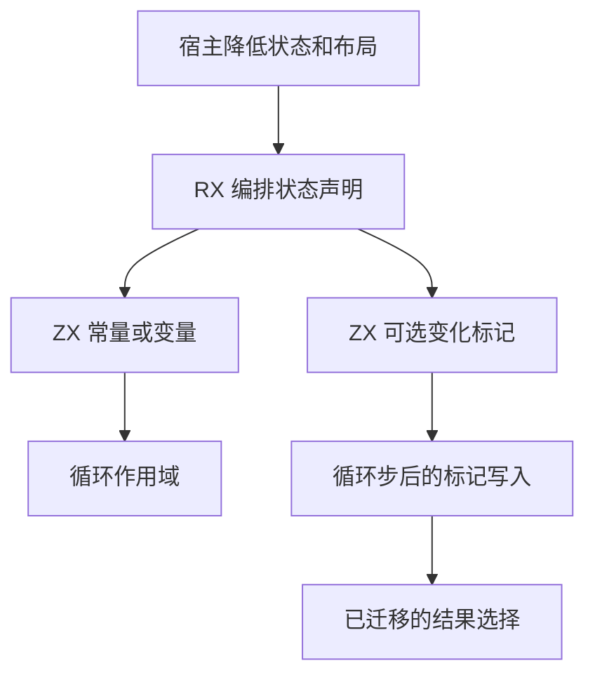
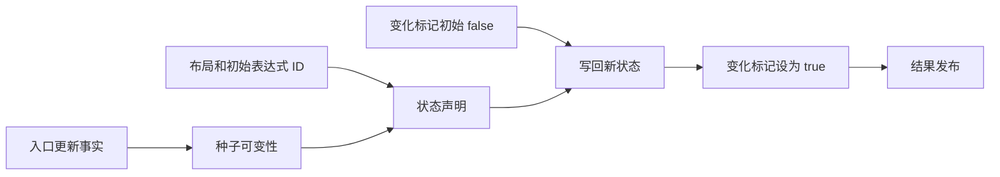

# 循环状态声明自举

## Intent

让普通循环和投影循环共享 RX/ZX 状态声明和变化标记生成。保持投影种子的可变性规则、标记设置时机及空循环回退，同时去除结果发布时无法被引用的中间块。本文按 IDEA 框架记录实施和验收。

## Data

- 普通循环、投影种子和投影后的内部状态由宿主分别建立声明。普通与投影路径重复创建变化标记和设置语句。
- 投影种子只在所有权计划包含入口更新时为变量。变化标记先为 false，只有写回循环状态后才设为 true。
- 未经布局转换且无需按值发布的循环结果原先仍生成中间块。该块的唯一可见影响是消耗一个后续标签编号。

## Edges

- RX 先生成状态声明，再按需生成变化标记。ZX 复用通用绑定发射器，并生成设置标记所需的表达式 ID。
- 宿主保留状态值、布局、条件和循环步的递归降低，按原语句顺序将标记写入循环体。状态名和标记名借用已有持久存储。
- Source 对未引用中间块仅保留序号更新。值布局和转换分支继续生成实际结果块。初始 seed 保留原先的结果块生成行为。
- 同输入对照完整产物，并验收 Source 生成、完整冷构建及现有循环回归。

## Answer

### 实施与验证

状态声明入口供普通循环、投影种子和投影后的状态变量复用。有变化标记时，一次生成声明、布尔值和标记引用。宿主只在原有写回位置追加由这些 ID 构成的赋值。

三个自编译阶段均使用 ReleaseSmall、12 核、16 分区，每阶段 22/22 步通过。第一阶段由上一阶段 Source stage 3 生成，本阶段 stage 1 与 stage 2 依次生成后续工具。

使用同一份 373 入口清单。上一阶段 Source stage 3、本阶段 stage 2 和 stage 3 的 8,780 个主组文件及 416 个增长组文件逐字节一致。仅排除生成器身份文件 `.zxc-inputs`。

主组原始产物中有 646 个模块包含循环状态变化标记的赋值。

| Source stage 3 交替三轮中位数 | 墙钟秒      | CPU 秒      | 单体峰值 RSS 字节         |
| ----------------------------- | ----------- | ----------- | ------------------------- |
| 缓存命中，前 → 后             | 1.50 → 1.50 | 5.17 → 5.18 | 839,876,608 → 839,417,856 |
| 空函数缓存，前 → 后           | 2.02 → 2.02 | 8.81 → 8.83 | 890,765,312 → 912,965,632 |

空函数缓存每轮实际生成 4,062 个主组函数。空缓存峰值中位数增加 22.2 MB。基线三轮峰值约为 890～937 MB，本阶段约为 911～917 MB。日志与统计在 `.zig-cache/cold-build-analysis/ownership-research/loop-state/`。

### 完整冷构建

Zig 0.17.0、ReleaseSmall、12 核、四分区、本地 Zig 归档，固定遍历种子 `0x3b41c83f`。关闭常驻生成器，使用独立空缓存，每 200 毫秒采样进程树。构建期间的工具由 Zig seed 构建，使用 seed 分析与生成。安装后的 CLI 使用 Source。

| 对照                 | 墙钟秒  | CPU 秒 | 进程树峰值字节 | 单体最大 RSS 字节 |
| -------------------- | ------- | ------ | -------------- | ----------------- |
| 固定基线             | 129.740 | 216.03 | 2,247,294,976  | 2,075,033,600     |
| 上一阶段同工作区样本 | 117.141 | 207.57 | 2,266,152,960  | 2,111,455,232     |
| 本阶段同工作区样本   | 116.893 | 206.90 | 2,311,667,712  | 2,113,257,472     |

完整冷构建 70/70 步通过。相对上一阶段，墙钟减少约 0.249 秒，CPU 减少 0.67 秒，树峰值增加 45.5 MB，单体最大 RSS 增加 1.8 MB。相对固定基线，墙钟少 12.847 秒，CPU 少 9.13 秒，树峰值高 64.4 MB，单体最大 RSS 高 38.2 MB。

两次树峰值均发生在 LLVM 分区编译重叠期间，峰值时点分别约为 62.98 秒和 81.03 秒。分区 0、1、2 对象逐字节一致，分区 3 增加 2,280 字节。日志和采样在 `partition-reference/cold-loop-state/`。

### 回归

使用本阶段 Source stage 3 运行 `test-loop-columns`、`test-aggregate-loop` 和 `test-value-return`，237/237 步、342/342 项通过。修改的 RX、ZX 通过格式和 lint 检查，修改的 Zig 通过 `zig fmt --check`。

### 自我复核

前后安装版 CLI 对投影循环与借用对象两个既有用例生成的 776 行、524 行 Zig 源码逐字节一致。已核对种子可变性、标记写入位置和后续标签编号。递归求值、所有权转换、循环作用域和 AST 存储仍由宿主处理。
