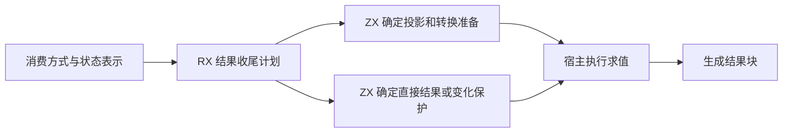
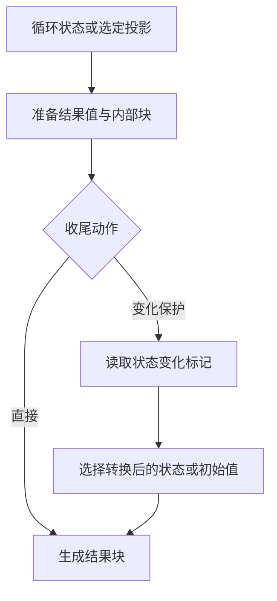

# 循环结果收尾自举

## Intent · 目标

由 RX 编排循环结果的准备与收尾计划。ZX 决定读取或转换方式、需要生成的内部结果块，以及直接返回或使用状态变化保护。Zig 宿主执行计划所指定的求值和 AST 写入。

## Data · 现状与假设

原来的 ZX 路由只给出结果类别。Zig 仍根据转换状态、按值返回和类别组合决定内部块是否生成、使用哪种转换，以及怎样收尾。将这些决定合并到单次无分配的生成计划中，可保留原有构造顺序和标签编号，复用现有 RX/ZX 结果块生成入口。

## Edges · 边界

- 有消费者时优先选择投影方式，无消费者时先处理丢弃，再计算状态返回。
- 内部块省略时只推进标签序号，保持随后标签与原实现一致。初始返回和转换仍由相同的惰性分支保护。
- Native seed 保留引导所需的内部块。正式路径的递归投影、转换调用和 AST 状态写入仍由宿主执行。

## Answer · 交付与验收

核对固定输入的 Zig 产物和 Source 三阶段一致性，运行直接、按值、零步和投影消费的现有回归，并测量生成器和完整冷构建成本。

### 阶段一致性与生成成本

以上阶段 Source stage3 构建本阶段 stage1，再逐级自编译。三轮各通过 22/22 步，五组共 9,555 个文件逐字节一致。前后两个 Source stage3 处理相同的本阶段输入，主组 8,923 个文件和增长组 422 个文件逐字节一致。

| 同输入三轮交替对照 | 前后墙钟中位数 | 前后 CPU 中位数 |     前后进程峰值 RSS 中位数 |
| ------------------ | -------------: | --------------: | --------------------------: |
| 各自预热函数缓存   |  1.53 → 1.53 s |   5.29 → 5.29 s | 846,036,992 → 845,922,304 B |
| 每轮使用新函数缓存 |  2.03 → 2.03 s |   8.88 → 8.89 s | 916,373,504 → 913,653,760 B |

两端工具本体均由 Source stage2 生成，运行时均启用 Source 分析和生成。日志及各轮测量保存在本地 `.zig-cache/cold-build-analysis/ownership-research/iteration-result-finish/`。

### 完整冷构建

固定 Zig 0.17.0、ReleaseSmall、12 核、四分区、全新 local/global 缓存和同一份本地 Zig 归档。以 Native seed 引导生成工具本体，安装产物启用 Source 分析与生成。构建通过 70/70 步。

| 指标                   |      固定基线 |        上阶段 |        本阶段 |    较上阶段 | 累计较固定基线 |
| ---------------------- | ------------: | ------------: | ------------: | ----------: | -------------: |
| 墙钟 / s               |       129.740 |       117.056 |       116.908 |      −0.148 |        −12.832 |
| CPU / s                |        216.03 |        207.04 |        206.50 |       −0.54 |          −9.53 |
| 进程树采样峰值 RSS / B | 2,247,294,976 | 2,292,793,344 | 2,265,366,528 | −27,426,816 |    +18,071,552 |
| 单进程系统峰值 RSS / B | 2,075,033,600 | 2,112,978,944 | 2,115,010,560 |  +2,031,616 |    +39,976,960 |

四个分区中仅分区 3 的目标文件变化，大小减少 48 B。单轮进程树采样的变化包含后端分区进程的峰值波动。日志、采样及对象哈希保存在本地 `.zig-cache/cold-build-analysis/ownership-research/partition-reference/cold-iteration-result-finish/`。

### 产物与代码复核

- 两个安装版 CLI 对 51 个既有应用样例生成逐字节一致的 Zig，涵盖直接、按值、投影消费、逃逸引用及可失败返回。
- 迭代、按值返回、循环列、聚合循环和模块循环回归通过 376/376 构建步骤、491/491 项 Zig 测试和 5/5 项 CLI 检查。覆盖零步惰性、条件与副作用顺序、分配失败及归档调用。
- 生成计划只返回准备动作和收尾动作，使用空分配器执行。宿主读取这两个标量字段，并在需要惰性回退时复用现有保护结果块。
- 正式路径保留原有的标签预留，初始引导路径继续实际构造内部块。递归转换和持久 AST 仍由 Zig 宿主提供。
