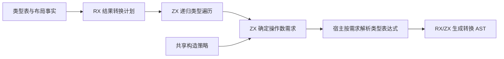
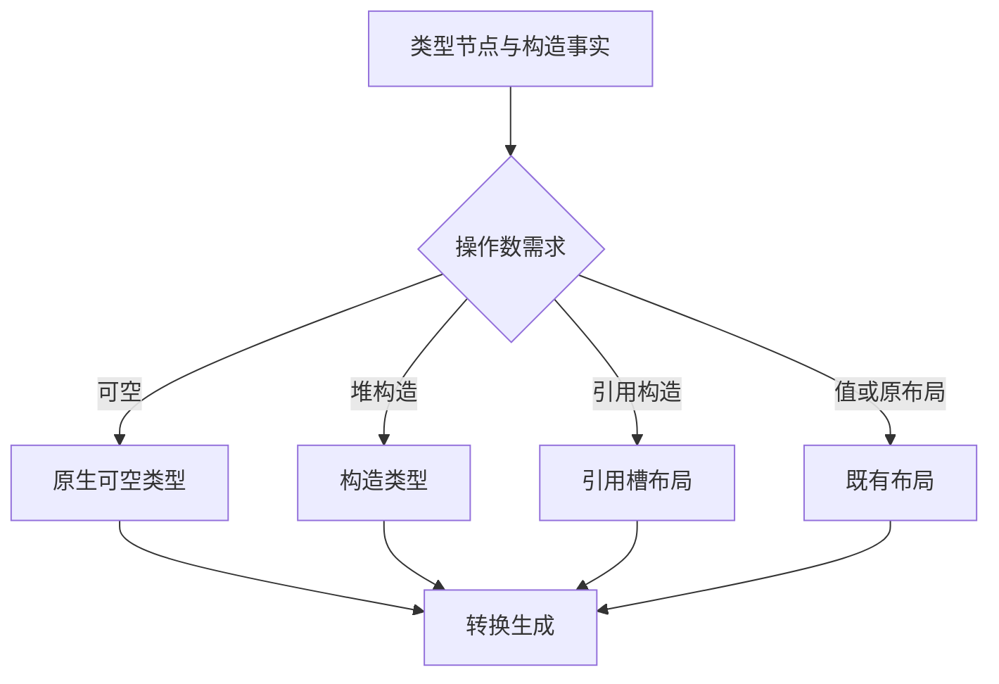

# 循环结果转换准备自举

## Intent · 目标

由 RX 编排循环结果的类型遍历、布局需求和构造方式分析。ZX 为每个类型节点生成操作数需求，宿主按计划查找现有类型表达式，再由 RX/ZX 生成转换 AST。

## Data · 现状与假设

零步结果的惰性分支已经使用通用 RX 结果块。结果转换的输出路径仍由 Zig 宿主检查类型种类、查询每个复合节点的构造策略并准备五列数据。已有构造策略可以在转换计划内批量应用，数组中分别保存转换布局和构造操作数。堆构造的类型和引用槽的存储布局互斥，结果转换也不会构造新的缓冲列表，因此这两种情况无需各占一列。

## Edges · 边界

- 根布局仍在标量快速返回前解析，节点布局和可空类型表达式的宿主查找保持原顺序。
- 构造仍以当前状态布局、选择事实和借用事实决定。堆构造解析目标类型，引用构造解析存储布局，按值构造使用既有布局。
- 保留转换发射器的声明、捕获和错误出口。Native seed 保留引导实现，宿主仍负责类型缓存与 AST 发布。

## Answer · 交付与验收

核对固定输入下的 Zig 产物、Source 三阶段一致性、循环结果的可空值与借用返回，并测量受影响的生成器和完整冷构建。

### 阶段一致性与生成成本

以上阶段 Source stage3 构建本阶段 stage1，再逐级自编译。三轮各通过 22/22 步，五组共 9,549 个文件逐字节一致。前后两个 Source stage3 处理相同的本阶段输入，主组 8,917 个文件和增长组 422 个文件逐字节一致。

| 同输入三轮交替对照 | 前后墙钟中位数 | 前后 CPU 中位数 |     前后进程峰值 RSS 中位数 |
| ------------------ | -------------: | --------------: | --------------------------: |
| 各自预热函数缓存   |  1.53 → 1.52 s |   5.28 → 5.25 s | 841,957,376 → 842,219,520 B |
| 每轮使用新函数缓存 |  2.03 → 2.04 s |   8.92 → 8.89 s | 898,908,160 → 919,601,152 B |

两端工具本体均由 Source stage2 生成，运行时均启用 Source 分析和生成。空缓存峰值中位数增加 20.69 MB，三次采样的前后区间重叠。本轮未对单次转换的临时分配单独计量。日志及各轮测量保存在本地 `.zig-cache/cold-build-analysis/ownership-research/iteration-result-conversion/`。

### 完整冷构建

固定 Zig 0.17.0、ReleaseSmall、12 核、四分区、全新 local/global 缓存和同一份本地 Zig 归档。以 Native seed 引导生成工具本体，安装产物启用 Source 分析与生成。构建通过 70/70 步。

| 指标                   |      固定基线 |        上阶段 |        本阶段 |   较上阶段 | 累计较固定基线 |
| ---------------------- | ------------: | ------------: | ------------: | ---------: | -------------: |
| 墙钟 / s               |       129.740 |       117.393 |       117.056 |     −0.337 |        −12.684 |
| CPU / s                |        216.03 |        207.47 |        207.04 |      −0.43 |          −8.99 |
| 进程树采样峰值 RSS / B | 2,247,294,976 | 2,292,613,120 | 2,292,793,344 |   +180,224 |    +45,498,368 |
| 单进程系统峰值 RSS / B | 2,075,033,600 | 2,117,697,536 | 2,112,978,944 | −4,718,592 |    +37,945,344 |

分区 0 和 1 的目标文件逐字节一致，分区 2 和 3 的大小分别变化 −256 B 和 +1,680 B。日志、采样及对象哈希保存在本地 `.zig-cache/cold-build-analysis/ownership-research/partition-reference/cold-iteration-result-conversion/`。

### 产物与代码复核

- 两个安装版 CLI 对 46 个既有应用样例生成逐字节一致的 Zig，包括嵌套对象、元组和列表的逃逸结果。
- 按值返回、循环列、RX 产品转移、聚合循环、模块循环和嵌套缓冲回归通过 384/384 构建步骤与 562/562 测试。覆盖可空值、引用身份、零步分支、源码和归档调用及分配失败。
- 所有节点按同一次遍历的索引取操作数。堆构造只读取构造类型，引用构造只读取引用槽布局。可空值的原生类型仍在原布局解析后获取。
- 未修改零步保护的求值路径、运行时错误检查或分配策略。Zig 宿主仍提供类型查找和 AST 状态写入。
