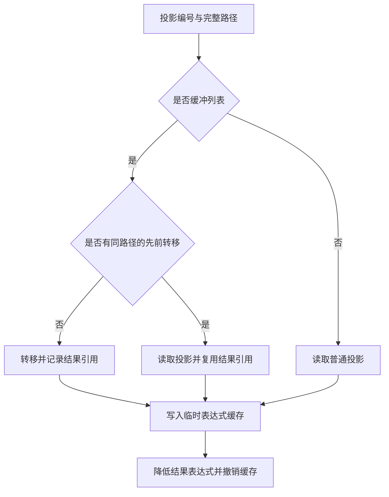

# 循环结果转移调度自举

## Intent · 目标

由 RX 编排循环结果分析和缓冲列表转移计划。ZX 决定哪些投影转移列表、哪些复用同一路径的已转移值、哪些只需读取。宿主执行计划和递归降低剩余表达式。

## Data · 现状与假设

现有 ZX 遍历已记录投影及路径，Zig 宿主仍遍历两次投影并维护以路径切片查找的临时表。将去重前移到同一次生成调用，可沿用原有的精确路径比较和顺序，省掉持久分配器中的临时表。实参求值和转移历史只由实际执行更新。

## Edges · 边界

- 缓冲列表按首次遇到的顺序处理，普通投影在后。保留重复列表投影的降低步骤及其错误顺序。相同路径复用首次转移记录中的结果引用。
- 路径比较包含完整的字段索引序列。重复投影的计划索引只指向当前调度已完成的转移，不直接假定历史中的绝对位置。
- Native seed 保留引导路径。Zig 宿主仍负责递归求值、调用转移生成器和写入缓存与 AST。

## Answer · 交付与验收

比对固定输入的生成 Zig、Source 三阶段产物、重复别名和独立列表的现有回归，并测量前后生成器与完整冷构建成本。

### 阶段一致性与生成成本

以上阶段 Source stage3 构建本阶段 stage1，再逐级自编译。三轮各通过 22/22 步，五组共 9,541 个文件逐字节一致。前后两个 Source stage3 处理相同的本阶段输入，主组 8,909 个文件和增长组 422 个文件逐字节一致。

| 同输入三轮交替对照 | 前后墙钟中位数 | 前后 CPU 中位数 |     前后进程峰值 RSS 中位数 |
| ------------------ | -------------: | --------------: | --------------------------: |
| 各自预热函数缓存   |  1.52 → 1.52 s |   5.26 → 5.27 s | 841,121,792 → 841,351,168 B |
| 每轮使用新函数缓存 |  2.04 → 2.05 s |   8.92 → 8.94 s | 907,345,920 → 885,030,912 B |

两端工具本体均由 Source stage2 生成，运行时均启用 Source 分析和生成。日志及各轮测量保存在本地 `.zig-cache/cold-build-analysis/ownership-research/iteration-result-transfer/`。

### 完整冷构建

固定 Zig 0.17.0、ReleaseSmall、12 核、四分区、全新 local/global 缓存和同一份本地 Zig 归档。以 Native seed 引导生成工具本体，安装产物启用 Source 分析与生成。构建通过 70/70 步。

| 指标                   |      固定基线 |        上阶段 |        本阶段 |   较上阶段 | 累计较固定基线 |
| ---------------------- | ------------: | ------------: | ------------: | ---------: | -------------: |
| 墙钟 / s               |       129.740 |       117.057 |       117.393 |     +0.336 |        −12.347 |
| CPU / s                |        216.03 |        206.54 |        207.47 |      +0.93 |          −8.56 |
| 进程树采样峰值 RSS / B | 2,247,294,976 | 2,300,182,528 | 2,292,613,120 | −7,569,408 |    +45,318,144 |
| 单进程系统峰值 RSS / B | 2,075,033,600 | 2,108,801,024 | 2,117,697,536 | +8,896,512 |    +42,663,936 |

四个 LLVM 分区目标文件中仅分区 1 的哈希发生变化，大小增加 2,400 B。单轮冷构建的 CPU 与峰值变化仍包含分区编译及进程采样波动。墙钟与 CPU 相对固定基线的累计差值仍为负。日志、采样及对象哈希保存在本地 `.zig-cache/cold-build-analysis/ownership-research/partition-reference/cold-iteration-result-transfer/`。

### 产物与代码复核

- 两个安装版 CLI 对 43 个既有应用样例生成逐字节一致的 Zig，包含同一列的重复别名、两个独立列、弹出后缩短的列及按索引读取。
- 循环列、RX 产品转移、按值返回、聚合循环及模块化循环回归通过 347/347 构建步骤与 512/512 测试。覆盖源码与归档、零步借用、两次转移、独立增长、转移后的失败与分配清理。
- 去重按与原实现相同的顺序查找最早拥有者，比较路径长度与每一项。首次使用保留转移表达式，重复使用取得转移记录中的引用。缓存撤销仍按原始投影顺序执行。
- 新增调度列和已转移引用的记录由同一临时分配器托管，作用域结束即回收。本轮未单独测量每次调度的临时分配量。
