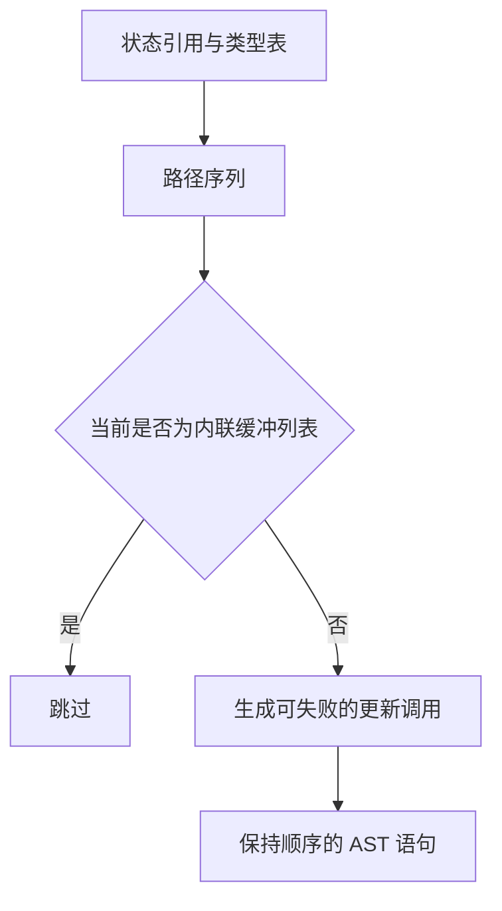

# 循环缓冲区更新自举

## Intent · 目标

由 RX/ZX 批量生成循环和归约进入时的缓冲区更新。宿主提交已有路径计划和当前作用域，接收一次结构化 AST 输出。

## Data · 现状与假设

路径筛选已有 RX/ZX 实现。宿主仍为每条路径检查当前缓冲表示、单独生成更新调用并发布 AST。批量入口可以复用现有路径构造和调用生成，将每次提交的工作量从每条路径一次降为每批一次。

## Edges · 边界

- 更新时仍检查实际作用域中的缓冲表示。嵌套循环的计划作用域和发射作用域可能不同。
- 保留路径顺序、每条路径的捕获与错误行为及是否允许继续增长的标记。归约中的具名累加器在批内共享同一个静态引用。
- 无立即路径时宿主直接返回。所有路径都被跳过时不设置分配器使用标记。初始引导器保留单路径实现。

## Answer · 交付与验收

比对固定输入生成 Zig 和 Source 三阶段产物，运行循环、归约及缓冲区增长的现有回归，再测量生成器和完整冷构建。

### 阶段一致性与生成成本

以上阶段 Source stage3 构建本阶段 stage1，再逐级自编译。三轮各通过 22/22 步，五组共 9,567 个文件逐字节一致。前后两个 Source stage3 处理相同的本阶段输入，主组 8,935 个文件和增长组 422 个文件逐字节一致。

| 同输入三轮交替对照 | 前后墙钟中位数 | 前后 CPU 中位数 |     前后进程峰值 RSS 中位数 |
| ------------------ | -------------: | --------------: | --------------------------: |
| 各自预热函数缓存   |  1.53 → 1.53 s |   5.28 → 5.28 s | 844,414,976 → 844,152,832 B |
| 每轮使用新函数缓存 |  2.05 → 2.06 s |   8.94 → 8.91 s | 907,739,136 → 920,649,728 B |

两端工具本体均由 Source stage2 生成，运行时均启用 Source 分析和生成。空缓存峰值中位数增加 12.91 MB，两端采样区间重叠。本轮未单独测量每批更新的临时分配量。日志及各轮测量保存在本地 `.zig-cache/cold-build-analysis/ownership-research/iteration-entry-renewal/`。

### 完整冷构建

固定 Zig 0.17.0、ReleaseSmall、12 核、四分区、全新 local/global 缓存和同一份本地 Zig 归档。以 Native seed 引导生成工具本体，安装产物启用 Source 分析与生成。构建通过 70/70 步。

| 指标                   |      固定基线 |        上阶段 |        本阶段 |    较上阶段 | 累计较固定基线 |
| ---------------------- | ------------: | ------------: | ------------: | ----------: | -------------: |
| 墙钟 / s               |       129.740 |       116.737 |       117.052 |      +0.315 |        −12.688 |
| CPU / s                |        216.03 |        206.77 |        207.33 |       +0.56 |          −8.70 |
| 进程树采样峰值 RSS / B | 2,247,294,976 | 2,304,688,128 | 2,248,998,912 | −55,689,216 |     +1,703,936 |
| 单进程系统峰值 RSS / B | 2,075,033,600 | 2,127,396,864 | 2,119,270,400 |  −8,126,464 |    +44,236,800 |

分区 0、1 目标文件逐字节一致，分区 2 和 3 分别变化 +18,248 B 和 −1,440 B。两次树峰出现在不同的后端并发阶段，单次采样只反映整棵进程树的测得峰值。日志、采样及对象哈希保存在本地 `.zig-cache/cold-build-analysis/ownership-research/partition-reference/cold-iteration-entry-renewal/`。

### 产物与代码复核

- 两个安装版 CLI 对 65 个既有应用样例生成逐字节一致的 Zig。新增比对覆盖多次追加的路径顺序、嵌套归约和可失败更新。
- 循环列、聚合循环、模块循环、对象归约、多次追加和归约运行时回归通过 403/403 步及 785/785 项 Zig 测试，另外两项归约副作用检查通过。覆盖零步分支、源码与归档路径、失败和分配成本。
- 进入更新和按值更新复用同一发布原子。进入路径在当前发射作用域执行缓冲过滤，实际更新时才标记分配器使用。具名累加器共用静态 AST 引用，不改变运行时求值。
