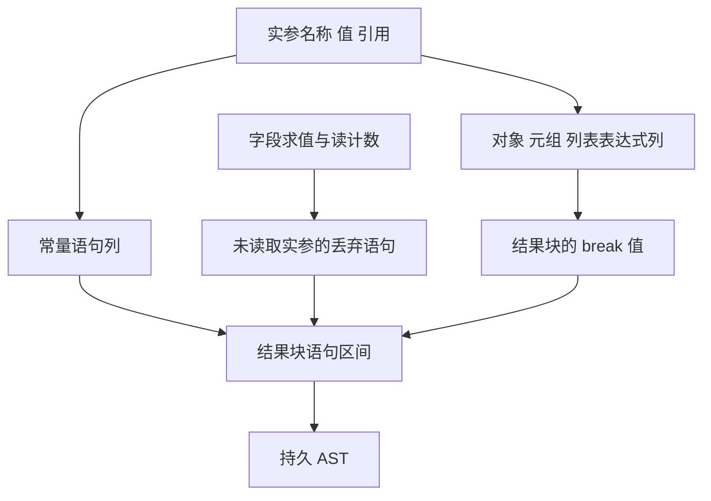

# 循环聚合字面量自举

## Intent · 目标

由 RX 编排缓冲循环内的对象、元组和列表字面量构造及结果块封装。ZX 构造实参引用和语句列，宿主直接将结构化结果写入现有 AST。

## Data · 现状与假设

每个实参现在先写入仅含一条常量语句的临时 Zig 数组，再读回名字和值以准备 ZX 字面量输入。生成器产出的绑定与丢弃语句列随后又被解包为 Zig 语句数组，供宿主发起第二次生成调用封装结果块。直接传递实参引用和语句列应消除两次行列转换，保留持久化 AST 的布局和生成文本。递归收集阶段可使用较小的栈缓冲，生成阶段保留独立的临时空间。

## Edges · 边界

- 对象实参按原顺序求值。求值前保存缓存，写入替换引用前记录读计数，字段处理后按读计数生成丢弃语句，离开对象作用域时恢复缓存。
- 结果块保留表达式及语句的索引顺序、名称序号和可失败列表复制。短期列只在宿主完成写入前借用，嵌套临时切片和块标签保留目标 AST 所需的所有权。
- 正式生成器仍经 Zig 宿主递归读取 IR、更新循环缓存及写入 AST，待其状态模型迁移后移除这些适配。Native seed 保留初始引导路径。

## Answer · 交付与验收

验收现有循环聚合及列表行为、分配失败和 Source 三阶段产物，使用相同输入逐字节比较生成 Zig，并记录受影响的生成器、冷构建和内存成本。

### 阶段一致性与生成成本

上一阶段 Source stage3 构建本阶段 stage1，随后逐级自编译。三轮均通过 22/22 构建步骤，主组、顺序组、集合组、宿主组和增长组的 9,532 个文件逐字节一致。用前后两个 Source stage3 处理同一份本阶段输入，主组 8,903 个文件与增长组 419 个文件也逐字节一致。

| 相同输入的生成器对照         | 前后墙钟中位数 | 前后 CPU 中位数 |     前后进程峰值 RSS 中位数 |
| ---------------------------- | -------------: | --------------: | --------------------------: |
| 各自预热缓存，三轮交替       |  1.51 → 1.51 s |   5.25 → 5.25 s | 853,508,096 → 853,311,488 B |
| 每轮使用新函数缓存，三轮交替 |  2.03 → 2.03 s |   8.89 → 8.88 s | 894,074,880 → 903,561,216 B |

两端工具本体均由 Source stage2 生成，运行时均启用 Source 分析和生成。空缓存峰值中位数增加 9.49 MB，两端三次采样区间重叠。日志和各轮原始数据保存在本地 `.zig-cache/cold-build-analysis/ownership-research/iteration-literal-block/`。

### 完整冷构建

固定 Zig 0.17.0、ReleaseSmall、12 核、四分区、全新 local/global 缓存和同一份本地 Zig 归档。以 Native seed 引导生成工具本体，安装产物启用 Source 分析与生成。构建通过 70/70 步。

| 指标                   |      固定基线 |        上阶段 |        本阶段 |    较上阶段 | 累计较固定基线 |
| ---------------------- | ------------: | ------------: | ------------: | ----------: | -------------: |
| 墙钟 / s               |       129.740 |       116.757 |       116.639 |      −0.118 |        −13.101 |
| CPU / s                |        216.03 |        207.41 |        206.48 |       −0.93 |          −9.55 |
| 进程树采样峰值 RSS / B | 2,247,294,976 | 2,229,747,712 | 2,283,159,552 | +53,411,840 |    +35,864,576 |
| 单进程系统峰值 RSS / B | 2,075,033,600 | 2,127,085,568 | 2,117,697,536 |  −9,388,032 |    +42,663,936 |

进程树峰值出现在三个 LLVM 分区编译进程同时运行时。其中分区 0 和 1 的目标文件与上阶段逐字节一致，峰值快照里的 RSS 仍合计增加 34,045,952 B。分区 2 的目标文件增加 14,320 B，分区 3 减少 12,648 B。单次冷构建无法分离树峰变化中的分区编译开销和进程采样波动。完整日志、进程树采样和对象哈希保存在本地 `.zig-cache/cold-build-analysis/ownership-research/partition-reference/cold-iteration-literal-block/`。

### 产物与代码复核

- 用前后阶段的正式 CLI 生成 40 个现有应用样例的 Zig，逐字节一致。覆盖循环内对象、元组、列表、别名及跨函数借用。
- 现有循环缓冲、迭代调用、嵌套缓冲、聚合循环、缓存所有权、模块化循环、对象和数组求值顺序回归通过 394/394 构建步骤及 670/670 测试，含已有分配失败检查。
- 实参名称与块标签在 AST 所属分配器内各保留一份。字面量表达式中嵌套的非文本切片由目标 AST 接管，常量语句中的名称借用已经持久化的实参名称。
- 递归收集使用 1 KiB 栈缓冲并保留 arena 回退，生成阶段使用独立页大小缓冲。变化可从代码确认，本轮未单独量化单个字面量的分配量。
- 循环内列表修改也复用实参引用，但其选定语句与结果块仍经宿主重建。整体自举仍需完成传递依赖审计及最终阶段链验收。
