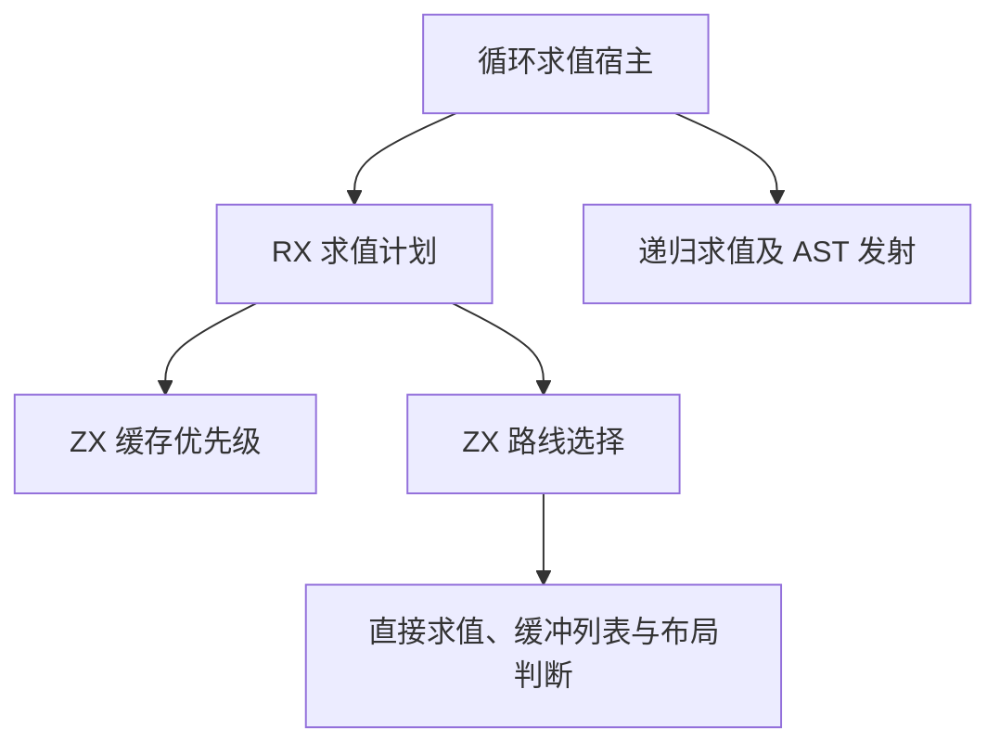

# 循环表达式求值自举

## Intent

将循环布局中表达式的缓存优先级与求值路线迁入 RX 和 ZX，保留常规表达式、借用参数、局部引用、缓冲列表及聚合转换的行为。

## Data

- 旧实现先检查临时调用参数，再读取循环缓存。命中循环缓存会增加读取计数。命中常规缓存时，按目标布局选择普通求值或转换。
- 未命中缓存时，循环作用域内的引用、字段、可空解包、元组投影和作用域有专门入口。缓冲列表按接收者类型选择索引、长度与修改，函数实参须具有已有迭代布局才走借用调用。
- 其余表达式按结果类型选择布局转换或普通求值。这里的类型来自借用的 IR 列，缓存和符号索引沿用已生成的数据结构。

## Edges

- RX 编排缓存探测及类型和表达式路线选择。ZX 复用已有缓存查询、符号索引与布局判断，返回路线和可选缓存值两个标量。
- 计划借用表达式、布局、缓存和符号列，不复制底层存储。宿主仍负责读取计数、标记已用符号、递归求值及 AST 发射。旧规则保留给初始 Zig seed。
- 路线选择发生在执行前。缓存命中时只执行对应读取，未命中时沿既有顺序求值操作数。实参临时替换、缓存恢复与 AST 持久化仍通过宿主适配器。

### 架构

### 数据流

## Answer

验收覆盖连续三阶段自编译、同输入产物逐字节对照、已有循环求值回归以及生成器与冷构建性能。正式编译器的传递依赖仍需继续迁移。

### 自编译与生成器

以上一阶段的 Source stage 3 生成本阶段 stage 1，再依次生成 stage 2 和 stage 3，三轮均为 22/22 步。主组 8,872 个文件、顺序组 23 个、集合组 70 个、增长组 416 个、宿主组 108 个，三阶段逐字节一致。前后工具使用同一份 382 入口清单生成的主组和增长组也完全一致。

前后工具均由 Source 自编译至 stage 3，运行时均使用 Source 分析与生成。空函数缓存每轮重新生成 4,103 个函数，取三轮交替测量的中位数。

| 三轮中位数          | 墙钟秒      | CPU 秒      | 单体峰值 RSS 字节         |
| ------------------- | ----------- | ----------- | ------------------------- |
| 缓存命中，前 → 后   | 1.52 → 1.52 | 5.25 → 5.23 | 849,477,632 → 849,264,640 |
| 空函数缓存，前 → 后 | 2.03 → 2.03 | 8.88 → 8.89 | 899,973,120 → 918,585,344 |

空函数缓存的单体峰值 RSS 中位数增加 18.6 MB。前三轮旧工具峰值分布在 899.6–915.5 MB，新工具为 906.2–926.7 MB。原始计时与产物校验在 `.zig-cache/cold-build-analysis/ownership-research/iteration-evaluation/`。

为检查连续阶段的峰值变化，再将 ABI 投影、投影读取和当前三个 Source stage 3 工具放在同一个已有输出目录，使用同一清单和空函数缓存，三轮轮换运行顺序。三个工具的峰值中位数分别为 901.7、899.5 和 900.2 MB，当前工具相对前一阶段高 0.7 MB，相对 ABI 投影阶段低 1.6 MB。三组的墙钟中位数为 2.03、2.04 和 2.03 秒，CPU 为 8.86、8.89 和 8.87 秒。复测未重现最初的 18.6 MB 中位数差异，九轮产物均逐字节一致。

### 完整冷构建

Zig 0.17.0、ReleaseSmall、12 核、四分区、固定遍历种子 `0x3b41c83f`、本地 Zig 归档。关闭常驻生成器，使用独立空缓存并每 200 毫秒采样进程树。构建中工具本体、分析及生成来自 Zig seed，安装版 CLI 使用 Source。

| 对照                 | 墙钟秒  | CPU 秒 | 进程树峰值字节 | 单体最大 RSS 字节 |
| -------------------- | ------- | ------ | -------------- | ----------------- |
| 固定基线             | 129.740 | 216.03 | 2,247,294,976  | 2,075,033,600     |
| 上一阶段同工作区样本 | 116.677 | 205.87 | 2,283,274,240  | 2,107,637,760     |
| 本阶段样本           | 116.610 | 206.46 | 2,203,664,384  | 2,105,147,392     |

完整冷构建 70/70 步通过。相对上一阶段，墙钟减少 0.07 秒，CPU 增加 0.59 秒，进程树峰值减少 79.6 MB，单体最大 RSS 减少 2.5 MB。相对固定基线，墙钟少 13.13 秒，CPU 少 9.57 秒，进程树峰值低 43.6 MB，单体最大 RSS 高 30.1 MB。

进程树峰值出现在 80.71 秒，LLVM 分区 0、1、2 同时编译。这三个分区的目标对象逐字节一致。分区 3 增加 2,760 字节，在树峰前已退出。日志和对象校验在 `partition-reference/cold-iteration-evaluation/`。

### 回归与自我复核

前后安装版 CLI 禁用缓存生成 22 个已有用例，Zig 文件逐字节一致，覆盖缓冲列表、过期快照、借用参数、聚合别名和循环投影。RX、ZX 通过格式化与 lint，Zig 通过 `zig fmt --check`。

本阶段 Source stage 3 运行 `test-modular-loop`、`test-iterate-buffer`、`test-iterate-calls`、`test-aggregate-loop`、`test-loop-columns`、`test-nested-buffer` 与 `test-value-return`，485/485 步、700/700 项通过。

复核了临时参数优先于两层缓存的顺序。循环缓存命中只增加循环读取计数，常规缓存命中后仍走原有布局转换，保持常规读取计数的来源。路线选择使用零容量分配器。各发射入口沿用旧实现的求值顺序。
