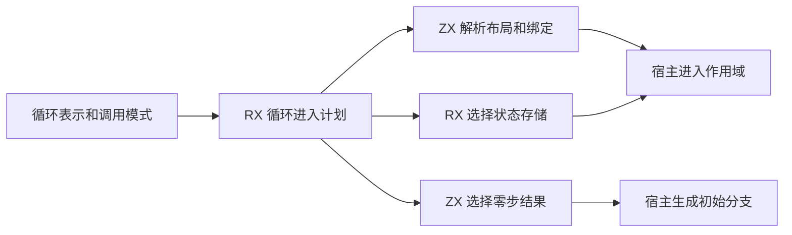
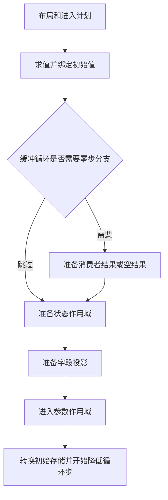

# 循环进入计划自举

## Intent · 目标

由 RX 编排从已选循环表示到初始求值、状态存储和参数作用域的进入计划。ZX 给出声明布局和缓冲循环零步时的结果选择，宿主按计划读写现有上下文。

## Data · 现状与假设

循环表示已在 RX/ZX 中选定，宿主随后仍将同一个表示反复解释成求值标志、参数布局和声明类型。进入计划可以直接消费该表示及调用模式，产出同一套标量事实。状态作用域的进入由选定的存储动作决定，缓冲循环的零步结果由进入计划选择。

## Edges · 边界

- 保留初始值求值、零步检查、进入状态作用域、准备字段、绑定参数和转换初始存储的先后顺序。
- 参数成员检查仍在进入参数作用域时读取实际上下文。字段投影可能在准备期间被拒绝，循环步计划仍读取实际投影结果。
- Native seed 保留引导计划。宿主仍提供递归求值、缓存与符号状态切换及 AST 发布。

## Answer · 交付与验收

核对 Source 三阶段和固定输入的生成 Zig，运行循环初始所有权、零步分支和作用域的现有回归，并测量生成器与完整冷构建成本。

### 阶段一致性与生成成本

以上阶段 Source stage3 构建本阶段 stage1，再逐级自编译。三轮各通过 22/22 步，五组共 9,559 个文件逐字节一致。前后两个 Source stage3 处理相同的本阶段输入，主组 8,927 个文件和增长组 422 个文件逐字节一致。

| 同输入三轮交替对照 | 前后墙钟中位数 | 前后 CPU 中位数 |     前后进程峰值 RSS 中位数 |
| ------------------ | -------------: | --------------: | --------------------------: |
| 各自预热函数缓存   |  1.52 → 1.52 s |   5.27 → 5.27 s | 846,135,296 → 846,594,048 B |
| 每轮使用新函数缓存 |  2.04 → 2.04 s |   8.91 → 8.91 s | 906,592,256 → 896,843,776 B |

两端工具本体均由 Source stage2 生成，运行时均启用 Source 分析和生成。日志及各轮测量保存在本地 `.zig-cache/cold-build-analysis/ownership-research/iteration-entry-plan/`。

### 完整冷构建

固定 Zig 0.17.0、ReleaseSmall、12 核、四分区、全新 local/global 缓存和同一份本地 Zig 归档。以 Native seed 引导生成工具本体，安装产物启用 Source 分析与生成。构建通过 70/70 步。

| 指标                   |      固定基线 |        上阶段 |        本阶段 |    较上阶段 | 累计较固定基线 |
| ---------------------- | ------------: | ------------: | ------------: | ----------: | -------------: |
| 墙钟 / s               |       129.740 |       116.908 |       117.168 |      +0.260 |        −12.572 |
| CPU / s                |        216.03 |        206.50 |        206.84 |       +0.34 |          −9.19 |
| 进程树采样峰值 RSS / B | 2,247,294,976 | 2,265,366,528 | 2,298,593,280 | +33,226,752 |    +51,298,304 |
| 单进程系统峰值 RSS / B | 2,075,033,600 | 2,115,010,560 | 2,123,202,560 |  +8,192,000 |    +48,168,960 |

峰值快照中的三个 LLVM 分区目标文件均逐字节一致，其中分区 1 的快照 RSS 增加 34,947,072 B。唯一变化的分区 3 目标文件增大 200 B。单轮树峰采样无法确定变化的成因。日志、采样及对象哈希保存在本地 `.zig-cache/cold-build-analysis/ownership-research/partition-reference/cold-iteration-entry-plan/`。

### 产物与代码复核

- 两个安装版 CLI 对 57 个既有应用样例生成逐字节一致的 Zig。新增比对涵盖映射与过滤产生的初始列表、局部状态、元组、共享及借用输入。
- 初始所有权、迭代、循环列、聚合循环和模块循环回归通过 334/334 构建步骤、503/503 项 Zig 测试及 5/5 项 CLI 检查。覆盖借用与转移、零步、前置与后置条件、副作用顺序、归档调用及分配失败。
- 进入计划返回标量字段，使用空分配器执行。宿主适配已选表示的枚举，并复用该计划中的参数布局来选择声明类型。初始分支准备和作用域恢复保持原顺序。
