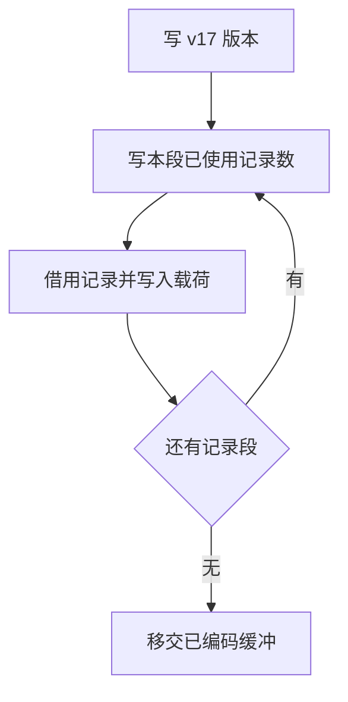

# 所有权磁盘缓存写入自举

## Intent · 目标

把 v17 磁盘 memo 的写入顺序、记录前缀和四类记录编码迁入 RX/ZX。沿用宿主哈希表的遍历顺序和原来的输出缓冲生命周期。

## Data · 证据与假设

旧实现用 Zig 反射遍历每个结构字段，为每个列表项单独写入。缓存由四个记录段组成，按摘要键保存本轮使用的记录。已生成的内存重放编码与磁盘格式不同，磁盘载荷包含用于跨进程重建的完整字段。缓存足够大时，应直接把已有列写入最终输出缓冲，避免为每条记录分配中间数组。

## Edges · 边界

- 保持 v17 格式、已使用记录的筛选、原哈希表迭代顺序和小端编码。部分级别字段只有三位，写入时明确清除填充位。
- 字节数组与小端整数列直接借用，按原格式写入单一输出缓冲。通用字节写入器封装 Zig 标准库。宿主负责哈希表遍历、缓冲所有权和文件 I/O。
- Native seed 保留原有反射编码。Source 的磁盘布局校验已由上一阶段迁移，读取后的类型还原及哈希表发布仍由 Zig 执行。

## Answer · 交付与验收

核对两版生成器对同一真实清单写出的 v17 载荷和生成文件。测量空缓存写入、跨进程编辑及完整冷构建。用带新标准接口的 seed 完成自编译阶段，再核查 Source 生成产物和既有回归。

### 自编译与写入对照

上一版 Source 工具内置的标准目录缺少新写入接口。本阶段由带当前标准目录的 Native seed 引导，stage1 通过 33/33 步，Source stage1 和 Source stage2 分别生成后续两阶段，各通过 22/22 步。stage2 与 stage3 的五组产物共 9,670 个文件逐字节一致。Native seed 生成的 stage1 产物与 stage2 有 1,104 个文件差异。

新标准接口扩展了生成目录中的 ABI 类型表。使用同一份 Source stage2 生成结果链接两个对照工具，仅在临时源码副本中为对照组选择原有 Zig 写入器。两组都运行 Source 分析、生成和磁盘读取。在同一清单上关闭常驻、各舍弃首轮，三轮交替使用空缓存和新输出目录。

| 每次写入完整磁盘 memo   |  Zig 写入器 | RX/ZX 写入器 |        变化 |
| ----------------------- | ----------: | -----------: | ----------: |
| 墙钟中位数 / s          |        2.26 |         2.23 |       −0.03 |
| CPU 中位数 / s          |       10.12 |        10.05 |       −0.07 |
| 进程峰值 RSS 中位数 / B | 917,471,232 |  892,600,320 | −24,870,912 |

两组每次写出的 13,660,162 字节 v17 载荷及 9,036 个生成文件逐字节一致。编辑和撤回也逐项对比了生成文件及磁盘载荷。编辑后的产物匹配空缓存生成。截断真实缓存后，Source 恢复完整载荷并生成一致产物。计时与 RSS 覆盖整次生成，未单独计量写入器的 CPU 或分配量。对照脚本、产物摘要和原始日志位于本地 `.zig-cache/cold-build-analysis/ownership-research/ownership-memo-disk-write/`。

### 完整冷构建

固定 Zig 0.17.0、ReleaseSmall、12 核、四分区、空 local/global 缓存、遍历种子 `0x3b41c83f` 和同一 Zig 归档。关闭常驻。Native seed 引导安装版，安装版运行 Source。构建通过 70/70 步。

| 指标                   |      固定基线 |        上阶段 |        本阶段 |   较上阶段 |  较固定基线 |
| ---------------------- | ------------: | ------------: | ------------: | ---------: | ----------: |
| 墙钟 / s               |       129.740 |       119.206 |       118.283 |     −0.923 |     −11.457 |
| CPU / s                |        216.03 |        207.13 |        207.01 |      −0.12 |       −9.02 |
| 进程树采样峰值 RSS / B | 2,247,294,976 | 2,282,160,128 | 2,274,181,120 | −7,979,008 | +26,886,144 |
| 单进程系统峰值 RSS / B | 2,075,033,600 | 2,115,928,064 | 2,116,141,056 |   +212,992 | +41,107,456 |

进程树峰值出现在分区并行编译期。分区 0、1、2 的目标文件逐字节一致，分区 3 增加 7,440 字节。进程树峰值仍较固定基线高 26.89 MB。冷构建的命令、采样、日志和对象摘要位于本地 `.zig-cache/cold-build-analysis/ownership-research/partition-reference/cold-ownership-memo-disk-write/`。

### 既有应用与回归

- 两个安装版 CLI 为 72 个既有应用生成的 Zig 逐字节一致。
- 函数分析、模块生成和所有权缓存回归通过 112/112 步及 222/222 项 Zig 测试。现有持久缓存、生成运行时和 watch 共 10 项通过。
- 载荷对照覆盖实际清单产生的全部四类记录，未逐个注入分配失败点。临时对照构建和测量探针留在忽略目录。
