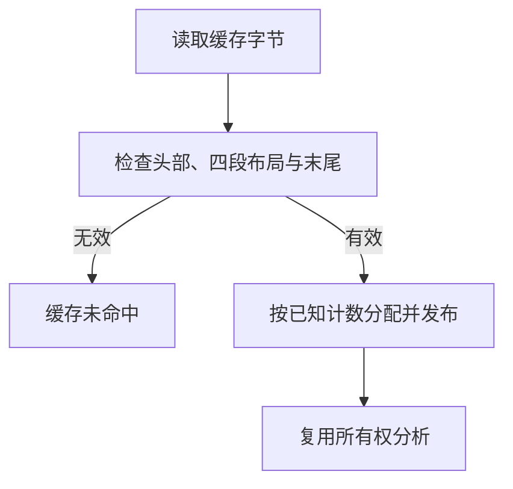

# 所有权磁盘缓存布局自举

## Intent · 目标

将所有权 memo 的磁盘版本、记录段顺序、载荷边界和列约束迁到 RX/ZX。Source 先验证整个记录，再为可用数据分配持久内存。保持 v17 字节布局和缓存失效边界。

## Data · 证据与假设

旧路径读到列表计数就按计数分配，随后逐项读取。在截断时清空映射，但已经分配的 arena 容量要等到 memo 释放。Source 的 renewal 键列供二分检索使用，路径列与键列按索引对应。旧通用读取器没有校验这些约束。

校验使用借用的文件数据和有界的游标，跳过无需解释的连续列。发布阶段可一次复制已校验的单字节列到最终存储，省去原读取器的逐值验证和写入。

## Edges · 边界

- 所有记录通过检查后才按文件中的数量为缓存分配空间。合法的零长度列表、重复摘要键和小端编码沿用既有语义。
- 单字节列保留一次进入最终 arena 的复制，因为文件缓冲由读取者在载入完成时释放。计划的整数列、宿主哈希表发布和 v17 写入仍由 Zig 实现。Native seed 保留原有读取器。
- 外层存储以编译器摘要和记录长度判定失效。正式 Source 构建使用 RX/ZX 规则，输入版本和文件格式保持原样。

## Answer · 交付与验收

比较 Source 三阶段产物与同输入应用产物，检查真实跨进程磁盘缓存的复用和损坏恢复。记录同一工作负载前后的墙钟、CPU、进程峰值 RSS 及完整冷构建的固定基线差异。

### Source 自编译与跨进程磁盘复用

以前一阶段 Source stage3 引导本阶段，stage1、stage2、stage3 各通过 22/22 步。主组、排序组、集合组、宿主组和增长组的 9,627 个文件逐字节一致。对照的两版生成器本体均由各自的 Source stage2 生成，运行均使用 Source 分析和生成。

关闭常驻生成器。每版先在独立目录生成 13,656,420 字节的 memo，再启动新进程、使用原缓存和新输出目录。各舍弃一轮预热，取三轮交替运行的中位数。相同输入的 8,993 个文件跨工具逐字节一致，各轮复用 4,156 个生成单元。

| 跨进程磁盘热生成 |      阶段前 |      阶段后 |     变化 |
| ---------------- | ----------: | ----------: | -------: |
| 墙钟 / s         |        1.76 |        1.78 |    +0.02 |
| CPU / s          |        6.41 |        6.42 |    +0.01 |
| 进程峰值 RSS / B | 851,984,384 | 851,804,160 | −180,224 |

同一处源码编辑在两版工具中均重新生成 3 个单元，输出相同，也匹配编辑后空缓存生成。撤回后恢复原产物。将实际 memo 截掉最后一个字节，同时更新外层存储头的长度，让内层读取器收到截断数据。Source 重建完整 memo，应用产物逐字节一致。生成代码核查覆盖布局入口的值调用路径，校验循环没有分配或复制输入字节。计时覆盖整次生成，未对布局函数单独计时。

### 完整冷构建

固定 Zig 0.17.0、ReleaseSmall、12 核、四分区、空 local/global 缓存、遍历种子 `0x3b41c83f` 和同一 Zig 归档。关闭常驻生成器。工具本体由 Native seed 引导，安装版使用 Source。构建通过 70/70 步。

| 指标                   |      固定基线 |        上阶段 |        本阶段 |    较上阶段 |  较固定基线 |
| ---------------------- | ------------: | ------------: | ------------: | ----------: | ----------: |
| 墙钟 / s               |       129.740 |       118.318 |       119.206 |      +0.888 |     −10.534 |
| CPU / s                |        216.03 |        207.10 |        207.13 |       +0.03 |       −8.90 |
| 进程树采样峰值 RSS / B | 2,247,294,976 | 2,312,192,000 | 2,282,160,128 | −30,031,872 | +34,865,152 |
| 单进程系统峰值 RSS / B | 2,075,033,600 | 2,120,237,056 | 2,115,928,064 |  −4,308,992 | +40,894,464 |

进程树峰值仍在分区并行编译期。分区 0、1、2 目标文件逐字节一致，分区 3 增加 4,760 字节。树峰较上阶段降低，较固定基线仍高 34.87 MB。构建命令、进程采样、时间记录和目标文件摘要存于本地 `.zig-cache/cold-build-analysis/ownership-research/partition-reference/cold-ownership-memo-disk-layout/`。

### 既有应用与回归

- 安装版 CLI 对 72 个既有应用生成的 Zig 逐字节一致。增长组的 424 个文件也在前后工具间一致。
- 函数分析、模块生成和所有权缓存回归通过 112/112 步及 222/222 项 Zig 测试。现有持久缓存、生成运行时和 watch 共 10 项通过。
- 截断探针仅覆盖实际文件的最后一个字节。键序、路径数和其他载荷条件已逐项与 v17 写入形态核对，未对每个错误出口单独注入损坏。日志存于本地 `.zig-cache/cold-build-analysis/ownership-research/ownership-memo-disk-layout/`。
