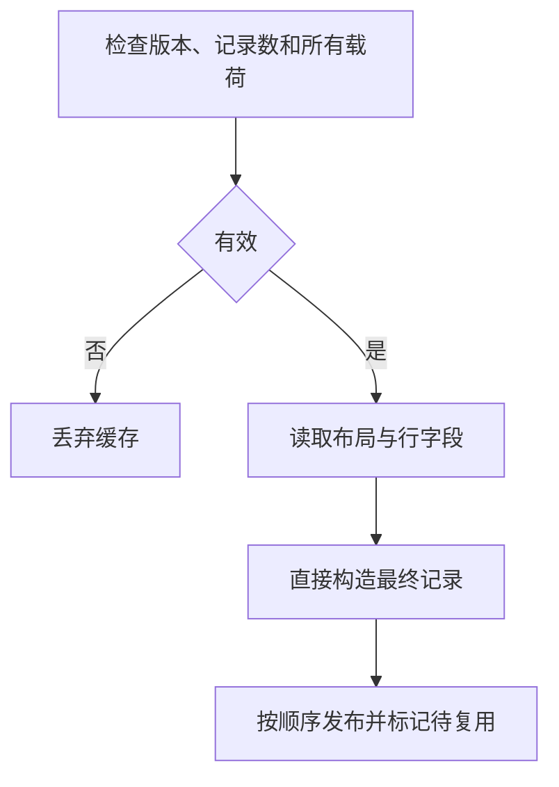

# 所有权磁盘缓存读取自举

## Intent · 目标

将 v17 磁盘 memo 的记录和嵌套行解码迁入 RX/ZX，保留跨进程复用、失败回退和原来的记录生命周期。

## Data · 证据与假设

上一阶段已通过 RX/ZX 验证布局并完成写入。Source 读取在验证之后仍依赖 Zig 按目标结构的字段顺序消费磁盘字节。四类记录可以共用 ZX 的布局描述，将有界字节列和解码后的标量直接送入最终 arena。连续的小端整数列可以整列写入对齐后的宿主存储，减少逐元素读取。

## Edges · 边界

- 完整验证在任何 memo 发布前执行。第二遍使用同一份只读字节和同一 ZX 布局规则，跳过已完成的逐字节级别校验和 renewal 键序检查。
- 宿主只负责为最终值分配、转换机器表示并发布哈希表。连续列从文件缓冲拷贝一次，结构行直接写入目标数组。可变长度的贡献与路径需要重读长度头以定位各条数据。
- 保留 v17 字节格式、原记录顺序、重复摘要键覆盖行为及磁盘失效边界。原生 seed 保留 Zig 编解码。宿主持久哈希表和缓存文件 I/O 仍为自举边界。

## Answer · 交付与验收

检查跨进程磁盘热生成、编辑和撤回的载荷与生成文件，复核截断恢复。对照完整冷构建，并检查同一输入下的 Source 三阶段自编译及既有回归。

### Source 自编译与磁盘热生成

以上一阶段 Source stage3 引导，三个阶段各通过 22/22 步，五组共 9,705 个文件逐字节一致。两版生成器的本体均由各自的 Source stage2 生成，运行均使用 Source 分析和生成。

在同一清单上关闭常驻。每组先生成 13,662,334 字节的磁盘 memo，再交替启动新进程，使用同一缓存和新输出目录。各舍弃一轮预热，取三轮中位数。每轮复用 4,188 个生成单元，9,071 个文件在两版工具间逐字节一致。

| 跨进程磁盘热生成        |      阶段前 |      阶段后 |    变化 |
| ----------------------- | ----------: | ----------: | ------: |
| 墙钟中位数 / s          |        1.78 |        1.78 |    0.00 |
| CPU 中位数 / s          |        6.47 |        6.46 |   −0.01 |
| 进程峰值 RSS 中位数 / B | 858,767,360 | 858,718,208 | −49,152 |

首次生成、编辑和撤回各自的 v17 载荷在前后工具间逐字节一致。编辑时均仅重新生成 3 个单元，产物匹配空缓存生成，撤回后恢复原产物。截断内层载荷并更新外层缓存长度，Source 重建完整 memo，生成文件一致。计时和 RSS 覆盖整次生成，未单独对解码入口计时。原始日志位于本地 `.zig-cache/cold-build-analysis/ownership-research/ownership-memo-disk-decode/`。

### 完整冷构建

固定 Zig 0.17.0、ReleaseSmall、12 核、四分区、空 local/global 缓存、遍历种子 `0x3b41c83f` 和同一 Zig 归档。关闭常驻。Native seed 引导安装版，安装版运行 Source。构建通过 70/70 步。

| 指标                   |      固定基线 |        上阶段 |        本阶段 |    较上阶段 |  较固定基线 |
| ---------------------- | ------------: | ------------: | ------------: | ----------: | ----------: |
| 墙钟 / s               |       129.740 |       118.283 |       118.553 |      +0.270 |     −11.187 |
| CPU / s                |        216.03 |        207.01 |        207.43 |       +0.42 |       −8.60 |
| 进程树采样峰值 RSS / B | 2,247,294,976 | 2,274,181,120 | 2,306,441,216 | +32,260,096 | +59,146,240 |
| 单进程系统峰值 RSS / B | 2,075,033,600 | 2,116,141,056 | 2,117,320,704 |  +1,179,648 | +42,287,104 |

两轮进程树峰值均出现在分区 0、1、2 并行编译时。这三个分区的目标文件逐字节一致，变化的分区 3 增加 5,512 字节，未出现在树峰采样中。解码所处的热生成实测峰值基本持平。冷构建命令、采样、日志和对象摘要位于本地 `.zig-cache/cold-build-analysis/ownership-research/partition-reference/cold-ownership-memo-disk-decode/`。

### 既有应用与回归

- 两个安装版 CLI 为 72 个既有应用生成的 Zig 逐字节一致。
- 函数分析、模块生成及所有权缓存回归通过 112/112 步和 222/222 项 Zig 测试。现有持久缓存、生成运行时及 watch 共 10 项通过。
- 清理本地冷构建缓存时移除了安装版引用的 Zig 归档。按引用路径恢复构建时的归档，核对归档字节后重跑受影响的生成运行时回归，三项通过。
- 截断恢复使用真实载荷，未单独注入各分配失败点。大端转换路径经过源码核对，实测平台为小端。
