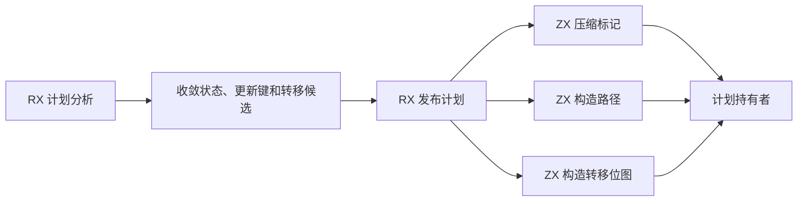
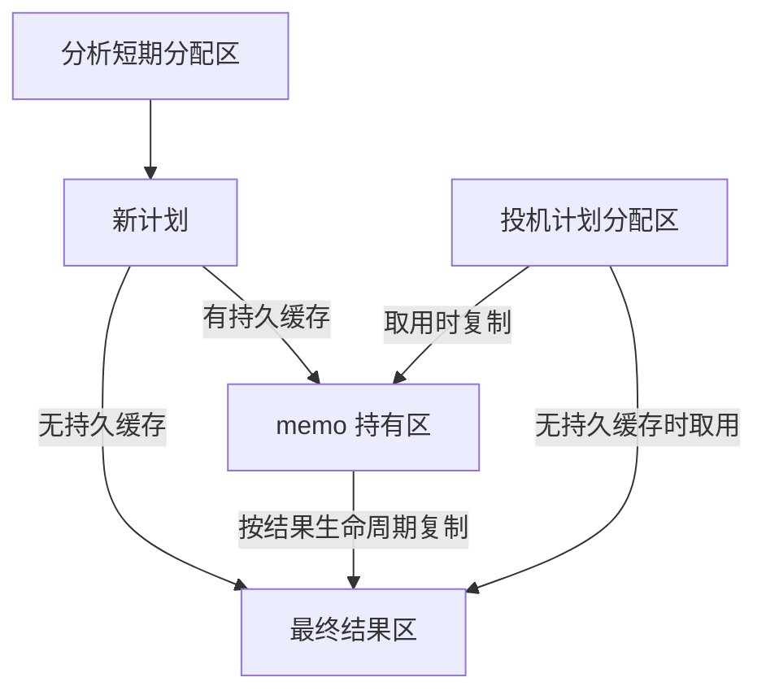

# 所有权计划发布自举

## Intent · 目标

由 RX/ZX 将所有权分析结果构造为可持有的计划。压缩标记、构造更新路径和生成转移位图直接使用计划的分配区。计算事实和查询使用可重用的短期分配区。

## Data · 证据与假设

旧计划先在分析分配区构造路径和转移表，再逐项复制。普通单进程分析还把每份最终计划写入仅在本次分析存活的 memo 并读回，尽管每个函数在收尾时只处理一次。并发创建独占结果时，所有权线程也将完成的计划复制给已有的独占分配区。直接写入已知的持有者可去掉这些中转复制。

## Edges · 边界

- 排序键从短期分析区复制一次。发射路径、标记和位图直接在计划持有区构造。类型表、路径计算输入和槽位表只在同步调用期间借用。
- 持久 memo 拥有新计划，复用和投机分析跨分配区时显式复制。无持久 memo 时，收尾直接构造最终计划，迭代阶段仍可复用结算和需求记录。
- 结果拥有分配区与其他分析线程隔离时，可以由所有权线程直接写入。共享调用方分配区时仍由工作线程独立分配，汇合后复制。
- 初始 Native seed 保留 Zig 计划算法。宿主分配区及缓存生命周期管理仍由 Zig 执行，缓存记录形状和指纹编码保持一致。

## Answer · 交付与验收

核对 Source 三阶段自编译产物、新旧 CLI 的同输入生成结果、既有所有权和缓存回归。按已固定的构建口径对照生成器和完整冷构建，分别记录 CPU、墙钟和峰值内存。

### 阶段一致性与生成性能

以上阶段 Source stage3 构建本阶段 stage1，再逐级自编译。三轮各通过 22/22 步，五组共 9,578 个文件逐字节一致。前后两个 Source stage3 处理相同的本阶段输入，主组 8,944 个文件和增长组 424 个文件逐字节一致。两端工具均由各自的 Source stage2 生成，运行时均启用 Source 分析和生成。

| 同输入三轮交替对照 | 前后墙钟中位数 | 前后 CPU 中位数 |     前后进程峰值 RSS 中位数 |
| ------------------ | -------------: | --------------: | --------------------------: |
| 各自预热函数缓存   |  1.52 → 1.52 s |   5.28 → 5.29 s | 858,292,224 → 855,277,568 B |
| 每轮使用新函数缓存 |  2.12 → 2.05 s |   8.93 → 8.95 s | 906,641,408 → 898,547,712 B |

两种口径的峰值 RSS 中位数分别减少 3.01 和 8.09 MB，空缓存样本区间重叠。单份计划分配量未独立测量，不能从全流程 RSS 推导每份计划的节省。各轮证据保存在本地 `.zig-cache/cold-build-analysis/ownership-research/ownership-plan-publication/`。

### 完整冷构建

固定 Zig 0.17.0、ReleaseSmall、12 核、四分区、全新 local/global 缓存和同一份本地 Zig 归档。以 Native seed 引导生成工具本体，安装版启用 Source 分析和生成。构建通过 70/70 步。

| 指标                   |      固定基线 |    上阶段复测 |        本阶段 | 较上阶段复测 |  较固定基线 |
| ---------------------- | ------------: | ------------: | ------------: | -----------: | ----------: |
| 墙钟 / s               |       129.740 |       117.009 |       116.899 |       −0.110 |     −12.841 |
| CPU / s                |        216.03 |        207.02 |        207.48 |        +0.46 |       −8.55 |
| 进程树采样峰值 RSS / B | 2,247,294,976 | 2,293,137,408 | 2,286,878,720 |   −6,258,688 | +39,583,744 |
| 单进程系统峰值 RSS / B | 2,075,033,600 | 2,123,825,152 | 2,126,954,496 |   +3,129,344 | +51,920,896 |

CPU 较上阶段复测增加 0.22%。以上阶段两轮平均为对照，墙钟减少 0.181 秒，CPU 减少 0.22 秒。本轮与上阶段复测的树峰都发生在分区并行编译期。分区 0、1、3 目标文件逐字节一致，分区 2 增加 480 B。原始日志、采样及哈希保存在本地 `.zig-cache/cold-build-analysis/ownership-research/partition-reference/cold-ownership-plan-publication/`。

### 应用产物与缓存

- 两个安装版 CLI 对 72 个既有应用生成逐字节一致的 Zig，覆盖循环入口、归约、共享、借用和按值更新。
- 安装版通过 8 项既有跨进程缓存检查，覆盖独立进程重用、修改被调函数、禁用缓存、损坏恢复及缓存键互换。应用执行结果随有效修改更新，关闭缓存时已有缓存内容保持一致。
- 函数分析、所有权缓存、模块生成、循环、对象更新和归约的既有回归通过 652/652 步及 1,389/1,389 项 Zig 测试。缓存回归对比缓冲资格变化、恢复原输入及分配失败后的重试结果，源码和归档各一项归约副作用检查也通过。
