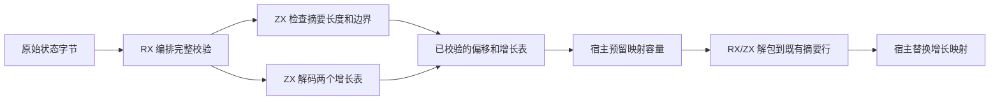
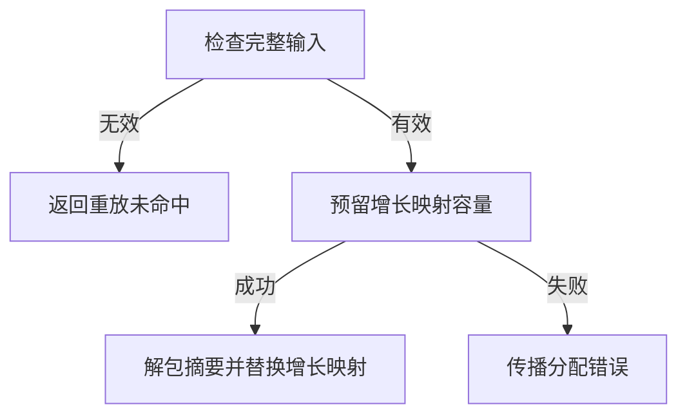

# 所有权重放状态解码自举

## Intent · 目标

由 RX/ZX 解码所有权重放的状态字节，按记录格式恢复函数和被调函数的摘要、增长项及需求。先完成格式检查和容量准备，再发布状态。

## Data · 证据与假设

原生读取器在消费每个字段时立即修改摘要或增长映射，直到末尾才确认输入全部被消费。Source 已经使用 ZX 编码这些状态。复用相同字段宽度、级别编码和标准字节操作，可迁移读取并保留记录格式。摘要字节可以直接解包写入现有行，只有增长项需要暂存以备一次性更新映射。

## Edges · 边界

- 保留小端函数编号、当前输入、被调输出、两个增长表及需求段顺序。摘要按每字节两个三位级别恢复，保留原有高位截断规则。增长表保留重复键以最后一项为准的语义。
- 摘要检查只走过行头和跨度。发布时借用相同的状态字节与摘要行，写入过程使用空分配器。增长项暂存在单次恢复作用域的分配区，正常小记录可用栈内缓冲。
- 无效记录及容量预留失败发生在发布之前。Zig 宿主负责存储借用与哈希表提交，初始 Native seed 保留原生解码器。磁盘 memo 外层格式、写入和载入仍是独立的 Zig 迁移边界。

## Answer · 交付与验收

核对 Source 三阶段自编译及既有应用的生成 Zig。用常驻生成器对照修改和撤回的产物，运行现有缓存、watch 和所有权回归。对照同输入生成器及完整冷构建的墙钟、CPU 和峰值内存。

### 自编译与常驻重放

以上一阶段 Source stage3 为入口逐级自编译，三轮各通过 22/22 步，五组共 9,604 个文件逐字节一致。两版 Source stage3 均由各自的 Source stage2 生成，运行时使用 Source 分析与生成。

在独立源码副本上交替运行三轮常驻原版、修改和撤回。每轮使用新常驻进程及新缓存。原版、修改版和撤回版各有 8,970 个文件在前后两端一致。新工具的原版和修改版也分别匹配独立空缓存生成，撤回后恢复原版。

| 常驻请求三轮中位数 |        前后墙钟 |      前后 CPU |                前后请求结束 RSS |
| ------------------ | --------------: | ------------: | ------------------------------: |
| 第一次生成         | 2.102 → 2.102 s | 9.51 → 9.48 s |     852,082,688 → 851,738,624 B |
| 修改标记常量       | 0.793 → 0.780 s | 2.03 → 2.02 s | 1,243,824,128 → 1,243,103,232 B |
| 撤回修改           | 0.740 → 0.741 s | 1.93 → 1.93 s | 1,369,112,576 → 1,367,883,776 B |

常驻测量覆盖整次请求，RSS 取请求结束时的进程采样。未单独采样解码函数或增长表的分配量。原始证据位于本地 `.zig-cache/cold-build-analysis/ownership-research/ownership-state-decode/`。

关闭常驻后，两版工具对同一份清单生成的主组 8,970 个文件和增长组 424 个文件也逐字节一致。

| 独立生成三轮中位数 |      前后墙钟 |      前后 CPU |            前后进程峰值 RSS |
| ------------------ | ------------: | ------------: | --------------------------: |
| 预热函数缓存       | 1.53 → 1.53 s | 5.30 → 5.29 s | 846,118,912 → 846,905,344 B |
| 每轮新函数缓存     | 2.05 → 2.06 s | 8.94 → 8.94 s | 917,733,376 → 906,526,720 B |

### 完整冷构建

固定 Zig 0.17.0、ReleaseSmall、12 核、四分区、空 local/global 缓存、遍历种子 `0x3b41c83f` 和同一份 Zig 归档。关闭常驻生成器，Native seed 引导生成工具本体，安装版使用 Source。构建通过 70/70 步。

| 指标                   |      固定基线 |  上阶段确认轮 |        本阶段 |    较上阶段 |  较固定基线 |
| ---------------------- | ------------: | ------------: | ------------: | ----------: | ----------: |
| 墙钟 / s               |       129.740 |       118.109 |       118.318 |      +0.209 |     −11.422 |
| CPU / s                |        216.03 |        207.48 |        207.10 |       −0.38 |       −8.93 |
| 进程树采样峰值 RSS / B | 2,247,294,976 | 2,288,369,664 | 2,312,192,000 | +23,822,336 | +64,897,024 |
| 单进程系统峰值 RSS / B | 2,075,033,600 | 2,114,256,896 | 2,120,237,056 |  +5,980,160 | +45,203,456 |

两次进程树峰值均位于分区并行编译期。本轮树峰较上阶段三轮的最高采样值高 2.36 MB，单进程峰值处于上阶段三轮范围内。分区 0、1、2 目标文件一致，分区 3 增加 4,152 B。原始命令、采样、日志及对象哈希存于本地 `.zig-cache/cold-build-analysis/ownership-research/partition-reference/cold-ownership-state-decode/`。

### 应用产物与边界核查

- 两个安装版 CLI 对 72 个既有应用的生成 Zig 逐字节一致。
- 8 项跨进程缓存和 2 项 watch 检查通过，覆盖编辑、缓存损坏恢复、旧产物保护及库消费。
- 函数分析、模块生成和所有权缓存回归通过 112/112 步及 222/222 项 Zig 测试，覆盖缓存复用、缓冲资格变化、撤回与分配失败重试。
- 格式校验检查函数编号、每行长度、字节跨度、增长级别和输入末尾。检查和容量预留均位于摘要写入与增长映射替换之前。未单独构造损坏的进程内重放记录，磁盘缓存损坏恢复由既有回归覆盖。
