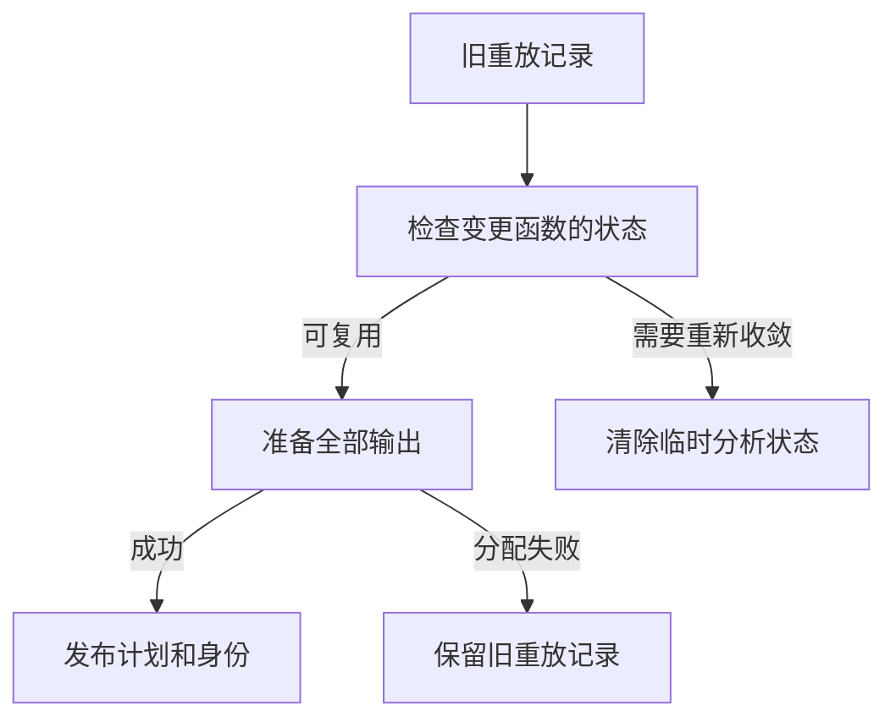

# 所有权重放记录自举

## Intent · 目标

由 RX/ZX 构造所有权重放的访问索引，保留每个函数的访问顺序。持久重放在输出准备成功后发布完整记录，无持久缓存的分析只保留收敛所需的 memo。

## Data · 证据与假设

原先每轮收敛都会收集访问历史，包括没有持久缓存的构建。有缓存时，新访问的状态字节先复制到分析区，再复制到重放记录的持有区。重放快路径会在分配输出的同时修改旧计划，分配失败时可能让旧身份指向新计划。

把状态字节直接写入新记录的分配区可省掉中转复制。访问索引与现有所有权使用位置索引共享分组实现。通过计数、前缀累加和反向放置生成稳定顺序，可以直接将末端位置变为起始位置。

## Edges · 边界

- 持久重放的状态字节从当前键或上一份记录复制一次，新记录成功后接管分配区。异构 memo 值的载入、组装和生命周期仍由 Zig 宿主管理。
- 同一函数的访问维持原顺序，空分组保留起始位置。稳定分组临时空间在各类访问之间复用，返回记录仅持有需要长期使用的起始位置和值。
- 重放快路径只保存变更项。复制全部输出之后才替换旧计划和函数身份。回退收敛前清除重放暂时写入的需求和增长记录。
- Native seed 保留普通 Zig 的分组算法，Source 由 RX/ZX 构造索引。磁盘 memo 格式不受影响，访问历史仍只在进程内使用。

## Answer · 交付与验收

用三阶段自编译、同输入生成 Zig、现有所有权及缓存回归验证稳定顺序和生命周期。观察已有 watch 测试中的进程内编辑和恢复，再对照热生成、空函数缓存和固定口径的完整冷构建。

### 阶段一致性与生成性能

以上阶段 Source stage3 为入口逐级自编译，三轮各通过 22/22 步，五组共 9,585 个文件逐字节一致。前后两个 Source stage3 处理本阶段同一份输入，主组 8,951 个文件和增长组 424 个文件逐字节一致。两端工具均由各自的 Source stage2 生成，运行时均启用 Source 分析与生成。

| 同输入三轮交替对照 | 前后墙钟中位数 | 前后 CPU 中位数 |     前后进程峰值 RSS 中位数 |
| ------------------ | -------------: | --------------: | --------------------------: |
| 各自预热函数缓存   |  1.52 → 1.52 s |   5.25 → 5.27 s | 844,627,968 → 847,642,624 B |
| 每轮使用新函数缓存 |  2.04 → 2.06 s |   8.90 → 8.94 s | 901,971,968 → 899,907,584 B |

两种口径的进程峰值 RSS 中位数分别增加 3.01 MB 和减少 2.06 MB。热样本中三个复测值都略高，空缓存样本区间重叠。重放状态字节和分组临时空间未独立测量。各轮证据存于本地 `.zig-cache/cold-build-analysis/ownership-research/ownership-trace-publication/`。

### 完整冷构建

固定 Zig 0.17.0、ReleaseSmall、12 核、四分区、空 local/global 缓存、遍历种子 `0x3b41c83f` 和同一份 Zig 归档。关闭常驻生成器，Native seed 引导生成工具本体，安装版使用 Source。四次构建各通过 70/70 步。上一提交的复测从 `06b3ea5b` 的源码快照启动，工作目录不同，复测的四个分区目标文件与原始基线逐字节一致。

| 指标 | 固定基线 | 上阶段原测 | 上阶段快照复测 | 本阶段首轮 | 本阶段复测 | 本阶段确认轮 | 本阶段中位数 |
| --- | ---: | ---: | ---: | ---: | ---: | ---: | ---: | ---: |
| 墙钟 / s | 129.740 | 116.899 | 118.257 | 121.947 | 117.554 | 118.109 | 118.109 |
| CPU / s | 216.03 | 207.48 | 206.99 | 210.06 | 207.46 | 207.48 | 207.48 |
| 进程树采样峰值 RSS / B | 2,247,294,976 | 2,286,878,720 | 2,306,867,200 | 2,309,832,704 | 2,253,144,064 | 2,288,369,664 | 2,288,369,664 |
| 单进程系统峰值 RSS / B | 2,075,033,600 | 2,126,954,496 | 2,126,397,440 | 2,118,189,056 | 2,123,120,640 | 2,114,256,896 | 2,118,189,056 |

首轮较上一阶段原测多 5.05 秒，其中 `zxc_host` 的编译区间多 4.84 秒。相同源码的后两轮该区间为 32.22、32.24 秒，上阶段原测为 32.38 秒。本阶段三轮的四个分区目标文件各自一致。确认轮与原测的墙钟差主要出现在改动代码开始编译前。

与上一提交快照复测相比，本阶段中位数墙钟减少 0.148 秒，CPU 增加 0.49 秒（0.24%），进程树峰值减少 18.50 MB。与固定基线相比，墙钟和 CPU 分别减少 11.631 秒和 8.55 秒，进程树峰值增加 41.07 MB。命令、日志、采样及对象哈希位于本地 `.zig-cache/cold-build-analysis/ownership-research/partition-reference/cold-ownership-trace-*`。

### 重放与应用产物

- 在现有主生成清单的独立源码副本上，向同一个常驻生成器提交原版、修改标记常量和撤回三次请求。原版与修改版的 8,951 个文件均分别匹配独立空缓存生成，撤回后与原版逐字节一致。修改时重用 4,136 个模块并重新生成 3 个产物，撤回时重用全部 4,137 个生成产物。
- 两个安装版 CLI 对 72 个既有应用样例生成逐字节一致的 Zig。
- 8 项跨进程缓存和 2 项 watch 回归通过，覆盖跨进程重用、缓存损坏恢复、编辑后重建、旧产物保护和库消费。
- 所有权、函数分析、循环、归约和模块生成回归通过 652/652 步及 1,389/1,389 项 Zig 测试，源码和归档各一项归约副作用检查也通过。
- 快路径中的实际计划替换和身份写入均位于全部可能失败的输出复制之后。现有缓存回归覆盖输出分配失败和重试，未对常驻快路径的最后一次分配单独注入失败。
