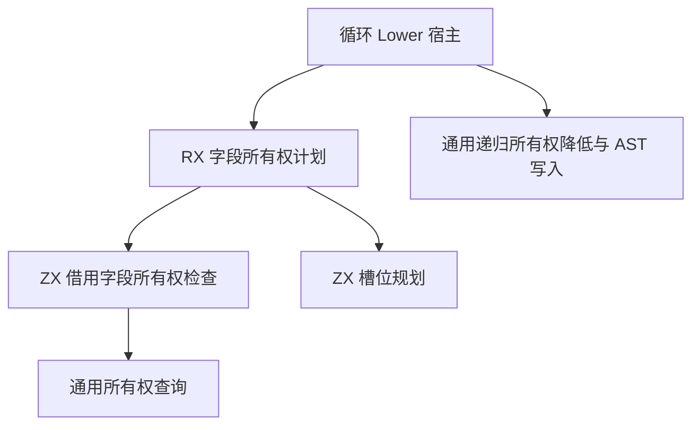

# 投影循环字段所有权自举

## Intent

将投影循环进入时的借用字段屏蔽与步进写回时的所有权槽位选择迁入 RX 和 ZX，保持生成代码和循环运行行为一致。

## Data

- 旧实现只在借用字段至少有一个携带所有权时重建初始对象。重建时处理所有借用字段，其他字段保持原值。
- 步进写回只重新限定非借用字段。槽位从零开始，每个字段都按其类型占用的槽数推进偏移，包括借用字段。
- 零次迭代分支保留原始种子。重建后的字段顺序、来源字段和递归降低顺序沿用旧实现。

## Edges

- RX 使用模块的入口参数选择屏蔽或写回，并在无需屏蔽时直接返回。ZX 复用已有的递归所有权查询，随后计算各字段是否转换及其槽位。
- 类型列、所有权事实和借用列直接借用宿主现有数据。槽位计划与重建字段缓冲使用短生命周期的栈优先分配器。写入 AST 时只保留节点 ID 与有独立生命周期的字段名。
- Source 正式路径仍通过 Zig 宿主依次调用通用字段投影、递归所有权降低与 AST 写入。宿主暂时持有可变 Lower、语句列表及名称分配上下文。将这些状态与递归调用接口迁入 RX/ZX 后才可移除此适配器。旧规则仅用于初始 Zig seed。

### 架构

### 数据流

## Answer

阶段验收包括连续三阶段 Source 自编译、同输入生成产物逐字节对照、已有投影循环回归以及生成器和冷构建的性能检查。完整自举仍须审核正式入口的传递依赖。

### 自编译和生成器

上一阶段的 Source stage 3 生成本阶段 stage 1，随后由本阶段工具连续生成 stage 2 和 stage 3。三轮均为 22/22 步。主组 8,843 个文件、顺序组 23 个、集合组 70 个、增长组 416 个、宿主组 108 个，逐字节一致。前后工具使用同一份 380 入口清单执行，主组和增长组产物也完全一致。

前后工具均由 Source 自编译至 stage 3，均使用 Source 分析与生成。三轮交替执行，空函数缓存每轮重新生成 4,091 个函数。

| 三轮中位数          | 墙钟秒      | CPU 秒      | 单体峰值 RSS 字节         |
| ------------------- | ----------- | ----------- | ------------------------- |
| 缓存命中，前 → 后   | 1.50 → 1.50 | 5.22 → 5.20 | 836,747,264 → 837,025,792 |
| 空函数缓存，前 → 后 | 2.01 → 2.02 | 8.83 → 8.85 | 887,373,824 → 917,372,928 |

空函数缓存的单体峰值中位数增加 30.0 MB。新工具的三轮采样范围为 887.6–920.9 MB。原始计时、峰值和产物校验记录在 `.zig-cache/cold-build-analysis/ownership-research/loop-field-ownership/`。

针对峰值额外以空函数缓存和空输出目录做了两轮交替检查，旧工具的两次峰值为 886.9 MB、916.5 MB，新工具为 918.8 MB、903.2 MB。两组采样范围重叠，复测产物与原始对照逐字节一致。该场景的输出目录状态与前三轮不同，计时保留在独立日志。

### 完整冷构建

Zig 0.17.0、ReleaseSmall、12 核、四分区、固定遍历种子 `0x3b41c83f`、本地 Zig 归档。关闭常驻生成器，独立空缓存，每 200 毫秒采样进程树。构建过程由 Zig seed 生成工具并执行 seed 分析与生成。安装版 CLI 使用 Source。

| 对照                 | 墙钟秒  | CPU 秒 | 进程树峰值字节 | 单体最大 RSS 字节 |
| -------------------- | ------- | ------ | -------------- | ----------------- |
| 固定基线             | 129.740 | 216.03 | 2,247,294,976  | 2,075,033,600     |
| 上一阶段同工作区样本 | 117.233 | 206.47 | 2,291,990,528  | 2,116,632,576     |
| 本阶段样本           | 116.923 | 206.26 | 2,254,209,024  | 2,099,888,128     |

完整冷构建 70/70 步通过。相对上一阶段，墙钟减少 0.31 秒，CPU 减少 0.21 秒，树峰值减少 37.8 MB，单体最大 RSS 减少 16.7 MB。相对固定基线，墙钟少 12.82 秒，CPU 少 9.77 秒，树峰值高 6.9 MB，单体最大 RSS 高 24.9 MB。

进程树峰值出现在 62.75 秒，四个 LLVM 分区编译与 RX 测试编译重叠。分区 0、1、2 的对象逐字节相同，分区 3 的对象增加 1,176 字节。构建日志和对象校验在 `partition-reference/cold-loop-field-ownership/`。

### 回归与自我复核

前后安装版 CLI 禁用缓存编译 12 个已有用例，生成的 Zig 源码逐字节一致。嵌套缓冲对象用例的输出实际包含借用字段屏蔽、投影布局与保留原种子的零次迭代分支。RX、ZX 通过格式化与 lint 检查，Zig 通过 `zig fmt --check`。

使用本阶段 Source stage 3 运行 `test-modular-loop`、`test-loop-columns`、`test-aggregate-loop`、`test-nested-buffer` 和 `test-value-return`，341/341 步、515/515 项通过。

已检查生成的屏蔽短路路径和槽位循环。无屏蔽时返回空切片，槽位循环复用列表增长存储，逐项写入可选槽位。宿主以借用列传入事实，字段缓冲写入 AST 列后释放。空函数缓存生成的 RSS 增幅仍缺少归因。
