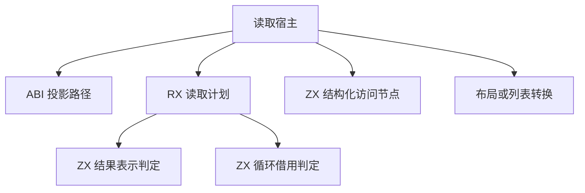
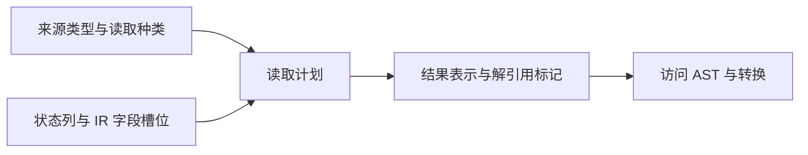

# 投影读取自举

## Intent

完成字段、元组与列表索引的结果规划，迁移投影循环读取借用字段时的解引用判定与 AST 发射，保持原有所有权、索引错误边界和求值顺序。

## Data

- ABI 路径先选择数据来源，读取结果随后决定直接返回、借用列表、值布局转换或列表元素转换。
- 投影循环的状态表达式列只标记与布局使用相同类型的表达式，IR 已保存字段槽位。由此可直接读取借用列，省去按字段名扫描。
- 旧实现先发射字段节点，再独立发射解引用节点。借用读取可一次追加这两个连续节点，保持节点编号、字段名和引用关系。

## Edges

- RX 在结果转换计划中显式检查是否存在投影循环字段上下文。ZX 复用结果表示判定，按状态表达式与字段槽位读取借用标记。直接读取及普通索引沿用既有发射原语。
- 计划借用类型及循环字段列，返回两个标量。借用读取发射器使用短生命周期栈缓冲写入 AST，普通字段读取不经过双节点发射器。
- 宿主仍递归求值接收者与索引，执行计划所指定的列表和布局转换，并持有 AST。后续需迁移这些状态与调用接口，才能移除适配器。Zig seed 保留原来的字段名扫描及逐节点发射。

### 架构

### 数据流

## Answer

验收覆盖三阶段自编译、同输入产物对照、已有字段与索引回归、生成器成本和完整冷构建。编译器自举的传递依赖审计继续进行。

### 自编译与生成器

使用上一阶段的 Source stage 3 生成当前 stage 1，再连续生成 stage 2 和 stage 3。三轮均为 22/22 步。主组 8,857 个文件、顺序组 23 个、集合组 70 个、增长组 416 个、宿主组 108 个，三阶段逐字节一致。前后工具同用一份 381 入口清单生成的主组和增长组也逐字节一致。

前后工具本体均由 Source 自编译至 stage 3，运行时均使用 Source 分析与生成。三轮交替测量，空函数缓存每轮重新生成 4,097 个函数。

| 三轮中位数          | 墙钟秒      | CPU 秒      | 单体峰值 RSS 字节         |
| ------------------- | ----------- | ----------- | ------------------------- |
| 缓存命中，前 → 后   | 1.50 → 1.50 | 5.21 → 5.22 | 834,797,568 → 835,387,392 |
| 空函数缓存，前 → 后 | 2.02 → 2.02 | 8.83 → 8.85 | 887,898,112 → 903,315,456 |

空函数缓存的单体峰值 RSS 中位数增加 15.4 MB。三轮前后峰值分别分布在 887.6–901.3 MB 与 887.9–913.2 MB，增幅尚未归因。计时与产物校验在 `.zig-cache/cold-build-analysis/ownership-research/projection-read/`。

### 完整冷构建

Zig 0.17.0、ReleaseSmall、12 核、四分区、固定遍历种子 `0x3b41c83f`、本地 Zig 归档。关闭常驻生成器，使用独立空缓存并每 200 毫秒采样进程树。构建中工具本体和分析、生成路径均来自 Zig seed，安装版 CLI 使用 Source。

| 对照                 | 墙钟秒  | CPU 秒 | 进程树峰值字节 | 单体最大 RSS 字节 |
| -------------------- | ------- | ------ | -------------- | ----------------- |
| 固定基线             | 129.740 | 216.03 | 2,247,294,976  | 2,075,033,600     |
| 上一阶段同工作区样本 | 116.630 | 206.22 | 2,251,161,600  | 2,108,096,512     |
| 本阶段样本           | 116.677 | 205.87 | 2,283,274,240  | 2,107,637,760     |

完整冷构建 70/70 步通过。相对上一阶段，墙钟增加 0.05 秒，CPU 减少 0.35 秒，树峰值增加 32.1 MB，单体最大 RSS 减少 0.5 MB。相对固定基线，墙钟少 13.06 秒，CPU 少 10.16 秒，树峰值高 36.0 MB，单体最大 RSS 高 32.6 MB。

本次树峰出现在 80.67 秒，由 LLVM 分区 0、1、2 同时编译形成。这三个分区的目标对象与上一阶段逐字节一致。唯一变动的分区 3 增加 744 字节，在峰值出现前已退出。上一阶段的树峰发生在 62.73 秒，四个分区与 RX 测试编译重叠。日志与对象校验在 `partition-reference/cold-projection-read/`。

### 回归与自我复核

前后安装版 CLI 禁用缓存生成 14 个已有用例，Zig 源码逐字节一致。嵌套缓冲对象用例包含投影循环对借用字段的实际解引用，另有字段、元组、索引边界与缓存所有权用例。RX、ZX 通过格式化与 lint，Zig 通过 `zig fmt --check`。

使用本阶段 Source stage 3 运行 `test-object-evaluation-order`、`test-array-evaluation-order`、`test-loop-columns`、`test-nested-buffer`、`test-aggregate-loop`、`test-cached-ownership` 与 `test-value-return`，348/348 步、602/602 项通过。

已核对借用字段索引与状态类型相同的来源约束。状态列先检查目标表达式，只有投影状态才访问借用列。借用读取保留两个节点的编号和顺序，合并 AST 列提交。读取计划使用零容量分配器，已有行为验证覆盖该入口。
