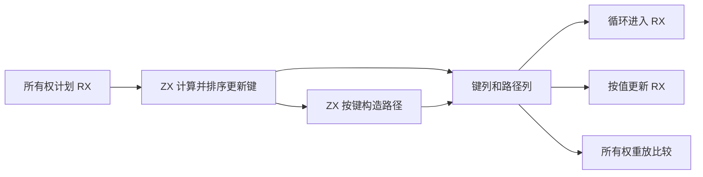
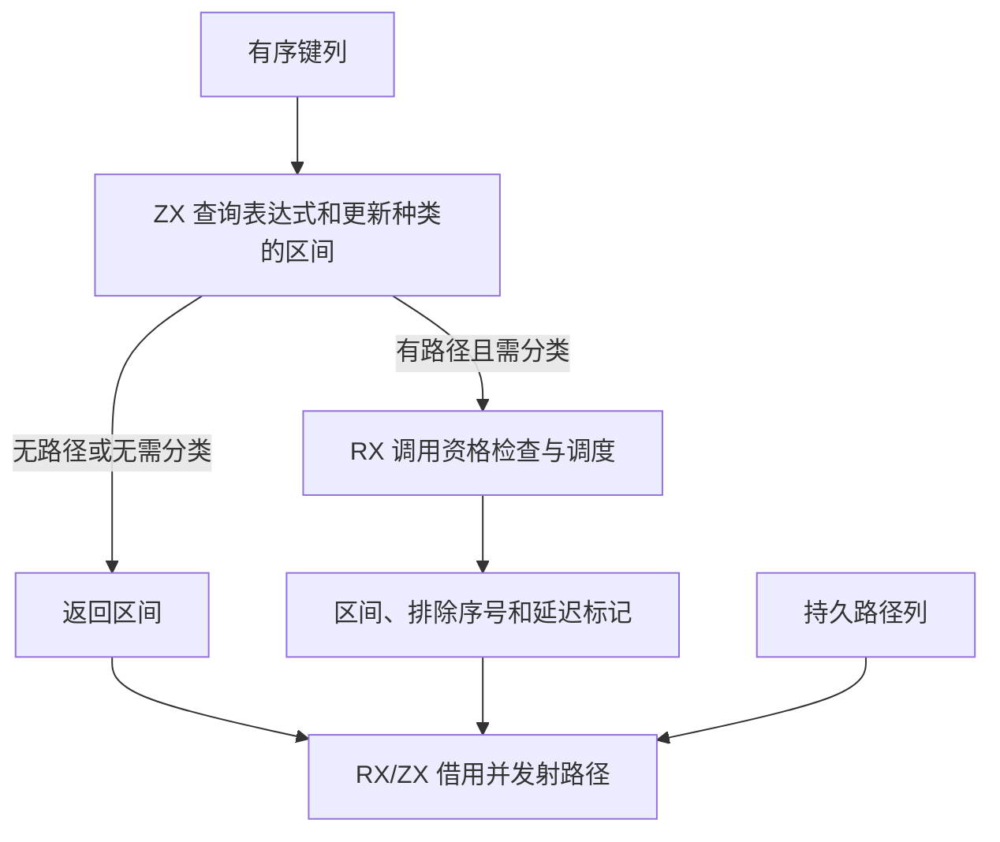

# 更新记录区间自举

## Intent · 目标

由 RX/ZX 生成、查询和消费同一份有序所有权更新计划。循环进入和按值更新直接借用对应路径区间，保留更新顺序和当前缓冲区作用域语义。

## Data · 证据与假设

旧 Source 计划已经将表达式编号、更新种类和成员位置打包排序，但输出行对象前丢弃了排序键。循环计划每次调用都从所有行构造临时指针列表，再顺序筛选并构造路径描述符数组。按值更新也遍历所有行。保留键列并共享路径列，可将查询改为二分查找，只遍历命中区间，计划和发射之间仅保存区间与被排除的序号。

## Edges · 边界

- 有序列由同一 Source 计划生成，内存 memo 和函数计划复制保留顺序，重放仍按表达式、更新种类和成员路径判断相等。
- 目标后端指纹继续按记录数、表达式编号、路径和更新种类写入，保留既有缓存键编码。
- 只有实际需要时才检查延迟资格。被延迟或计划时已内联缓冲的路径保留排除序号，发射仍检查发射时的缓冲作用域。区间非空继续决定循环状态声明的可变性。
- 路径内容由函数的所有权计划持有。资格检查使用短期 arena，排除序号跨循环步骤发射借用调用方临时存储。
- 初始 Native seed 保留原行记录和顺序扫描。Source 仍依赖 Zig 宿主管理计划、缓存和 AST 存储的生命周期。

## Answer · 交付与验收

固定输入核对 Source 三阶段自编译和新旧 CLI 生成结果，运行循环、归约、值更新和所有权重放现有回归。对照主生成、增长生成和完整冷构建，记录阶段及固定基线差异。

### 阶段一致性与生成性能

以上阶段 Source stage3 为入口逐级构建本阶段 stage1、stage2 和 stage3，各通过 22/22 步。五组共 9,571 个文件在三阶段逐字节一致。前后两个 Source stage3 处理本阶段同一份输入，主组 8,937 个文件和增长组 424 个文件逐字节一致。

| 同输入三轮交替对照 | 前后墙钟中位数 | 前后 CPU 中位数 |     前后进程峰值 RSS 中位数 |
| ------------------ | -------------: | --------------: | --------------------------: |
| 各自预热函数缓存   |  1.52 → 1.52 s |   5.28 → 5.28 s | 855,375,872 → 858,193,920 B |
| 每轮使用新函数缓存 |  2.04 → 2.07 s |   8.91 → 8.92 s | 887,996,416 → 885,522,432 B |

两端工具本体均由 Source stage2 生成，运行时均启用 Source 分析与生成。热生成进程峰值 RSS 中位数增加 2.82 MB，空缓存轮次两端区间重叠。单次循环调度的临时分配量未独立测量。各轮原始证据存于本地 `.zig-cache/cold-build-analysis/ownership-research/renewal-owner-range/`。

### 完整冷构建

固定 Zig 0.17.0、ReleaseSmall、12 核、四分区、全新 local/global 缓存和同一份本地 Zig 归档。以 Native seed 引导生成工具本体，安装产物启用 Source 分析与生成。两次构建均通过 70/70 步，四个分区目标文件在两轮构建中逐字节一致。

| 指标                   |      固定基线 |        上阶段 |    本阶段首轮 |    本阶段复测 |
| ---------------------- | ------------: | ------------: | ------------: | ------------: |
| 墙钟 / s               |       129.740 |       117.052 |       117.151 |       117.009 |
| CPU / s                |        216.03 |        207.33 |        208.38 |        207.02 |
| 进程树采样峰值 RSS / B | 2,247,294,976 | 2,248,998,912 | 2,296,233,984 | 2,293,137,408 |
| 单进程系统峰值 RSS / B | 2,075,033,600 | 2,119,270,400 | 2,130,165,760 | 2,123,825,152 |

首轮 CPU 增加 1.05 秒，复测减少 0.31 秒。两轮平均墙钟为 117.080 秒、CPU 为 207.70 秒，较上阶段分别增加 0.028 和 0.37 秒，较固定基线分别减少 12.660 和 8.33 秒。两轮进程树采样峰值较上阶段增加 44.14～47.24 MB，较固定基线增加 45.84～48.94 MB，均出现在分区并行编译期。单进程系统峰值较上阶段增加 4.55～10.90 MB。原始日志、采样及目标文件哈希保存在 `partition-reference/cold-renewal-owner-range/` 和 `partition-reference/cold-renewal-owner-range-repeat/`。

### 应用产物与回归

- 两个安装版 CLI 对 72 个既有应用样例生成逐字节一致的 Zig。本阶段增加比对索引读取、覆盖、字段选择、缓存调用及共享、借用、重复循环入口。
- 既有循环、归约、对象和多路径更新、函数分析、所有权缓存与模块生成回归通过 652/652 步及 1,389/1,389 项 Zig 测试。源码和归档各一项归约副作用检查也通过。
- 检查生成类型确认键列和路径列借用标量切片及路径切片。宿主传递区间时不生成记录指针数组。变更已覆盖缓存计划的比较和目标指纹，跨不同拥有者的计划复制仍保留。
