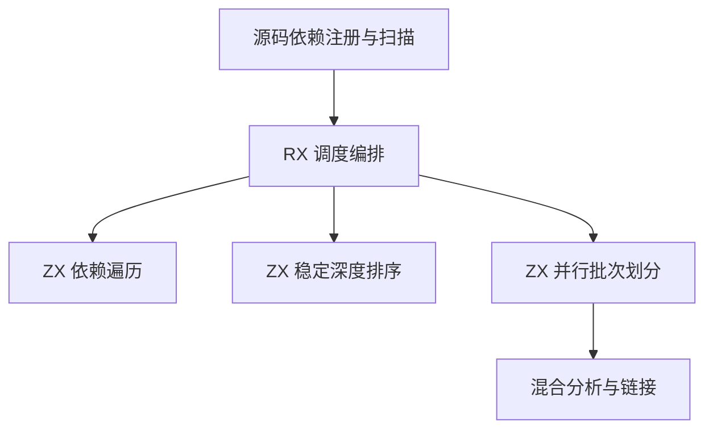

# 混合项目依赖调度自举

## Intent · 意图

将混合 RX、ZX、Store 项目的依赖排序、环定位和分析批次划分迁入 RX/ZX。保持模块链接顺序、并行分析输入和首个错误的位置。

## Data · 证据

现有源码图先按声明顺序做深度优先遍历，再把入口闭包及其余根引入的模块分别按依赖深度稳定排序。混合编译随后重算所有模块的深度，按排序后连续的等深度区间开展并行分析。编译库和原生模块占用源依赖序列中的位置，但不形成源码图的边。

## Edges · 边界

Zig 继续负责解析、路径与模块身份注册、工作线程和诊断位置。调度器读取紧凑的源码边索引，沿用根与边的原始顺序，只在报告环时回查原始边位置。遍历、排序及批次规划使用临时 arena。保留结果仅含模块索引和批次边界，可在后续增量分析中复用。

## Answer · 交付与验收

在一次回归中覆盖源码图、混合库和并行分析。对照相同输入的产物、环诊断和固定配置冷构建，分别核对 Native seed 与 Source 路径。

### 正确性

使用已有三阶段核对的 Source 工具生成新调度入口。与原 Zig 调度器对照三节点的全部 512 张有向图及七种根序列，涵盖空根序列、重复根及混合非源码边。另对照三组 4,096 节点图，覆盖深链、入口闭包优先及附加根之间的稳定排序。共 3,587 组对照的模块顺序、批次边界及首条回边位置一致。

Source 工具生成的 ReleaseSmall 编译器完成集中回归。七组构建目标共 1,256 步、1,065 项 Zig 测试，混合库两个运行方向和九项磁盘项目检查均通过。

### 冷构建与安装版

冷构建复用解析缓存阶段的可比基线。两批均由 Native seed 引导，使用 Zig 0.17.0、ReleaseSmall、12 核、四分区、种子 `0x3b41c83f` 和空 local/global 缓存，关闭常驻生成。上批数据早于独立的 enum 格式化提交，该提交也新增了原生 enum 格式化入口。

| 指标                   |      固定基线 |          上批 |          本批 |      较上批 |
| ---------------------- | ------------: | ------------: | ------------: | ----------: |
| 墙钟 / s               |       129.740 |       117.137 |       117.332 |      +0.195 |
| CPU / s                |        216.03 |        209.02 |        209.25 |       +0.23 |
| 进程树采样峰值 RSS / B | 2,247,294,976 | 2,318,401,536 | 2,300,575,744 | −17,825,792 |
| 单进程系统峰值 RSS / B | 2,075,033,600 | 2,122,711,040 | 2,112,765,952 |  −9,945,088 |

较固定基线，墙钟减少 12.408 秒，CPU 减少 6.78 秒，进程树峰值仍高 53,280,768 字节。较近期 206.33 秒的复测，CPU 累积增加 2.92 秒，接近 3 秒观察线。分区 0 和 2 的目标文件逐字节一致，分区 1 和 3 分别增加 424 和 6,864 字节。

两份 Native seed 安装版均运行 Source 分析。按相同输入重复对照源码闭包、原生依赖和 Store 三个库项目，47 份产物逐字节一致。禁用缓存后，每轮发布三个项目的中位数墙钟为 0.0702 → 0.0699 秒，CPU 为 0.0770 → 0.0773 秒。

详细命令、哈希、日志与采样位于 `.zig-cache/cold-build-analysis/ownership-research/mixed-source-schedule/` 和同级 `partition-reference/cold-mixed-source-schedule/`。
