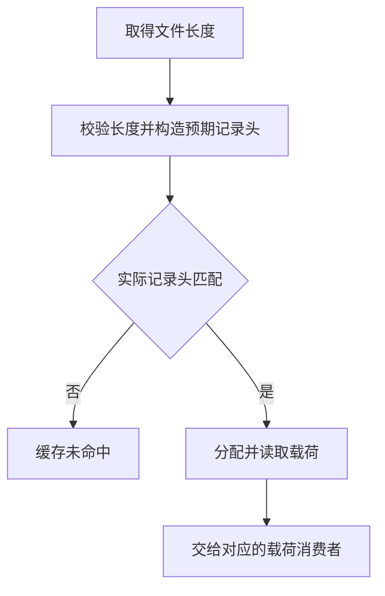

# 生成缓存外层记录自举

## Intent · 目标

将生成缓存的 v2 外层记录规则迁入 RX/ZX。覆盖生成的 Zig 单元和所有权 memo，保留已有文件格式、缓存键和失效条件。

## Data · 证据与假设

原 Zig 读取器先读取载荷，再比较记录头。版本、编译器身份、键或长度不匹配时，已经分配并读入的载荷会被丢弃。记录头可以在固定缓冲内生成，先完成比较，再把合法载荷直接读到其最终分配。路径和记录头可共享一次键的十六进制转换。

## Edges · 边界

- 保留 v2 标记、小写十六进制摘要、16 位长度字段、换行位置和 64 MiB 上限。Native seed 仍使用 Zig 构造同格式记录头。
- Source 复用标准字节写入器写栈上记录头。合法载荷直接读到最终分配。记录头不匹配时停止读取，避免读入随后要丢弃的载荷。
- Zig 负责路径、系统调用、持久写入调度及文件所有权。生成单元和 memo 共享同一记录头规则。

## Answer · 交付与验收

对照相同清单的生成文件和持久缓存记录，验证跨进程热读、空缓存写入、编辑、撤回、旧编译器记录与损坏记录回退。比较 Source 三阶段和固定配置的完整冷构建。

### Source 自编译与缓存对照

以上一阶段 Source stage3 引导，三个阶段各通过 22/22 步。五组产物共 9,718 个文件逐字节一致。对照生成器均由各自的 Source stage2 生成，并运行 Source 分析和生成。

关闭常驻，在同一清单上交替启动两版工具。热读各舍弃一轮预热，再取三轮中位数。空缓存使用独立缓存目录。每轮热读复用 4,194 个生成单元，两版生成的 9,084 个文件逐字节一致。

| 场景             | 墙钟中位数 / s | CPU 中位数 / s |   进程峰值 RSS 中位数 / B |
| ---------------- | -------------: | -------------: | ------------------------: |
| 跨进程磁盘热生成 |    1.80 → 1.79 |    6.49 → 6.48 | 858,898,432 → 858,456,064 |
| 每轮空缓存生成   |    2.28 → 2.28 |  10.16 → 10.15 | 896,761,856 → 895,205,376 |

逐条比对 4,195 条磁盘记录。除每个工具自身的编译器摘要外，版本、文件键、长度文本和载荷均逐字节一致，包含 13,664,098 字节的所有权 memo。编辑时均仅重生成三个单元，产物匹配空缓存生成，撤回后恢复原产物。用旧工具的完整 memo 文件替换新工具的记录后，新工具以自己的摘要重建文件。截断内层载荷并更新外层长度后也恢复了完整记录。计时与 RSS 覆盖整次生成，未单独计量记录头解析。日志位于本地 `.zig-cache/cold-build-analysis/ownership-research/generation-cache-envelope/`。

### 完整冷构建

固定 Zig 0.17.0、ReleaseSmall、12 核、四分区、空 local/global 缓存、遍历种子 `0x3b41c83f` 和同一 Zig 归档。关闭常驻。Native seed 引导安装版，安装版运行 Source。构建通过 70/70 步。

| 指标                   |      固定基线 |        上阶段 |        本阶段 |    较上阶段 |  较固定基线 |
| ---------------------- | ------------: | ------------: | ------------: | ----------: | ----------: |
| 墙钟 / s               |       129.740 |       118.553 |       118.549 |      −0.004 |     −11.191 |
| CPU / s                |        216.03 |        207.43 |        207.46 |       +0.03 |       −8.57 |
| 进程树采样峰值 RSS / B | 2,247,294,976 | 2,306,441,216 | 2,275,590,144 | −30,851,072 | +28,295,168 |
| 单进程系统峰值 RSS / B | 2,075,033,600 | 2,117,320,704 | 2,119,303,168 |  +1,982,464 | +44,269,568 |

进程树峰值仍出现在分区 0、1、2 并行编译时，三个分区的目标文件逐字节一致。分区 3 目标文件增加 1,584 字节。冷构建的命令、采样、日志和对象摘要位于本地 `.zig-cache/cold-build-analysis/ownership-research/partition-reference/cold-generation-cache-envelope/`。

### 既有应用与回归

- 两个安装版 CLI 为 72 个既有应用生成的 Zig 逐字节一致。
- 函数分析、模块生成和所有权缓存回归通过 112/112 步及 222/222 项 Zig 测试。现有持久缓存、生成运行时及 watch 共 10 项通过，包含错误键的记录被丢弃及正常记录重建。
- 64 MiB 上限与零长度接受规则按源码核对。真实清单覆盖了长度格式与记录失效，未构造恰好 64 MiB 的文件。
