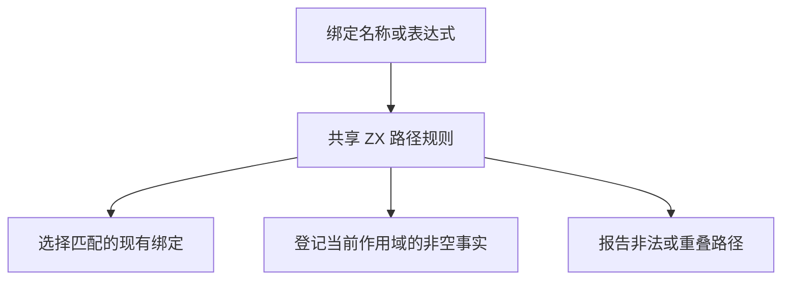

# 绑定路径共享自举

## Intent · 意图

让 RX 类型推导、条件收窄、ZX 注入绑定、枚举别名和 Store 路径共用 ZX 路径规则。保持路径段边界、匹配顺序、可见范围和诊断。

## Data · 证据

索引表达式提供名称字节区间和字段父编号。原 RX 在宿主递归匹配，ZX 注入绑定另有一份匹配规则。校验和重叠判断也各有两套实现。旧的事实登记为每个可见路径重新分配完整名称，连续拼写可直接借用解析源码。

## Edges · 边界

ZX 判定精确和根前缀匹配，并计算可发布路径的长度与连续性。索引路径直接访问解析节点。连续路径的借用覆盖分支或表达式作用域，缩回事实列表后释放解析结果。带间隔的路径只分配一次最终文本，宿主负责将原始字节写入目标。Native seed 继续使用其树形表示。

## Answer · 交付与验收

逐项核对路径匹配、原生名称列、借用地址和非连续路径。集中运行表达式绑定、RX 推导及相关项目回归，再对照安装版产物、条件项目和冷构建指标。

固定的 Source stage 3 和 Native seed 分别生成规则，两组各通过 14,000 个路径对照。零容量分配器覆盖布局、精确和前缀匹配、合成名称、名称校验与重叠判断。连续布局返回的区间逐字节等于原规范路径。表达式绑定、RX 推导、RX 文本、混合库和 XML 表达式共通过 49 个构建步骤、315 项回归。

安装版对照 15 个生成结果和 2 个拒绝诊断，逐字节一致。对照覆盖空格与括号分隔、嵌套可空字段、短路、Default 在显式 Case 前及多 Task 绑定。重复生成按版本交替八轮，每轮关闭缓存生成 16 次，舍弃第一轮。双事实条件、单事实条件、48 个 Task 绑定的 CPU 中位数分别为 0.5518 → 0.5521 秒、0.7246 → 0.7240 秒、0.7483 → 0.7527 秒。

### 冷构建

沿用 Zig 0.17.0、ReleaseSmall、12 核、四分区和种子 `0x3b41c83f`，关闭常驻生成。与上批复用同一源码目录及其源码缓存，显式本地和全局构建缓存从空开始。构建由 Native seed 引导，安装版使用 Source 分析与生成。两次均通过 70 步。

| 指标                             | 固定历史基线 |    上批 |    本批 |
| -------------------------------- | -----------: | ------: | ------: |
| 构建墙钟 / s（`time -l`）        |            — |  117.13 |  116.47 |
| 进程树采样墙钟 / s               |      129.740 | 117.192 | 116.514 |
| CPU / s                          |       216.03 |  208.10 |  208.63 |
| 进程树峰值 RSS / MB              |      2,247.3 | 2,333.8 | 2,310.4 |
| 单进程峰值 RSS / MB（`time -l`） |      2,075.0 | 2,105.7 | 2,130.1 |

较上批墙钟减少 0.66 秒，CPU 增加 0.53 秒，进程树峰值下降 23.4 MB，单进程峰值增加 24.4 MB。两个分区对象逐字节一致，另外两个分别增加 3,920 和 608 字节。较固定历史基线，采样墙钟减少 13.23 秒、CPU 减少 7.40 秒、进程树峰值增加 63.1 MB。CPU 较近期 206.33 秒样本增加 2.30 秒。对照日志位于 `.zig-cache/cold-build-analysis/ownership-research/binding-path/`，完整构建采样及分区哈希位于同级的 `partition-reference/cold-binding-path/`。
