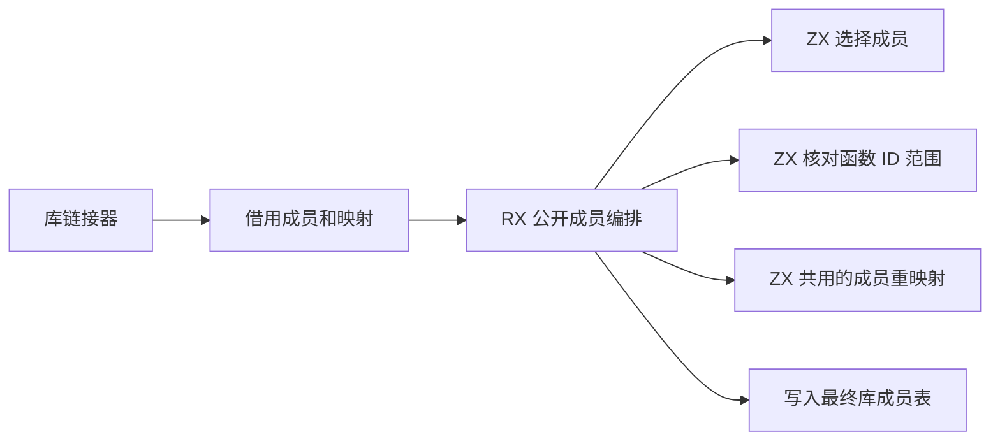
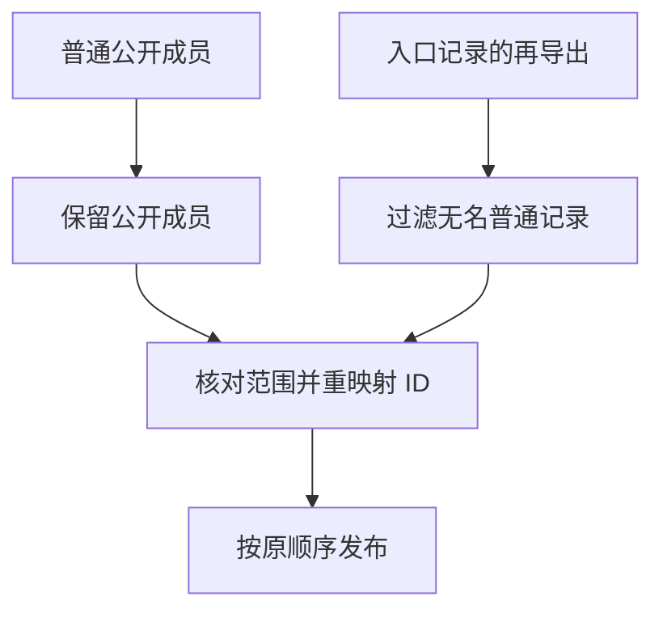

# 编译库公开成员链接自举

## Intent · 意图

将统一编译库公开函数与 barrel 再导出的筛选、边界校验和 ID 重映射迁入 RX/ZX，保持公开成员顺序、名称和编译库格式。

## Data · 证据

- 旧链接器分别循环普通成员和入口记录的再导出函数，两处各自重映射函数 ID、输入类型 ID、输出类型 ID，并移除内部命名空间。
- RX 依次组织成员选择、函数 ID 范围校验和重映射。ZX 保留普通公开成员，过滤 barrel 中未命名且没有 intrinsic 的记录，并复用编译库读取时的成员重映射规则。
- 函数映射由现有 Program 链接器按连续 ID 构造。正式路径借用类型映射及成员名称文本，临时列使用独立缓冲，宿主只为最终库拥有名称和成员行。

## Edges · 边界

普通成员先于入口记录的再导出成员。原始成员列表与再导出各自保留顺序，函数映射越界仍返回 `InvalidModule`。Zig 宿主仍按 Program 文件身份取入口记录、投影原生结构及发布最终成员行。初始 seed 保留旧循环和 ID 映射。库链接的常量和 Store 初始化器仍是独立职责。

## Answer · 交付与验收

核对三阶段 Source 自编译与现有库回归，对照两版安装版的编译库发布产物。额外使用仓库现有编译器 import parser barrel 进行同输入编译，核对成员及整份发布产物。分别记录完整冷构建和实际库发布的开销。

### Source 自编译

以前一阶段 Source stage 3 引导，连续构建三个 ReleaseSmall、16 分区的 Source 工具，关闭常驻生成。三个阶段均通过 22/22 步。stage 2 首轮因临时空间不足退出，保留已生成的产物并从该阶段续跑。五组产物每阶段共 9,815 个文件，排除内部输入清单后按路径及 SHA-256 对照，全部一致。

以本阶段 Source stage 3 执行 `test-library-codec`、`test-library-link` 和 `test-library-initializers`，50/50 构建步骤与 114/114 测试通过。

### 完整冷构建

固定 Zig 0.17.0、ReleaseSmall、12 核、四分区、遍历种子 `0x3b41c83f` 和 Zig 归档，关闭常驻生成，local/global 缓存为空。安装版由 Native seed 引导，运行时使用 Source。完整构建通过 70/70 步。

| 指标                   |      固定基线 |        上阶段 |        本阶段 |   较上阶段 |  较固定基线 |
| ---------------------- | ------------: | ------------: | ------------: | ---------: | ----------: |
| 墙钟 / s               |       129.740 |       117.378 |       117.484 |     +0.106 |     −12.256 |
| CPU / s                |        216.03 |        207.41 |        207.84 |      +0.43 |       −8.19 |
| 进程树采样峰值 RSS / B | 2,247,294,976 | 2,294,071,296 | 2,300,051,456 | +5,980,160 | +52,756,480 |
| 单进程系统峰值 RSS / B | 2,075,033,600 | 2,110,783,488 | 2,119,188,480 | +8,404,992 | +44,154,880 |

分区 0、1、2 的目标文件逐字节相同，分区 3 增加 5,912 字节。

### 安装版发布和消费

两版以相同路径、输入和 solver 交替运行，去除首轮后取三轮中位数。现有 import parser barrel 包含 16 个原始源码文件，发布的 15 个文件逐字节一致，`library.zxcir` 均为 72,652 字节。`advance` 和 `resume` 的成员顺序和函数 ID 7、8 相同。墙钟均为 0.16 秒，CPU 为 0.17 → 0.16 秒，进程峰值 RSS 为 32,407,552 → 32,391,168 字节。

五导出混合 RX/ZX 样例的 11 个发布文件和独立消费生成的 Zig 逐字节一致。发布墙钟均为 0.03 秒、CPU 均为 0.02 秒，消费墙钟均为 0.01 秒。

安装版重发布、契约、运行和 Store 集成共 11 项通过。

本地命令、日志与采样位于 `.zig-cache/cold-build-analysis/ownership-research/library-public-members/` 和同级 `partition-reference/cold-library-public-members/`。
