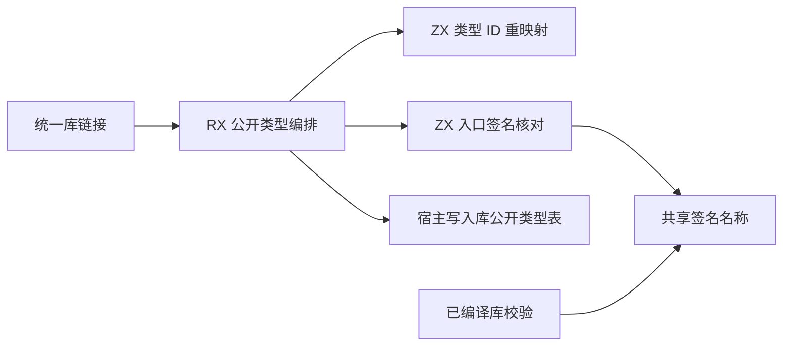
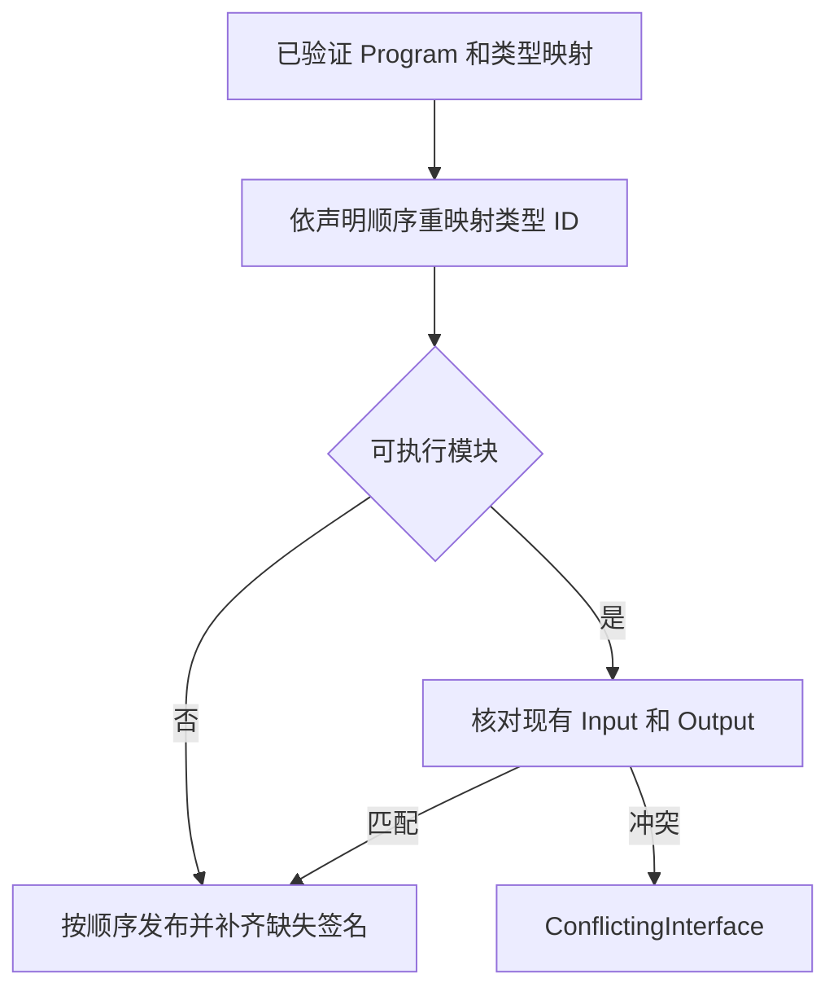

# 编译库公开类型链接自举

## Intent · 意图

将库链接时的公开类型重映射、可执行入口签名补齐及冲突检查迁入 RX/ZX。保持公开接口、产物格式和声明顺序。

## Data · 证据

- 旧链接器逐项重映射声明类型，再扫描公开列表两次来检查和补齐 `Input`、`Output`。
- RX 使用已有的列式类型 ID 重映射函数。对可执行入口，ZX 在一次遍历中核对两个签名名及类型；只在缺少声明时按 `Input`、`Output` 的顺序补齐。纯类型模块原样保留声明集合。
- 库读入校验和链接补齐共享签名名常量。宿主借用既有类型映射及名称文本，临时列优先使用栈缓冲，按计划一次分配最终公开类型表。

## Edges · 边界

初始 seed 保留旧实现。正式入口的 Zig 适配器仍负责从现有 Program 投影公开类型列、将 ZX 计划写入库 arena，以及调用现有的 Program、常量、函数成员和 Store 链接流程。显式声明冲突仍返回 `ConflictingInterface`。

## Answer · 交付与验收

核对三阶段 Source 自编译、现有库链接与编解码回归，并用两版安装版比较同一库的发布文件、消费结果及冷构建开销。

### Source 自编译

以前一阶段的 Source stage 3 引导，连续构建三个 ReleaseSmall、16 分区的 Source 工具，关闭常驻生成。三个阶段均通过 22/22 步。五组产物每阶段共 9,805 个文件，排除内部输入清单后按路径及 SHA-256 比较，全部一致。以本阶段 Source stage 3 执行 `test-library-codec`、`test-library-link` 和 `test-library-initializers`，50/50 构建步骤、114/114 测试通过。

### 完整冷构建

固定 Zig 0.17.0、ReleaseSmall、12 核、四分区、遍历种子 `0x3b41c83f` 和 Zig 归档，关闭常驻生成，local/global 缓存为空。安装版由 Native seed 引导，运行时使用 Source。构建通过 70/70 步。

| 指标                   |      固定基线 |        上阶段 |        本阶段 |    较上阶段 |  较固定基线 |
| ---------------------- | ------------: | ------------: | ------------: | ----------: | ----------: |
| 墙钟 / s               |       129.740 |       117.738 |       117.378 |      −0.360 |     −12.362 |
| CPU / s                |        216.03 |        207.73 |        207.41 |       −0.32 |       −8.62 |
| 进程树采样峰值 RSS / B | 2,247,294,976 | 2,239,856,640 | 2,294,071,296 | +54,214,656 | +46,776,320 |
| 单进程系统峰值 RSS / B | 2,075,033,600 | 2,110,668,800 | 2,110,783,488 |    +114,688 | +35,749,888 |

两轮树峰均出现在分区 0、1、2 并行编译时。这三个目标文件逐字节一致，分区 3 的目标文件增加 1,752 字节。树峰差异主要来自分区 1 的采样 RSS。

### 安装版发布、消费与重发布

两版在同一路径发布现有五导出混合 RX/ZX 库，交替运行，去掉首轮后取三轮中位数。两版的 11 个发布文件及独立消费生成的 Zig 逐字节一致。发布墙钟均为 0.03 秒、CPU 均为 0.02 秒，消费墙钟均为 0.01 秒。两版使用相同编译库与四个重命名导出重发布，9 个输出逐字节一致，墙钟和 CPU 中位数均为 0.02 秒。

安装版运行、重发布、契约与 Store 集成共 11 项通过。重发布和契约套件首轮遇到临时空间不足时的写入失败，释放已验证的构建中间产物后通过复测。

本地命令、日志与采样位于 `.zig-cache/cold-build-analysis/ownership-research/library-public-types/` 和同级 `partition-reference/cold-library-public-types/`。
