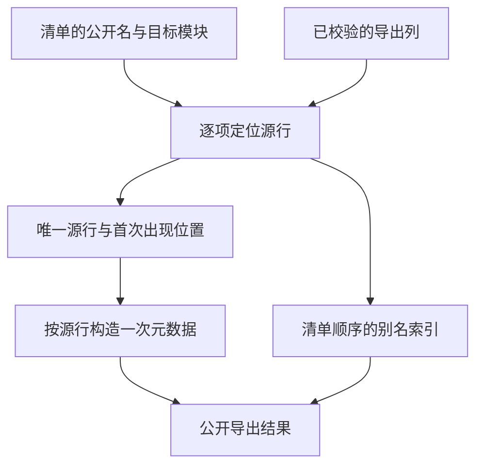

# 编译库导出选择自举

## Intent · 意图

把统一编译库重发布时的公开模块选择和别名映射迁入 RX/ZX。保持原始产物的完整校验、清单顺序和公开身份，并让同一个源模块的多个别名复用重映射后的元数据。

## Data · 证据

- 原路径完整重映射并发布所有导出，再由 Zig 按名称寻找清单中的条目、复制结果描述符并替换公开名。
- Source 路径仍先校验完整库，随后由 RX 执行选择计划、缺失判断及导出重映射。ZX 按清单顺序解析名称并登记首次出现的源行。类型、函数和 Store 初始化器沿用原有链接顺序。
- 只重映射被选中的不同源行。宿主按计划构造最终导出数组，同源别名共用类型、函数成员和常量数据，只拥有各自的公开名。普通库加载直接沿用原始导出行顺序。
- 上阶段的 Store 集成失败来自既有静态列表优化。生成 Zig 中，`history` 和矩阵内层常量是 `comptime` 只读切片，根对象和矩阵外层仍使用各自的 arena。既有测试保留动态存储独立断言，并在释放另一个 arena 后检查列表值。

## Edges · 边界

保留 `MissingPublicModule`、完整源图校验、类型专用导出和重复源模块的不同别名。初始 seed 保留旧选择算法。源产物目前仍由 Zig 宿主投影为列，生成结果仍由宿主接入现有目标表。选择查询沿用顺序查找，仍加载闭包中的函数及 Store 初值。

## Answer · 交付与验收

使用三阶段 Source 自编译、库编解码和链接回归、安装版重发布和 Store 初值集成验证。分别核对固定基线下的冷构建，以及同一编译库重发布的输出和成本。

### Source 自编译

以前一阶段 Source stage 3 引导，连续构建三个 ReleaseSmall、16 分区的 Source 工具，关闭常驻生成。三个阶段均通过 22/22 步。五组产物每阶段共 9,797 个文件，排除内部输入清单后按路径和 SHA-256 比较，全部一致。

以本阶段 Source stage 3 执行 `test-library-codec`、`test-library-link` 和 `test-library-initializers`，50/50 构建步骤及 114/114 测试通过。

### 完整冷构建

固定 Zig 0.17.0、ReleaseSmall、12 核、四分区、遍历种子 `0x3b41c83f` 和 Zig 归档，关闭常驻生成，local/global 缓存为空。安装版由 Native seed 引导，运行时使用 Source。构建通过 70/70 步。

| 指标                   |      固定基线 |        上阶段 |        本阶段 |    较上阶段 |  较固定基线 |
| ---------------------- | ------------: | ------------: | ------------: | ----------: | ----------: |
| 墙钟 / s               |       129.740 |       117.297 |       117.738 |      +0.441 |     −12.002 |
| CPU / s                |        216.03 |        207.05 |        207.73 |       +0.68 |       −8.30 |
| 进程树采样峰值 RSS / B | 2,247,294,976 | 2,257,960,960 | 2,239,856,640 | −18,104,320 |  −7,438,336 |
| 单进程系统峰值 RSS / B | 2,075,033,600 | 2,105,475,072 | 2,110,668,800 |  +5,193,728 | +35,635,200 |

分区 1、2、3 的目标文件逐字节相同，分区 0 增加 4,080 字节。

### 安装版重发布

固定同一份五导出编译库，使用现有样例重发布四个公开名，其中两个指向同一个源模块。两版按相反顺序交替，去除首轮后取三轮中位数。墙钟与 CPU 均为 0.02 秒，进程峰值 RSS 均为 25,034,752 字节。两版的 9 个输出逐字节一致，重发布的 `library.zxcir` 均为 25,048 字节。两版的 Store 源样例同样输出 14 个逐字节一致的文件。

安装版的重发布、契约、运行和 Store 集成共 11 项通过。重发布用例核对多个别名、缺失模块、损坏摘要、验证失败后保留已发布文件，以及下游运行结果。Store 用例通过释放独立 arena、旧快照和重新发布后的读取检查。

本地命令、日志与采样位于 `.zig-cache/cold-build-analysis/ownership-research/library-export-selection/` 和同级 `partition-reference/cold-library-export-selection/`。
