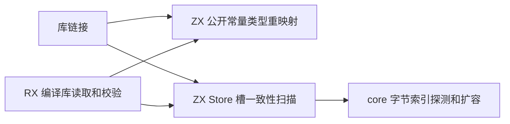
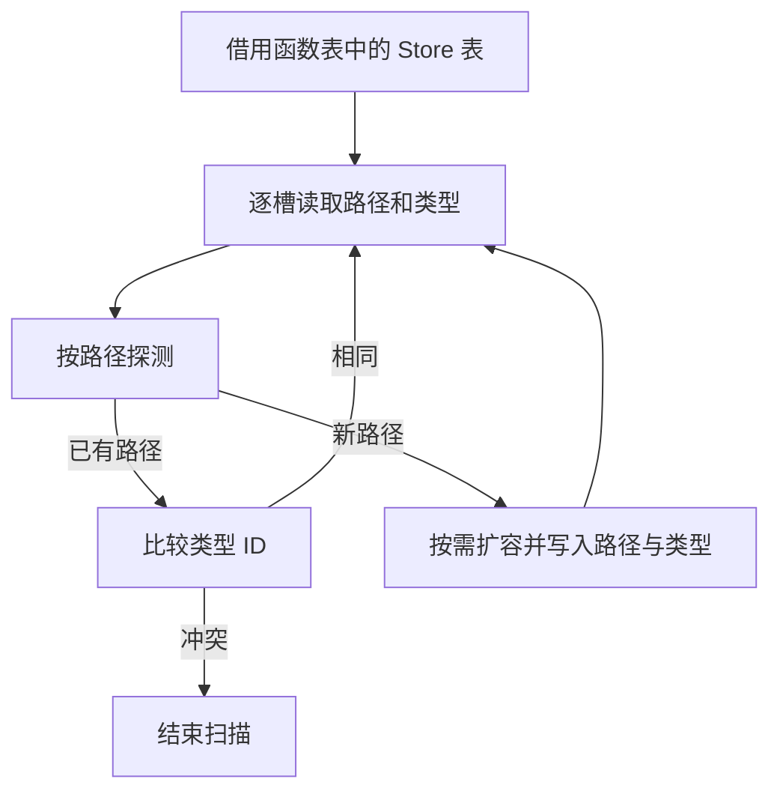

# 编译库常量与状态槽链接自举

## Intent · 意图

迁移编译库公开常量类型重映射与跨函数 Store 槽类型一致性规则。保留现有发布格式、诊断顺序和共享状态身份。

## Data · 证据

- 库链接器原先逐行写入公开常量，再通过原生类型映射更新类型 ID。正式路径现在调用读取编译库时已有的 ZX 批量 ID 映射，适配层借用映射表，只收集连续的 ID 列并为最终产物持有常量名称和字符串载荷。
- 库链接器原先用原生哈希表检查 Store 槽类型，编译库读取则复制路径与类型列并排序。两条正式路径现在使用同一个 ZX 哈希扫描，按原函数和槽位顺序扫描，遇到首个不一致的类型即结束。
- 索引复用 core 的字节哈希、探测、扩容和负载阈值。空表遍历期间无索引分配，索引容量随不同路径的数量增长。键借用路径字节，新增键时才保存键和类型，正常插入直接使用探测到的桶位。

## Edges · 边界

链接阶段仍先报告 `ConflictingStore`，读取或校验损坏产物仍报告 `InvalidLibrary`。原生宿主保留 IR 类型投影、最终产物所有权及分配失败转换。初始 seed 保留原生规则。Store 初始化器去重及其函数体比较是剩余迁移职责。

## Answer · 交付与验收

核对三个 Source 自编译阶段、现有库链接和编解码回归、安装版发布和消费产物。冷构建沿用固定输入与工具链，分别比较墙钟、CPU、进程树采样峰值 RSS 和单进程系统峰值 RSS。检查生成入口借用原 Store 行指针以及哈希桶的原地写入。

### Source 自编译

以前一阶段 Source stage 3 引导，依次构建三个 ReleaseSmall、16 分区的 Source 工具，关闭常驻生成。每个阶段均通过 22/22 步。排除内部输入清单后，每阶段的五组共 9,826 个生成文件按路径及 SHA-256 逐字节一致。三个阶段的 Store 入口均直接借用原表的行指针切片，桶位更新生成原地写入。

本阶段 Source stage 3 执行 `test-library-codec`、`test-library-link` 和 `test-library-initializers`，通过 50/50 构建步骤与 114/114 测试。

### 冷构建

固定 Zig 0.17.0、ReleaseSmall、12 核、四分区、遍历种子 `0x3b41c83f` 和同一份 Zig 归档。关闭常驻生成，local/global 缓存为空。Native seed 引导构建工具本体，安装版运行时使用 Source。成功的各轮均通过 70/70 步。两次空间不足的尝试未计入结果。

| 指标                   | 固定基线      | 上阶段        | 本阶段        | 较上阶段    | 较固定基线  |
| ---------------------- | ------------- | ------------- | ------------- | ----------- | ----------- |
| 墙钟 / s               | 129.740       | 117.484       | 119.163       | +1.679      | −10.577     |
| CPU / s                | 216.03        | 207.84        | 207.08        | −0.76       | −8.95       |
| 进程树采样峰值 RSS / B | 2,247,294,976 | 2,300,051,456 | 2,280,275,968 | −19,775,488 | +32,980,992 |
| 单进程系统峰值 RSS / B | 2,075,033,600 | 2,119,188,480 | 2,108,506,112 | −10,682,368 | +33,472,512 |

在同一个隔离源码目录配对重建。先构建 `ad4b5513`，再覆盖本阶段八个编译器文件。两版的四个分区分别与原目录中对应版本的分区对象字节一致。

| 指标                         | 配对基线      | 配对本阶段    | 变化       |
| ---------------------------- | ------------- | ------------- | ---------- |
| 墙钟 / s                     | 118.082       | 119.750       | +1.668     |
| CPU / s                      | 208.18        | 208.50        | +0.32      |
| 进程树采样峰值 RSS / B       | 2,301,968,384 | 2,303,311,872 | +1,343,488 |
| 单进程系统峰值 RSS / B       | 2,109,587,456 | 2,106,310,656 | −3,276,800 |
| 首次采样到配置器后的墙钟 / s | 87.888        | 88.073        | +0.185     |

两组完整墙钟均增加约 1.67 秒，超过 1 秒阈值。原目录增加的 1.642 秒、隔离目录增加的 1.483 秒出现在 Zig 启动到首次采样到构建配置器之间。配对的 Zig maker 路径标识、内容寻址的依赖清单标识均一致。从配置器首次出现到构建结束，原目录增加 0.038 秒，配对增加 0.185 秒，接近 0.2 秒的采样间隔。配对的 LLVM 分区编译耗时增加约 0.12 秒，末尾的静态库编译与链接耗时下降约 0.10 秒。以受改动影响的构建阶段和固定基线累计结果验收，完整墙钟的启动差异保留在记录中。

### 安装版发布

两个版本发布同一五导出 RX/ZX 库的 11 个文件和消费生成的 Zig 全部逐字节一致。交替执行四轮，去除首轮后发布墙钟中位数均为 0.03 秒，CPU 均为 0.02 秒，进程峰值 RSS 均为 25,034,752 字节。两个版本发布现有 ASCII 与编译库格式常量时，55 个数值和 2 个字符串常量的类型及载荷一致，7 个文件逐字节一致。

现有 Store 样例的 14 个发布文件逐字节一致。交替执行四轮，去除首轮后墙钟和 CPU 中位数均为 0.03 秒，进程峰值 RSS 为 18,857,984 → 18,972,672 字节。

安装版的重发布、契约、运行和 Store 集成共 11 项通过。首轮多个用例在可用空间约 560 MiB 时报告 `WriteFailed`，清理可重建的 Zig 缓存后使用同一安装版重跑通过。

命令、日志、采样和分区哈希保存在 `.zig-cache/cold-build-analysis/ownership-research/library-link-values/` 及同级 `partition-reference/cold-library-link-values/`。
