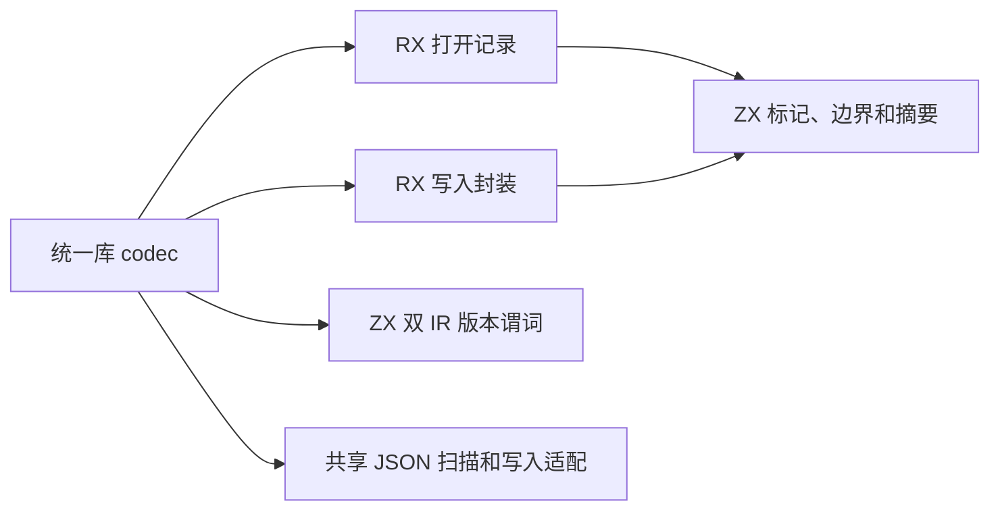
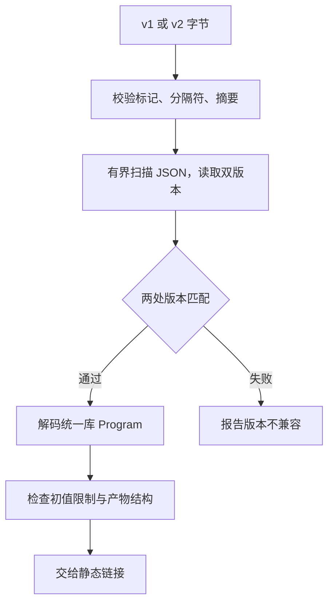

# 编译库记录封装自举

## Intent · 意图

用 RX/ZX 实现统一编译库的封装、摘要及 IR 版本校验。保持 v1 读取和 v2 写出的契约，并沿用统一库的结构校验、静态链接及公开模块边界。

## Data · 证据

- 编译库原来先分配 JSON 载荷，再计算摘要并复制到最终记录。解码在验证标记和摘要后，分三遍检查深度、读取双版本及解码完整产物。
- Source 封装由 RX 组织，ZX 检查版本标记和分隔符，复用语义缓存已有的 SHA-256 与小写十六进制编码。JSON 直接写入最终缓冲，封装填入预留前缀。
- 库读取仍先核对载荷与 Program 两个 IR 版本。版本预读共用有界 token 扫描，在遍历 JSON 时同时检查深度。版本通过后才构造完整 Program。

## Edges · 边界

保留 v1 禁止携带 Store 初值、v2 允许 Store 初值的规则，以及 `InvalidLibrary`、`IncompatibleLibraryVersion` 和 `OutOfMemory` 的错误边界。正式路径的 Zig 宿主仍负责标准库类型化 JSON、v1 初值限制的执行与内存管理。初始 seed 保留原生封装入口。

## Answer · 交付与验收

核对完整库发布输出、跨版本读取和消费输出。执行已有编解码、Store 初始化器和语义缓存回归。完整冷构建与库发布、消费的比较分别记录。

### Source 自编译

以前一阶段 Source stage 3 引导，连续构建三个 ReleaseSmall、16 分区的 Source 工具，关闭常驻生成。三个阶段均通过 22/22 步。五组产物每阶段共 9,793 个文件，排除内部输入清单后按路径和 SHA-256 比较，全部一致。

以本阶段 Source stage 3 运行 `test-library-codec`、`test-library-initializers` 和 `test-cache-codec`，38/38 构建步骤及 107/107 测试通过。覆盖 v1 兼容、v1 初值拒绝、双版本不兼容、损坏 JSON、摘要和分配失败。

### 完整冷构建

固定 Zig 0.17.0、ReleaseSmall、12 核、四分区、遍历种子 `0x3b41c83f` 和 Zig 归档，关闭常驻生成，local/global 缓存为空。安装版由 Native seed 引导，运行时使用 Source。构建通过 70/70 步。

| 指标                   |      固定基线 |        上阶段 |        本阶段 |    较上阶段 |  较固定基线 |
| ---------------------- | ------------: | ------------: | ------------: | ----------: | ----------: |
| 墙钟 / s               |       129.740 |       117.173 |       117.297 |      +0.124 |     −12.443 |
| CPU / s                |        216.03 |        207.13 |        207.05 |       −0.08 |       −8.98 |
| 进程树采样峰值 RSS / B | 2,247,294,976 | 2,314,846,208 | 2,257,960,960 | −56,885,248 | +10,665,984 |
| 单进程系统峰值 RSS / B | 2,075,033,600 | 2,111,438,848 | 2,105,475,072 |  −5,963,776 | +30,441,472 |

两个树峰均落在三个 LLVM 分区同时编译的时点。分区 0、1、2 的目标文件逐字节相同，分区 3 增加 2,200 字节。

### 安装版发布、消费与磁盘缓存

两版在同一路径发布现有五导出混合 RX/ZX 库样例，然后由独立消费项目读取。交替运行，去除首轮后取三轮中位数。两版的 11 个发布文件和消费生成的 Zig 逐字节一致，`library.zxcir` 均为 24,676 字节。发布墙钟均为 0.03 秒，CPU 均为 0.02 秒，采样系统峰值均为 25,034,752 字节。消费墙钟均为 0.01 秒，采样系统峰值均为 25,116,672 字节。消费 CPU 接近计时器分辨率。

复用 157 模块的语义缓存对照。两版各写出 157 条记录，共 789,415 字节。除工具摘要外，记录与生成 Zig 逐字节一致。热读墙钟和 CPU 中位数均为 0.69 秒。每轮空缓存写入的墙钟为 1.43 → 1.44 秒，CPU 均为 1.44 秒。编辑和还原均只重新分析一个模块，编辑产物等于独立冷生成。

发布集成首轮并行解包遇到磁盘空间不足。清理旧构建中间产物后串行重跑，10 项通过。Store 初始化器独立存储用例在本阶段及上阶段安装版均失败于 `a.history.ptr != b.history.ptr`，同一 Store 样例的 14 个发布文件逐字节一致。

本地命令、日志与采样位于 `.zig-cache/cold-build-analysis/ownership-research/library-envelope/` 和同级 `partition-reference/cold-library-envelope/`。
