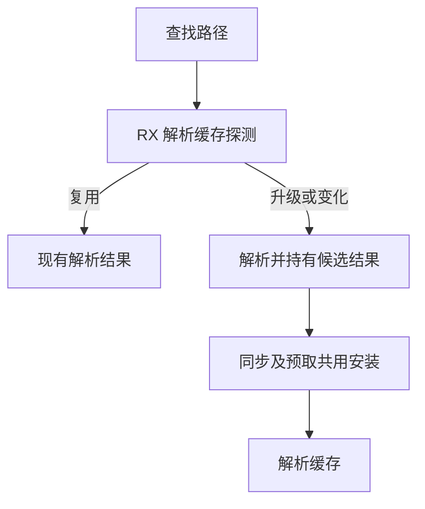
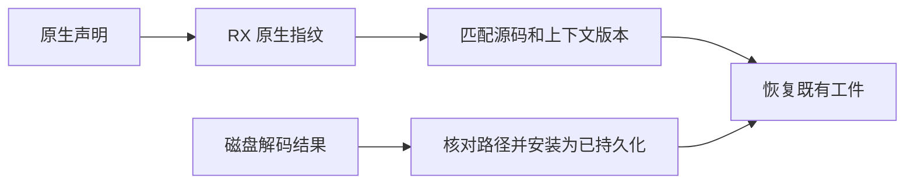

# 解析缓存与语义缓存状态自举

## Intent · 意图

迁移解析缓存的重用、原生格式升级、摘要回退与发布规则，以及语义缓存的版本、持久化接收和原生指纹规则。让并行预取和同步解析共用结果安装，保留缓存键和所有权契约。

## Data · 证据

解析缓存可以通过保留的源码文本判定命中，只有无法确认时才计算 SHA-256。解析诊断不保留文本，依赖摘要判定。当前同步替换与并行安装存在重复，磁盘加载也先插入脏项、再查表清除脏标记。

- RX 在文本命中时短路哈希，并区分复用已有语法与升级到原生格式。摘要路径使用现有 SHA-256 后端，生成的摘要占固定栈缓冲区。
- 预取每个位置只发布一个可选的解析结果及摘要。安装阶段只读取已填充的摘要，避免在命中槽读取未初始化的列。同步与并行两条路径共用安装，安装失败时仍由提交方释放未转移的解析结果。
- 语义条目匹配源码及上下文两份摘要。磁盘加载验证路径后直接安装干净条目，仍在写入成功后清除编译新产物的脏标记。
- 原生指纹的域、声明字段、命名空间依序由 RX 编排，长度前缀和字节更新由 ZX 调用现有标准库原语。

## Edges · 边界

保留物理哈希表、解析结果 arena、磁盘 I/O 与并行工作分配。Zig 通过已有向量字节比较提供源码相等性，ZX 决定是否回退到摘要。生成入口只借用文本和上下文，临时摘要使用调用栈。保留原始磁盘格式、精确路径身份、指纹字段顺序和计数语义。

## Answer · 交付与验收

集中覆盖同步解析、并行预取、缓存身份与分配失败。对照已有源码和原生依赖项目的热恢复、编辑回退及冷生成，跟踪固定配置的自举性能。

### 集中回归

使用 Source 自举工具生成 ReleaseSmall 测试编译器，关闭常驻生成，以 12 核执行六组回归。70/70 步、127/127 项 Zig 测试和两组混合库运行检查通过。安装版另外通过五项独立进程持久缓存检查。

源码依赖项目和原生依赖项目的 13 份缓存有效载荷逐字节一致，包括两个原生指纹。编译器身份头随工具版本改变。三份生成文件与禁用缓存结果逐字节一致。合法修改叶子模块及恢复原内容时，增量结果分别与冷生成对照一致。每 24 次热恢复的七轮中位数墙钟 0.1197 → 0.1194 秒，CPU 0.1184 → 0.1182 秒。安装版由 Native seed 引导，运行使用 Source。

### 冷构建

复用上批在同一临时源码目录取得的对照。固定 Zig 0.17.0、ReleaseSmall、12 核、四分区、种子 `0x3b41c83f`、同一 Zig 归档、Native seed 和空 local/global 缓存，关闭常驻生成。

| 指标                   | 固定基线      | 上批          | 本批          | 较上批      | 较固定基线  |
| ---------------------- | ------------- | ------------- | ------------- | ----------- | ----------- |
| 墙钟 / s               | 129.740       | 116.994       | 117.137       | +0.143      | −12.603     |
| CPU / s                | 216.03        | 208.87        | 209.02        | +0.15       | −7.01       |
| 进程树采样峰值 RSS / B | 2,247,294,976 | 2,305,294,336 | 2,318,401,536 | +13,107,200 | +71,106,560 |
| 单进程系统峰值 RSS / B | 2,075,033,600 | 2,107,604,992 | 2,122,711,040 | +15,106,048 | +47,677,440 |

分区 0～2 的目标文件逐字节一致，分区 3 增加 2,248 字节。本批进程树峰值出现在三个字节相同的分区同时编译时，上批出现在四个分区与 RX 检查同时编译时。较 206.33 秒的近期工作区复测，CPU 累积增加 2.69 秒，继续沿用固定基线观察。

命令、输出哈希、采样和日志保存在 `.zig-cache/cold-build-analysis/ownership-research/cache-state/` 和同级 `partition-reference/cold-cache-state/`。
