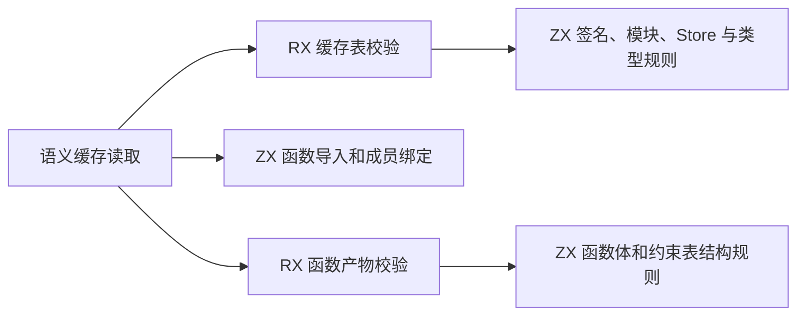
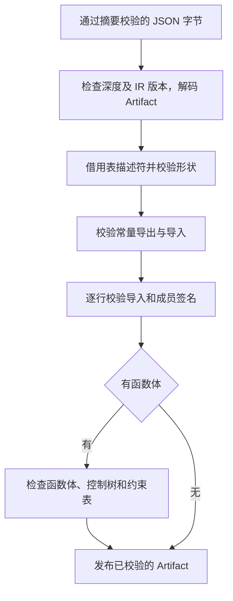

# 语义缓存产物结构校验自举

## Intent · 意图

让 Source 编译器读取持久化语义缓存时，复用 RX/ZX 的 IR 结构校验。保持 v7 格式、可接受的记录及拒绝损坏记录的边界，直接借用解码后的表。

## Data · 证据

- 缓存原先在通过摘要、JSON 和 IR 版本校验后，逐项检查函数签名、原生模块、Store、类型、常量、绑定以及可选函数体。常量校验已经使用 ZX，函数体和约束表也已有独立的 canonical RX/ZX 结构校验。
- 正式入口的签名、模块、Store 及类型列由 RX 组织，表的列宽、连续分段、行索引和控制树沿用已有 ZX 谓词。函数导入和成员共用同一个 ZX 签名绑定谓词。
- 控制树校验使用独立的临时空间，先从栈缓冲分配，超出时使用一次调用生命周期的 arena。常量校验继续使用解码分配器。

## Edges · 边界

初始 seed 保留旧检查。正式路径的 Zig 适配器仍负责 JSON 深度扫描、版本和 JSON 解码、把现有 Artifact 列借给生成入口、以及逐行投影 Zig 的可选枚举字段。函数体复用 canonical 校验次序，符号和表达式列先于控制树工作区分配接受检查。此阶段迁移结构规则，完整的 Artifact 模型及 JSON 边界仍待迁移。

## Answer · 交付与验收

验收使用相同配置的三阶段生成产物、现有缓存编解码回归、正式 CLI 的持久缓存与增量结果，以及相同工具链和核心数下的完整冷构建。

### Source 自编译

以前一阶段的 Source stage 3 引导，连续构建三个 ReleaseSmall、16 分区的 Source 工具，关闭常驻生成。三个阶段均通过 22/22 步。main、ordered、collections、host 和 growth 五组每阶段合计 9,764 个文件，除内部输入清单外按路径与 SHA-256 核对，全部一致。现有 `test-cache-codec` 使用本阶段 Source stage 3，23/23 构建步骤、39/39 测试通过。

### 完整冷构建

使用 Zig 0.17.0、ReleaseSmall、12 核、四分区和遍历种子 `0x3b41c83f`，固定归档，关闭常驻生成，每轮使用空 local/global 缓存。Native seed 构建安装版，安装版运行 Source。以下各轮均通过 70/70 步。

| 指标                   |      固定基线 |        上阶段 |        本阶段 |  较固定基线 |
| ---------------------- | ------------: | ------------: | ------------: | ----------: |
| 墙钟 / s               |       129.740 |       117.863 |       118.972 |     −10.768 |
| CPU / s                |        216.03 |        206.72 |        207.54 |       −8.49 |
| 进程树采样峰值 RSS / B | 2,247,294,976 | 2,284,830,720 | 2,283,192,320 | +35,897,344 |
| 单进程系统峰值 RSS / B | 2,075,033,600 | 2,123,759,616 | 2,122,645,504 | +47,611,904 |

首轮 130.787 秒的同时有本次启动的磁盘扫描占用 CPU，作为受干扰样本单独保存。停止扫描后，本阶段比上阶段历史单次样本慢 1.109 秒，CPU 多 0.82 秒。分区 1、2 的目标文件逐字节相同，分区 0、3 分别增加 2,632 和 448 字节。

随后在同一个隔离目录中用相同配置依次重建两版。目录以 `f47cf001` 的文件快照为起点，第二轮覆盖本阶段八个源文件。配对结果用于判断阶段差异，历史固定基线继续用于累计比较。

| 指标                   |    上阶段重测 |    本阶段重测 |        差异 |
| ---------------------- | ------------: | ------------: | ----------: |
| 墙钟 / s               |       124.868 |       118.660 |      −6.208 |
| CPU / s                |        207.07 |        207.80 |       +0.73 |
| 进程树采样峰值 RSS / B | 2,276,769,792 | 2,305,785,856 | +29,016,064 |
| 单进程系统峰值 RSS / B | 2,121,711,616 | 2,106,310,656 | −15,400,960 |

配对树峰发生在不同的进程重叠点。上阶段样本包含三个运行约 20 秒 CPU 时间的 LLVM 分区，本阶段样本包含四个刚启动的分区和一个宿主编译进程。两种目录中的墙钟差异方向相反，未将配对降幅计为优化收益。完整记录位于本地 `.zig-cache/cold-build-analysis/ownership-research/semantic-cache-validation/` 和同级 `partition-reference/cold-semantic-cache-validation/`。

### 持久缓存路径

两个工具本体均由 Native seed 生成，实际运行 Source 前端。交替编译同一临时工作区中的 157 个模块，各自持有独立缓存。冷热各取三轮中位数，热读另有一轮预热。

| 场景           | 墙钟中位数 / s | CPU 中位数 / s | 进程峰值 RSS 中位数 / B |
| -------------- | -------------: | -------------: | ----------------------: |
| 跨进程磁盘热读 |    0.76 → 0.75 |    0.75 → 0.76 | 24,084,480 → 24,133,632 |
| 每轮空缓存写入 |    1.56 → 1.55 |    1.55 → 1.55 | 29,130,752 → 29,261,824 |

两版均写出 157 条记录，共 789,415 字节。去除工具摘要后逐条对照记录和校验摘要，载荷与生成 Zig 字节完全一致。热读复用全部 157 个模块，编辑及还原均只重新分析一个模块，编辑后的增量 Zig 等于独立冷生成。

安装版另有 72 份现有源码样例生成 Zig 与上阶段逐字节一致，持久语义缓存、生成缓存运行、watch 恢复及库 watch 共 10 项通过。
