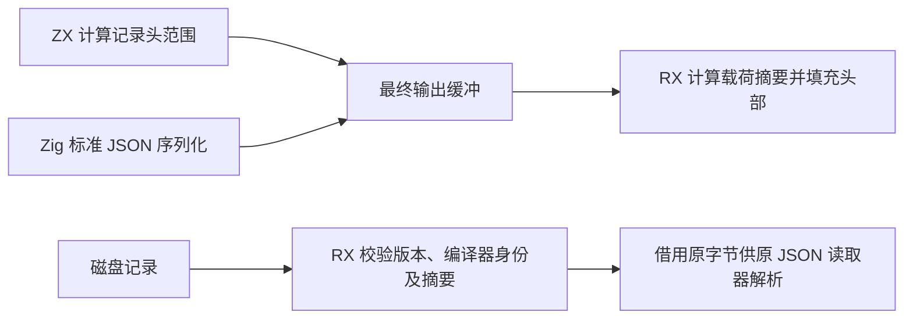
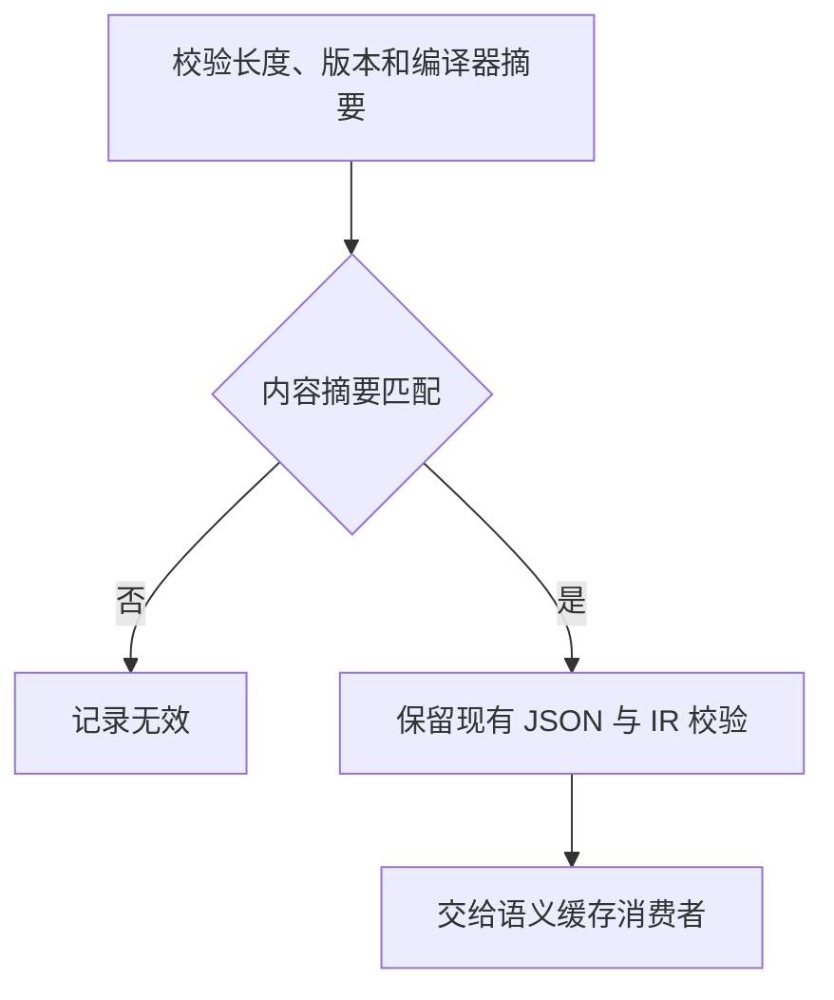

# 语义缓存外层记录自举

## Intent · 目标

将语义缓存 v7 的记录头、编译器身份和内容摘要校验迁入 RX/ZX。保留 JSON 表示及现有失效语义，同时消除编码时独立分配和拼接完整载荷的步骤。

## Data · 证据与假设

旧写入器先分配 JSON 载荷，计算 SHA-256 后再分配完整记录，并复制整个载荷。v7 记录头长度可在写入前确定，因此可以先在最终输出缓冲预留记录头，再由原 JSON 序列化器直接写入载荷。写入和读取可共用基于借用字节范围的摘要计算。

## Edges · 边界

- 版本、换行位置、两个小写十六进制 SHA-256 摘要及 JSON 载荷逐字节保持原格式。计算摘要时借用输入载荷，摘要和文本转换使用固定栈缓冲。
- 保留原有 JSON 深度、IR 版本和产物结构检查。JSON 编解码、类型化产物和磁盘 I/O 继续由宿主负责。初始 seed 保留原 Zig 路径。
- 记录头预留后，JSON 序列化直接写入最终缓冲。缓冲可以按标准分配器规则增长，封装阶段不再单独分配和复制完整载荷。

## Answer · 交付与验收

用真实 CLI 的语义缓存路径比较相同项目的冷写、热读、编辑和撤回。核对磁盘载荷与生成产物，运行既有缓存编解码回归。固定工具链比较 Source 三阶段及完整冷构建。

### Source 自编译

以上一阶段 Source stage3 引导，三个阶段各通过 22/22 步。五组产物共 9,744 个文件逐字节一致。

### 完整冷构建

固定 Zig 0.17.0、ReleaseSmall、12 核、四分区、空 local/global 缓存、遍历种子 `0x3b41c83f` 和同一 Zig 归档。关闭常驻。Native seed 引导安装版，安装版运行 Source。构建通过 70/70 步。

| 指标                   |      固定基线 |        上阶段 |        本阶段 |   较上阶段 |  较固定基线 |
| ---------------------- | ------------: | ------------: | ------------: | ---------: | ----------: |
| 墙钟 / s               |       129.740 |       118.549 |       117.863 |     −0.686 |     −11.877 |
| CPU / s                |        216.03 |        207.46 |        206.72 |      −0.74 |       −9.31 |
| 进程树采样峰值 RSS / B | 2,247,294,976 | 2,275,590,144 | 2,284,830,720 | +9,240,576 | +37,535,744 |
| 单进程系统峰值 RSS / B | 2,075,033,600 | 2,119,303,168 | 2,123,759,616 | +4,456,448 | +48,726,016 |

两轮树峰对应不同的编译重叠。本轮树峰包含四个分区和一个宿主 Zig 编译进程。分区 0、1、2 的目标文件逐字节一致，分区 3 增加 3,920 字节。命令、采样、日志及目标文件摘要位于本地 `.zig-cache/cold-build-analysis/ownership-research/partition-reference/cold-semantic-cache-envelope/`。

### CLI 语义缓存对照

两版工具均为同配置完整冷构建的安装版，本体由 Native seed 引导，运行时使用 Source。对照采用同一临时工作区，包含 157 个有依赖关系的 ZX 模块。两版各自持有独立缓存，交替执行。热读舍弃一轮预热，冷热各取三轮中位数。

| 场景           | 墙钟中位数 / s | CPU 中位数 / s | 进程峰值 RSS 中位数 / B |
| -------------- | -------------: | -------------: | ----------------------: |
| 跨进程磁盘热读 |    0.70 → 0.69 |    0.70 → 0.69 | 23,937,024 → 23,920,640 |
| 每轮空缓存写入 |    1.44 → 1.44 |    1.45 → 1.44 | 29,999,104 → 29,212,672 |

两版各写出 157 条记录，共 789,415 字节。除各自的编译器摘要外，记录头和 JSON 载荷逐字节一致。热读每次加载并复用全部 157 条记录。修改叶模块和撤回时，各只重分析并重写一个模块。修改结果与空缓存生成一致，撤回恢复原产物。计时与 RSS 覆盖整次 CLI 运行，未单独计量编解码函数或序列化缓冲。原始日志位于本地 `.zig-cache/cold-build-analysis/ownership-research/semantic-cache-envelope/`。

### 回归

- Source 语义缓存编解码回归通过 23/23 步及 39/39 项测试，覆盖错误摘要、损坏头部、JSON 深度、IR 版本、类型结构以及分配失败清理。
- 两个安装版 CLI 为 72 个既有应用生成的 Zig 逐字节一致。持久缓存、生成运行时及 watch 共 10 项通过。
