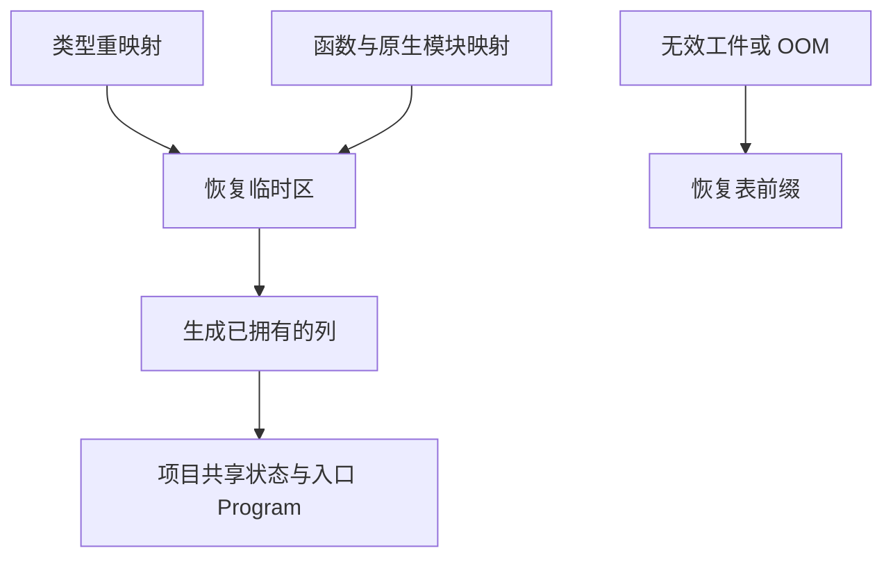

# 语义缓存绑定与结果恢复自举

## Intent · 意图

迁移语义缓存命中时的依赖身份、导入绑定和已链接签名校验。复用工件链接的 IR 装配，缩短恢复过程中类型、函数和原生模块映射的生命周期。

## Data · 证据

恢复路径依次校验依赖、合并类型、检查导入并重映射函数与原生模块。最终 Program 需要重映射后的列，映射本身仅在单次恢复内使用。缓存和普通工件链接原先各自装配端口、导出与 Store。

- 依赖校验由 RX 串联身份、本地名、来源名和目标核对。ZX 保留缺省来源名回退、已编译目标三段身份和目标类别的比较。Zig 传递借用的行描述符。
- 函数绑定由 RX 先检查两侧记录形状与名称，再区分内建操作和真实函数。ZX 检查映射范围、端口与重复槽一致性，宿主在检查成功后写入槽位。已链接函数借用签名列，避免为比对取出正文和 Store 列。
- 普通链接和缓存恢复复用同一 IR 装配，包含端口、返回所有权、导出类型、Store 模式和已拥有的列。缓存仍在补齐递归函数槽后执行终验。
- 三类重映射和只读校验的工作区随单次恢复释放。失败时回滚共享表前缀，写入项目 arena 的部分候选 IR 随项目释放。

## Edges · 边界

保留缓存失败回退到分析、OOM 继续传播、类型与名义表前缀回滚、已有 IR 终验。Zig 持有分配器、安装列和提交已核对的函数 ID。依赖路径和签名文本通过只读视图传递。

## Answer · 交付与验收

集中覆盖缓存读取、依赖修改、工件 IR 和原生绑定，比较现有项目的冷生成与恢复产物。冷构建沿用同目录与固定配置。

### 集中回归

使用既有 Source 自举工具生成 ReleaseSmall 测试编译器，关闭常驻生成，以 12 核运行六组回归，120/120 步及 197/197 项通过。覆盖语义缓存、缓存编解码、工件提取、原生链接、重链接运行和独立库消费。首轮生成发现工件规划和原生缓存消费了旧的类型别名。工件规划改用核心签名表，原生缓存保留自己的非空 ID 与端口契约。

使用本批安装版，五项独立进程的持久缓存检查通过，覆盖热命中、依赖正文编辑、损坏回退和禁用缓存。源码依赖项目复用 8 个模块，原生依赖项目复用 3 个源码模块与 2 个原生接口。三份生成文件在两版之间、以及各自热缓存与禁用缓存之间逐字节一致。七轮中位数每 24 次热恢复墙钟 0.1178 → 0.1182 秒，CPU 0.1174 → 0.1175 秒。安装版由 Native seed 引导，运行使用 Source。

### 冷构建

复用上批在同一临时源码目录取得的对照。固定 Zig 0.17.0、ReleaseSmall、12 核、四分区、种子 `0x3b41c83f`、同一 Zig 归档、Native seed 和空 local/global 缓存，关闭常驻生成。两版均通过 70/70 步。

| 指标                   | 固定基线      | 上批          | 本批          | 较上批      | 较固定基线  |
| ---------------------- | ------------- | ------------- | ------------- | ----------- | ----------- |
| 墙钟 / s               | 129.740       | 116.429       | 116.994       | +0.565      | −12.746     |
| CPU / s                | 216.03        | 208.04        | 208.87        | +0.83       | −7.16       |
| 进程树采样峰值 RSS / B | 2,247,294,976 | 2,235,940,864 | 2,305,294,336 | +69,353,472 | +57,999,360 |
| 单进程系统峰值 RSS / B | 2,075,033,600 | 2,110,586,880 | 2,107,604,992 | −2,981,888  | +32,571,392 |

分区 0～2 目标文件逐字节一致，分区 3 增加 3,272 字节。上批树峰值出现在三个分区编译后段，本批峰值出现在四个分区编译初段，与 441,991,168 B 的 `rx-tests-check` 同时存在。仅合计分区进程的峰值为 2,205,908,992 → 2,211,954,688 B，增加约 6.0 MB。较 206.33 秒的近期工作区复测，CPU 累积增加 2.54 秒，接近 3 秒观察线。后续继续沿用固定基线并观察并发阶段重叠。

命令、输出哈希、采样和日志保存在 `.zig-cache/cold-build-analysis/ownership-research/semantic-cache-restore/` 和同级 `partition-reference/cold-semantic-cache-restore/`。
