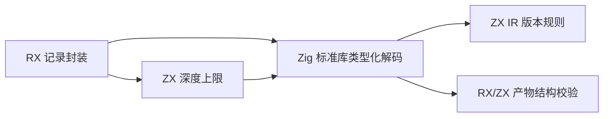
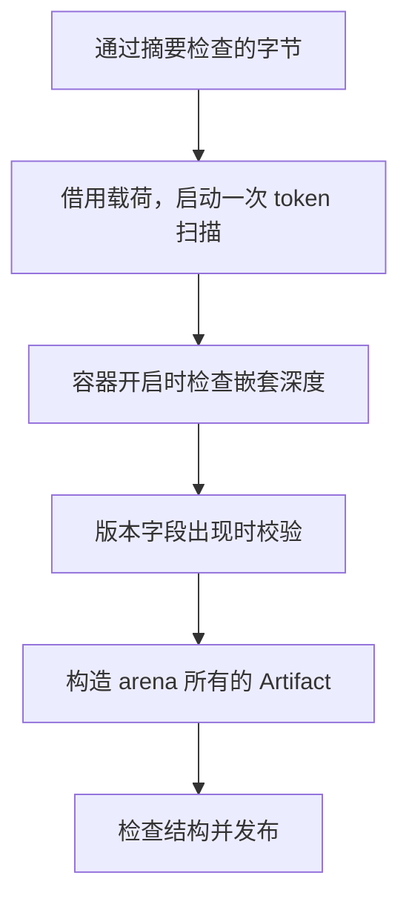

# 语义缓存载荷单次解码自举

## Intent · 意图

将语义缓存的载荷接收规则迁入 RX/ZX，让 Source 编译器在解码 v7 载荷的同一次扫描中限制 JSON 嵌套深度并校验 IR 版本。成功记录继续经已有结构检查发布。

## Data · 证据

- 原 Source 路径在校验记录摘要后，使用三套 JSON 扫描状态依次检查深度、提取版本和解码完整产物。前两遍在合法记录上都会读完整载荷。
- RX 封装校验返回载荷起点及 ZX 定义的深度上限。标准库负责词法和类型化解码，普通 token 适配器只在对象或数组的开启 token 上检查上限。与原规则相同，第 2,048 层可以进入，第 2,049 层返回错误。
- 版本字段仍按原来的 `u32` 规则解析。读到字段时调用 ZX 版本谓词，使用现有 IR 版本来源。生成器按值返回载荷描述符，宿主从已验证的记录中借用字节。

## Edges · 边界

初始 seed 继续使用原有解码路径。v7 的写出、字段顺序、分配失败传播和结构校验保持现有契约。类型化解析按 JSON 字段出现顺序执行，常规写出总是先写版本。手工重排字段的记录可能先分配部分产物，随后在版本不匹配时由 arena 回收。标准 JSON 解析和 Artifact 类型映射仍经 Zig 适配。

## Answer · 交付与验收

用既有缓存测试验证无效输入和分配失败边界。用真实 CLI 核对载荷字节、跨进程复用和编辑结果，分开记录完整冷构建与磁盘缓存热读，并核对三阶段 Source 自编译产物。

### Source 自编译

以前一阶段的 Source stage 3 引导，连续构建三个 ReleaseSmall、16 分区的 Source 工具，关闭常驻生成。三个阶段均通过 22/22 步。五组产物每阶段共 9,770 个文件，排除内部输入清单后按路径和 SHA-256 核对，全部一致。使用本阶段 Source stage 3 运行现有 `test-cache-codec`，23/23 构建步骤及 39/39 测试通过。

### 完整冷构建

使用相同 Zig 0.17.0、ReleaseSmall、12 核、四分区、遍历种子 `0x3b41c83f` 和固定归档，关闭常驻生成，local/global 缓存为空。Native seed 构建安装版，安装版运行 Source。完整构建通过 70/70 步。

| 指标                   |      固定基线 |        上阶段 |        本阶段 |    较上阶段 |  较固定基线 |
| ---------------------- | ------------: | ------------: | ------------: | ----------: | ----------: |
| 墙钟 / s               |       129.740 |       118.972 |       117.173 |      −1.799 |     −12.567 |
| CPU / s                |        216.03 |        207.54 |        207.13 |       −0.41 |       −8.90 |
| 进程树采样峰值 RSS / B | 2,247,294,976 | 2,283,192,320 | 2,314,846,208 | +31,653,888 | +67,551,232 |
| 单进程系统峰值 RSS / B | 2,075,033,600 | 2,122,645,504 | 2,111,438,848 | −11,206,656 | +36,405,248 |

树峰分别出现在四个分区与宿主同时运行，以及三个分区已运行约 20 秒 CPU 的时点。可按命令辨认的四个分区各自采样峰值均下降。分区 0、1、2 的目标文件逐字节相同，分区 3 增加 48 字节。安装版增加 56,112 字节。

### 持久缓存路径

同一临时工作区包含 157 个有依赖关系的模块。两个安装版均由 Native seed 生成并运行 Source，各自持有缓存，交替执行。冷热各取三轮中位数，热读另有一轮预热。

| 场景           | 墙钟中位数 / s | CPU 中位数 / s | 进程峰值 RSS 中位数 / B |
| -------------- | -------------: | -------------: | ----------------------: |
| 跨进程磁盘热读 |    0.70 → 0.69 |    0.69 → 0.69 | 24,068,096 → 24,035,328 |
| 每轮空缓存写入 |    1.44 → 1.43 |    1.44 → 1.44 | 29,212,672 → 29,310,976 |

两版各写出 157 条记录，共 789,415 字节。工具摘要之外的载荷、校验摘要和生成 Zig 逐字节一致。磁盘热读复用全部模块，编辑和还原均只重新分析一个模块。编辑后的增量产物与独立冷生成一致。

安装版的 72 份既有样例生成结果一致，持久缓存、生成缓存运行和 watch 的 10 项回归通过。

本地原始数据位于 `.zig-cache/cold-build-analysis/ownership-research/semantic-cache-payload/` 和同级 `partition-reference/cold-semantic-cache-payload/`。
