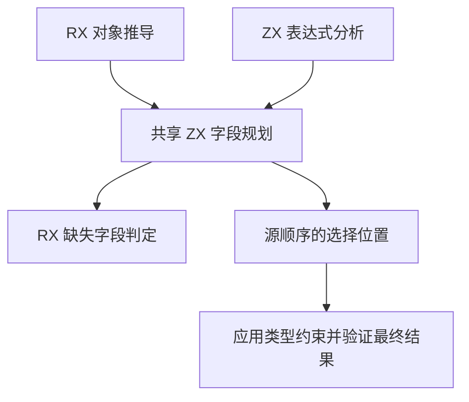

# 静态字段选择规则自举

## Intent · 意图

将 RX 静态字段选择的键匹配、选择顺序和结果准入迁入 RX/ZX，与 ZX 分析器共用字段规划。保持已知与推导对象的行为、求值顺序和原诊断。

## Data · 证据

ZX 分析器已有字段选择实现。RX 另行复制源字段、验证请求键、按源字段顺序选择，并在结果类型完成后重复匹配请求键。共享规划可以在一次字段扫描中同时记录选中位置和已见的键。空键集合可以直接表示全部或空集合。

## Edges · 边界

已知对象直接借用类型表的字段名。推导对象临时投影名称描述符，借用底层文本。Zig 继续保持已知类型的登记顺序、类型统一和源位置。RX 区分延迟和立即报告缺失字段；最终结果用同一组已选位置验证。初始 Native seed 保留原判定。

## Answer · 交付与验收

对照两条分析路径的字段顺序、空选择、未知字段和结果准入，并比较生成源码、库产物和固定配置的冷构建。

### 规则与分配

共享规划按源字段顺序扫描，每次匹配同时确认请求键和输出位置。两条入口都在规划前解码并拒绝重复请求键。空键省略选择保留源对象身份，空键选取在源对象为空时也保留原身份。

Source 工具生成的规划通过 16,000 组对照，覆盖名称切片偏移、不同结果顺序、Unicode 名称、空集合以及两种缺失字段处置。生成 Zig 只为键命中标记和选中位置保留临时列，最终覆盖检查不分配。已知对象字段名直接借用，推导对象的名称描述符由栈优先分配器临时投影。

五组集中回归覆盖 RX 推导、RX 文本、混合库、模块记录及 ZX 对象相关前端用例。53/53 构建步、662/662 项测试通过。安装版的五个成功用例生成源码逐字节一致，三个拒绝用例的诊断完全一致，包括 RX 延续校验中的结果额外字段与 ZX 的未知请求字段。

### 性能

沿用 Zig 0.17.0、ReleaseSmall、12 核、四分区、固定种子 `0x3b41c83f`、空 local/global 缓存和同一源码目录，关闭常驻生成。冷构建由 Native seed 引导，安装版运行 Source 分析。70/70 步通过。

| 指标                   |      固定基线 |          上批 |          本批 |      较上批 |
| ---------------------- | ------------: | ------------: | ------------: | ----------: |
| 墙钟 / s               |       129.740 |       116.669 |       117.018 |      +0.349 |
| CPU / s                |        216.03 |        207.50 |        209.00 |       +1.50 |
| 进程树采样峰值 RSS / B | 2,247,294,976 | 2,261,549,056 | 2,311,716,864 | +50,167,808 |
| 单进程系统峰值 RSS / B | 2,075,033,600 | 2,108,096,512 | 2,121,711,616 | +13,615,104 |

冷构建的主组推导从 678 毫秒降至 665 毫秒。整轮退休指令增加约 0.085%，CPU 增加约 0.72%，墙钟增量在 1 秒容差内。较固定基线，CPU 仍少 7.03 秒，较近期 206.33 秒样本增加 2.67 秒，接近 3 秒观察线。

两批树峰都出现在 LLVM 分区 0、1、2 同时编译时。其中分区 1、2 的对象逐字节一致，在峰值时合计多占约 29.5 MB。分区 0 的目标对象增加 248 字节，该分区自身采样峰值减少约 3.6 MB。分区 3 对象增加 872 字节，树峰时已结束。树峰较固定基线高约 64.4 MB，独立记录其趋势。

安装版禁用缓存发布源码闭包、原生依赖及 Store 三个库，47 份产物逐字节一致。每轮三项目的中位数墙钟 0.0694 → 0.0691 秒，CPU 0.0767 → 0.0759 秒。命令、日志与哈希记录在 `.zig-cache/cold-build-analysis/ownership-research/rx-field-selection/` 和同级 `partition-reference/cold-rx-field-selection/`。
