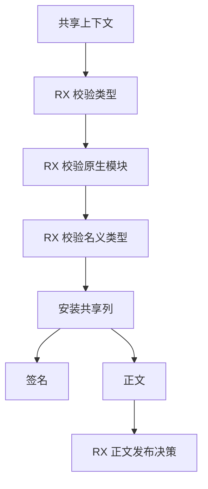
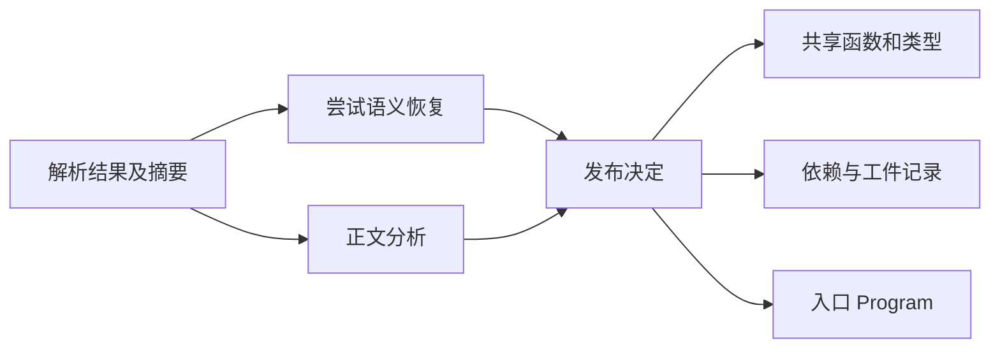

# 项目共享状态与正文发布自举

## Intent · 意图

统一签名与正文的共享类型、原生接口和名义类型准入，迁移正文发布决策。缩短依赖分析临时状态的生命周期，保留语义缓存键和发布数据。

## Data · 证据

签名与正文原先各自验证同一套共享上下文。项目遍历只读取入口的完整 Program，依赖只通过已发布的函数、类型和记录参与后续分析。依赖记录只供正文的语义缓存和工件提取使用。解析缓存已保存源码摘要，正文结束时曾再次哈希同一份文本。

- 签名与正文借用同一套输入列执行类型、原生接口与名义类型校验。准入后才拷贝结果需持有的列和字符串。
- RX 区分类型模块、普通依赖和入口，并单独标记递归函数。只有入口保留完整 Program，函数表最终从同一结果 arena 借用可见前缀。
- 函数表此前在每次发布正文时都复制一次已完成的函数列。生成分析已完成所有权检查，seed 只在同步所有权检查期间借用可见列。缓存恢复的临时函数快照同样由已有视图替代。
- 导入重名表跟随 DFS 帧释放，签名阶段省去正文专用的依赖记录。正文复用解析时确定的 SHA-256，非入口模块复用同一份空上下文摘要。

## Edges · 边界

类型与原生表的持久列安装、解析与语义缓存的容器由 Zig 宿主负责。共享输入表和缓存工件仍按原有可信边界校验。入口结果继续拥有外部输入的字符串，不借用调用者可能提前释放的内存。

## Answer · 交付与验收

集中执行语义缓存、混合模块、共享类型、名义类型和工件回归。同输入比较发布产物，并核对项目编译与固定冷构建的时间和内存。

### 集中回归

以既有 Source 自举工具生成 ReleaseSmall 测试编译器，关闭常驻生成，以 12 核执行八组定向回归。首轮 300/303 项 Zig 测试通过，两个混合库运行检查也通过。三项类型合并的分配失败测试返回 `SwallowedOutOfMemoryError`。类型表合并忽略了临时 arena 预热的失败值，随后报告名义类型冲突或缺失，吞掉先前的分配失败。合并现在传播预热 OOM，并省略末轮无后续消费者的预热。复用原生成器、输入与编译参数，定向重跑受影响的两个现有测试文件，5/5 通过，其中包括首轮失败的三项。没有修改断言或新增用例。

安装版独立进程的持久语义缓存检查 5/5 通过，覆盖热命中、合法依赖编辑、与禁用缓存的生成结果对照、损坏恢复和禁用缓存。另以两版安装工具关闭应用缓存，交错发布三个现有项目。47 个发布文件逐字节一致，七轮中位数每组三项目墙钟 0.0700 → 0.0708 秒，CPU 0.0767 → 0.0772 秒。安装版由 Native seed 引导，实际运行使用 Source 分析与生成。

### 冷构建

复用上批在同一临时源码目录取得的结果。固定 Zig 0.17.0、ReleaseSmall、12 核、四分区、遍历种子 `0x3b41c83f`、同一 Zig 归档、Native seed 和空 local/global 缓存，关闭常驻生成。两版均通过 70/70 步。采样中两次均未观察到 ANECompilerService 的 CPU 时间增长。

| 指标                   | 固定基线      | 上批          | 本批          | 较上批      | 较固定基线  |
| ---------------------- | ------------- | ------------- | ------------- | ----------- | ----------- |
| 墙钟 / s               | 129.740       | 118.179       | 116.429       | −1.750      | −13.311     |
| CPU / s                | 216.03        | 208.25        | 208.04        | −0.21       | −7.99       |
| 进程树采样峰值 RSS / B | 2,247,294,976 | 2,302,918,656 | 2,235,940,864 | −66,977,792 | −11,354,112 |
| 单进程系统峰值 RSS / B | 2,075,033,600 | 2,115,108,864 | 2,110,586,880 | −4,521,984  | +35,553,280 |

新增两个生成入口，分区 1～3 逐字节一致，分区 0 增加 1,528 字节。较早先的 206.33 秒工作区复测，CPU 高 1.71 秒，仍沿用固定基线跟踪。冷构建数据包括整个工具链，无法单独归因到某一次快照或摘要消除。

命令、输出哈希、采样和日志保存在 `.zig-cache/cold-build-analysis/ownership-research/project-shared-state/` 和同级 `partition-reference/cold-project-shared-state/`。
