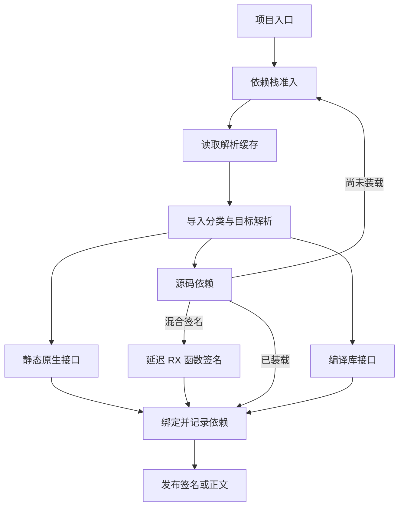

# 项目模块装载与依赖解析自举

## Intent · 意图

把项目源码装载的依赖准入、源码与包目标选择、混合 RX 签名处理和递归入口接入合在一批迁移。保留导入顺序、错误位置、包隔离和已有缓存边界。

## Data · 证据

当前正文与签名共用迭代式 DFS，节点解析在首次入栈时执行。每个依赖绑定后再处理后续导入，首次错误取决于该顺序。项目解析与 CLI 源码收集都需要区分本地文件与包，旧实现分别重复分类。正文入口对原生默认转发单独构造 IR，库入口与递归入口已有公共构造器。

- 导入分派复用同一个说明符分析函数。源码装载和 CLI 在一次分类后取得文件或包目标，RX 签名路径明确区分跳过普通函数导入与保留待解析的重新导出。
- 父帧同时保存目标路径和依赖索引，依赖完成后直接恢复原导入，避免重复查表。签名入口共用装载栈容量，退出项目时释放帧数组，依赖记录仍由项目持有。
- 路径规范化和导入诊断保留原有规则。本地路径归属只需解析一次导入方，包项确定无重复后才分配目标。原生默认入口与递归入口复用转发主体，原生入口保留其契约。

## Edges · 边界

平台路径规范化、查表、解析缓存访问及有副作用的列安装仍由宿主执行。项目表与缓存的存储生命周期分开迁移。迁移保持依赖遍历迭代、有界、无额外源码字节复制，错误顺序仍由原游标驱动。

## Answer · 交付与验收

使用现有路径、混合项目、编译库、模块记录及缓存回归集中验收。对照同一输入的生成产物，使用固定冷构建基线检查墙钟、CPU 和内存。

### 集中回归

使用 Source 自举工具生成 ReleaseSmall 测试编译器。关闭常驻生成，以 12 核执行八组回归。145/145 步成功，99/99 项 Zig 测试和 35/35 项运行检查通过，覆盖路径与包边界、模块记录、解析缓存、语义缓存、混合 RX/ZX、编译库和原生声明。

### 项目发布对照

使用前后两个安装版，在同一源码和输出位置关闭应用缓存，交替发布带工作区依赖、原生依赖和 Store 的三个现有项目。13、20 和 14 个发布文件的 SHA-256 逐一相同。剔除首轮后，七轮中位数的每组三项目墙钟为 0.0712 → 0.0715 秒，CPU 均为 0.0771 秒。安装版由 Native seed 引导，实际运行使用 Source 分析与生成。

### 冷构建

固定 Zig 0.17.0、ReleaseSmall、12 核、四分区、遍历种子 `0x3b41c83f`、同一 Zig 归档与空 local/global 缓存。关闭常驻生成，使用 Native seed。在同一个临时源码目录先构建上阶段提交，再应用本阶段源码，二者均通过 70/70 步。历史固定基线保留作累计对照，同目录的配对数据用于判断本批变化。

| 指标                   | 固定基线      | 上批配对      | 本批配对      | 配对差      | 较固定基线  |
| ---------------------- | ------------- | ------------- | ------------- | ----------- | ----------- |
| 墙钟 / s               | 129.740       | 118.107       | 118.179       | +0.072      | −11.561     |
| CPU / s                | 216.03        | 208.37        | 208.25        | −0.12       | −7.78       |
| 进程树采样峰值 RSS / B | 2,247,294,976 | 2,320,547,840 | 2,302,918,656 | −17,629,184 | +55,623,680 |
| 单进程系统峰值 RSS / B | 2,075,033,600 | 2,113,486,848 | 2,115,108,864 | +1,622,016  | +40,075,264 |

分区 1 和 2 的目标文件逐字节一致，分区 0 和 3 分别增加 424 和 1,728 字节。较两阶段前的工作区复测 206.33 秒，CPU 高 1.92 秒。

工作区首轮冷构建记录 125.271 秒墙钟和 217.08 秒 CPU。首轮 seed 编译与未修改的 C 转译、标准库目录编译同时变慢。一次复测因磁盘空间不足中止，随后回收旧测量缓存。在同目录配对中，seed 编译、C 转译和标准库目录编译恢复到相同的秒级用时，首轮差异没有复现。系统后台服务在配对前后分别消耗约 112 与 0 CPU 秒，数据仍包含不同的后台负载。

命令、输出哈希、采样和日志保存在 `.zig-cache/cold-build-analysis/ownership-research/project-module-loading/` 和同级 `partition-reference/cold-project-*`。
